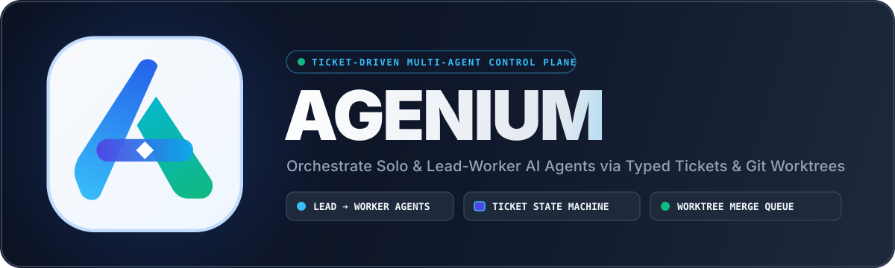

<p align="center">
  
</p>

# Agenium

**Agenium runs a team of AI coding agents the way a good engineering team runs itself: through tickets.**
You describe what you want to the team's Lead in your own language. The Lead writes a requirement spec for you to
approve, turns it into a plan and tickets, and hands each ticket to the agent whose role fits. Each agent works in its
own git worktree; nothing reaches `main` without a review against the ticket's acceptance criteria and a merge
through a single queue. You watch it happen in a desktop app, step in when an agent asks, and keep the final say.

Agents can be any mix of models: API models (Anthropic, OpenAI, Gemini, DeepSeek, OpenRouter, Azure, Bedrock, local
LM Studio / Ollama, or your own OpenAI-compatible endpoint) and the coding CLIs you are already logged in to
(Claude Code, Codex, Gemini/Antigravity, Grok, OpenCode). A Claude Lead with Codex, Grok and DeepSeek workers is one
team.

[Tiếng Việt](README.vi.md) · [Status and limits](docs/PROGRESS.md) · [What is verified, and how](docs/VERIFICATION.md) ·
[Jev judge](docs/JEV.md) · [Changelog](CHANGELOG.md) · [Decisions (ADRs)](docs/adr/README.md)

> **Status: 0.1.0, pre-release.** Feature-complete for a first release on Windows and Linux (Ubuntu); the
> installers are being built and tested on clean virtual machines. macOS runs the full test suite; its desktop build
> follows. See [Status](#status) for what has and has not been run against real models.

## How it works

```
 You ──chat──▶ Lead ──spec──▶ You approve ──▶ Lead: plan + tickets ──▶ Workers (one worktree per ticket)
                 ▲                                                          │
                 ├── questions, permission requests ◀───────────────────────┤
                 └── review against acceptance criteria ◀── report ─────────┘
                         │ approved
                         ▼
                   merge queue ──▶ main ──▶ ticket Closed
```

- **Tickets are the only channel for work.** Agents change state only through typed, validated tool calls
  (`create_ticket`, `submit_report`, `ask_question`, `review_ticket` …). Every change is an event in a log, so the
  board, the audit trail and the live view always agree, and a crash loses nothing.
- **Plans you can hold the team to.** A spec has numbered requirements; every plan item traces back to one; every
  ticket carries acceptance criteria; a review checks each criterion against evidence. A ticket that fails review is
  reopened with per-criterion feedback; one that keeps failing is escalated to you.
- **Dependencies are real.** A ticket that needs another waits until that one is merged; the board shows what blocks
  what and what each ticket is needed for.
- **You are asked, not surprised.** Agents ask you questions through the Lead, request permission for anything outside
  their sandbox, and a change of scope waits for you.

## Features

| Area | What you get |
|---|---|
| **Teams** | Solo agent (Lead and worker in one) or a Lead with workers and an optional planner. Team templates for coding, research, content and security testing; 27 ready-made roles (backend, frontend, API tester, UI tester, code reviewer, technical writer, SRE …); compose a team from your own agents. |
| **Any model, mixed** | API providers with vendor presets and a custom OpenAI-compatible endpoint (your headers, per-model settings, extra request fields — [ADR-115](docs/adr/ADR-115-custom-endpoint-requests.md)). Vendor CLIs driven headless, every tool call decided by Agenium. Effort levels per agent; a fallback model when a CLI cannot run. |
| **Desktop app** | Overview, chat with the Lead, Kanban board, ticket pages with side-by-side diffs (Monaco), live office view of who is doing what, run logs with a terminal view, memory browser, team organiser, settings. English and Vietnamese. |
| **Safety** | Agent commands run in an OS sandbox (Linux bubblewrap, macOS Seatbelt, Windows MXC containers where Windows provides them): writes only in the ticket's worktree, no access to your secrets; without a sandbox every command waits for your approval. Secrets live in an encrypted vault keyed by the OS keyring and never reach agents, logs or git; commits are secret-scanned. |
| **Memory that learns, carefully** | Each agent keeps memories (facts, lessons, a knowledge graph) found by a local embedding model (bge-small, runs on your machine, installed with the app) plus keyword and graph search. New skills and lessons need evidence and pass strict gates, so an agent does not drift. |
| **Skills and tools** | `SKILL.md` skills per role or agent (13 built in), MCP servers (stdio, Streamable HTTP, legacy SSE, OAuth) bound per agent with their own credentials, image viewing for vision models (`view_image`). |
| **Cost and control** | Tokens and estimated cost per run, ticket and agent; prompt caching; context compaction for long runs; pause, cancel, re-run. |
| **Operations** | Hourly/daily backups with retention, restore into a new root, database migrations with a backup first, a support bundle without secrets, Markdown project reports, optional push to your remote on close. |
| **Optional judge (Jev)** | TypeSafe's Jev model can take small decisions off the main agents — whether a ticket is worth remembering, which skill fits — to save their tokens. Off by default, fail-open. See [docs/JEV.md](docs/JEV.md). |

## Install and first run

**Desktop app.** Download the installer for your system from the releases page: `Agenium_0.1.0_x64-setup.exe` (or
the `.msi`) on Windows 10/11, `Agenium_0.1.0_amd64.deb` (`sudo apt install ./Agenium_0.1.0_amd64.deb`) or the
AppImage on Linux. Agenium needs **Git** (on Windows: https://git-scm.com/downloads). On first start the app
prepares the local embedding model (bundled with the installer, so no download), then a short setup asks for your
language and where Agenium keeps its data. Add a model provider (an API key goes straight to the encrypted vault) or
use a coding CLI you are logged in to, create a project, pick a team, and start chatting with the Lead.

**From source** (any of Windows, Linux, macOS):

```sh
# Requirements: Rust stable >= 1.89, a C/C++ compiler, git >= 2.30, Node.js >= 20 (desktop UI)
npm --prefix apps/desktop/ui install
npm --prefix apps/desktop/ui run build
cd apps/desktop && cargo run --release --features tauri/custom-protocol
```

**Headless CLI.** Everything the app does is also available as the `agenium` command:

```sh
agenium setup --user-language vi
agenium models download                      # the local embedding model (~130 MB, checksum verified)
agenium provider presets                     # known vendors and the key each one needs
agenium provider add deepseek --preset deepseek --key-env DEEPSEEK_API_KEY   # the key goes to the encrypted vault
agenium project create shop
agenium team create --project shop --template coding --model deepseek/deepseek-chat --prefix shop
agenium agent cli shop-lead --cli claude --model claude-opus-5-5   # the Lead now runs through Claude Code
agenium chat --project shop "Add a product search page with filters"
agenium approve --project shop spec 1
agenium run --project shop                   # work, review and merge until the plan is done
agenium board --project shop
```

## Status

0.1.0 is the first release candidate. What has been verified (details and evidence in
[docs/PROGRESS.md](docs/PROGRESS.md) and [docs/VERIFICATION.md](docs/VERIFICATION.md)):

- **439 automated tests** across the workspace (unit, contract tests against local HTTP servers, end-to-end runtime
  tests with a scripted model, crash tests that kill the process mid-write), clippy clean, dependency policy checked
  with `cargo-deny`, a 25-check UI smoke test that drives the real app.
- **Real models:** golden coding tasks 5/5 on DeepSeek (API) and through the Claude, Codex, Gemini (Antigravity),
  Grok and OpenCode CLIs; full team runs (spec → plan → tickets → reviews → merges) on DeepSeek and on a mixed team
  of Claude Opus (Lead), Codex, Grok, Gemini and DeepSeek.
- **Platforms:** Windows 11 (development machine and a clean VM), Ubuntu 25.10 (real VM, sandbox escape tests:
  0 escapes), macOS (Apple Silicon VM: full suite, sandbox containment).

Known limits of 0.1.0: on Windows the agent sandbox uses MXC process containers, which current stable Windows 11
releases (23H2 tested) do not provide yet — there every agent command waits for your approval unless you choose, in
Settings, to let agents run without a sandbox (ADR-117); Git must be installed
(Agenium tells you where to get it). Anthropic, Gemini and OpenAI APIs are contract-tested but have not been called
with a real key; the extra request fields of [ADR-115](docs/adr/ADR-115-custom-endpoint-requests.md) apply to
OpenAI-compatible endpoints only; Devin's CLI cannot be driven; installers are not code-signed yet.

## Repository layout

```
apps/            what users run: cli/ (the agenium command), desktop/ (Tauri 2 app + React UI)
orchestration/   orchestrator: app service, intent engine, scheduler, agent runtime, git effects, templates
agent/           loop (agent loop), llm (providers), cli-backend (vendor CLIs), tools, memory, skills, mcp
security/        sandbox (Windows MXC, bubblewrap, Seatbelt), secrets (vault, keyring, redaction, secret scan)
foundation/      core (domain, protocol tools, ticket state machine), config, store (SQLite), bus, vcs (git)
quality/eval/    golden tasks, team scenario, memory and judge evaluations; results/ holds real-model runs
devtools/        xtask, local CI scripts, UI smoke test
docs/            ADRs, progress, verification map, evaluations, original design pack
```

Build and check everything locally:

```sh
.\devtools\scripts\ci-local.ps1 -Ui     # Windows: fmt, clippy -D warnings, tests, schemas, golden tasks, UI smoke
devtools/scripts/ci-local.sh            # Linux / macOS
```

On Windows the repository builds with the GNU toolchain and MSYS2 gcc (`.cargo/config.toml` maps `rc.exe` to MinGW
`windres`).

## License

Apache-2.0 — see [LICENSE](LICENSE) and [NOTICE](NOTICE) (third-party code and assets).
