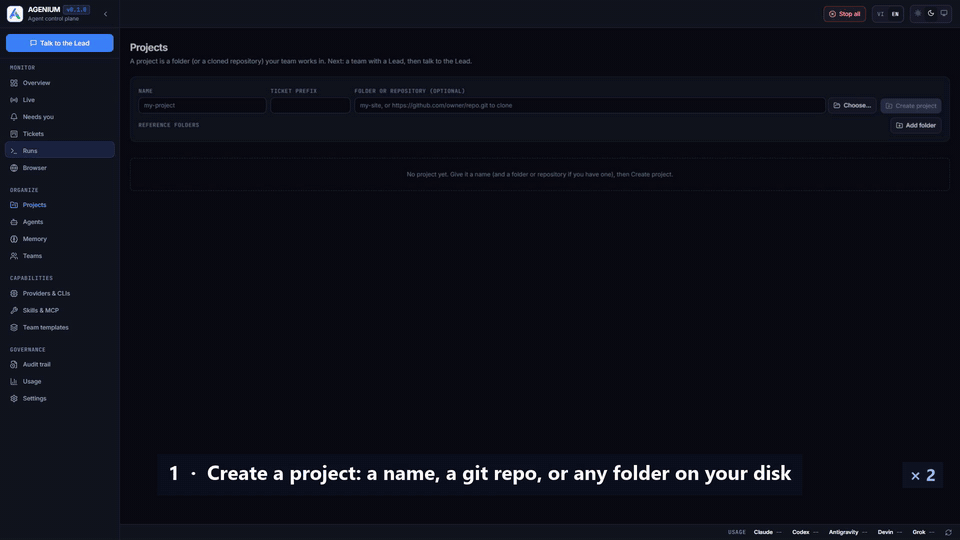
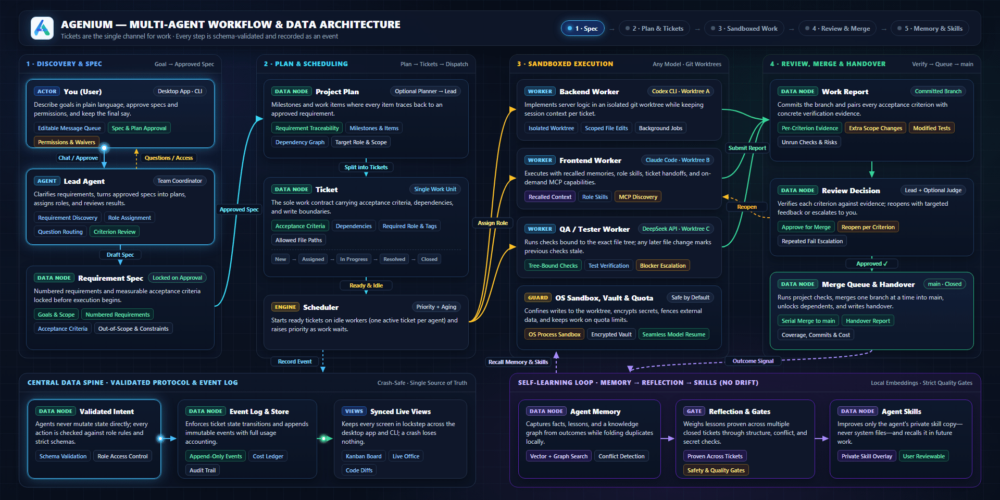

<p align="center">
  
</p>

<p align="center">
  
  
  
  
  <a href="https://github.com/quanghoa1/AGENIUM/stargazers"></a>
</p>

<p align="center">
  <a href="https://github.com/quanghoa1/AGENIUM/releases/latest"></a>
</p>

<p align="center">
  <b>Run a team of AI coding agents the way a good engineering team runs itself: through tickets.</b>
</p>

<p align="center">
  <a href="README.vi.md">Tiếng Việt</a> ·
  <a href="docs/PROGRESS.md">Status</a> ·
  <a href="docs/VERIFICATION.md">Verification</a> ·
  <a href="docs/adr/README.md">Design decisions</a> ·
  <a href="CHANGELOG.md">Changelog</a> ·
  <a href="docs/JEV.md">Jev judge</a>
</p>

<p align="center">
  <a href="https://github.com/quanghoa1/AGENIUM/releases/download/v0.1.0/agenium-demo.mp4"></a>
</p>

---

You describe what you want to the team's **Lead** in your own language. The Lead writes a requirement spec for you to
approve, turns it into a plan of tickets with acceptance criteria, and hands each ticket to the agent whose role fits.
Every agent works in its own git worktree inside a sandbox; nothing reaches `main` without a review against the
ticket's criteria and a merge through a single queue. You follow it all in a desktop app, answer when an agent asks,
and keep the final say.

A team can mix any models: API models from Anthropic, OpenAI, Google, DeepSeek and others, local models, and the
coding CLIs you already use — Claude Code, Codex, Grok, Gemini (Antigravity), OpenCode and Devin. A Claude Lead with Codex,
Grok and DeepSeek workers is one team.

## See it work

A real run, sped up: a Codex Lead and planner, Codex and Grok workers, from a one-line request to a reviewed, merged Pomodoro app in under 8 minutes. The animation above is the whole run; [Full-quality video (MP4)](https://github.com/quanghoa1/AGENIUM/releases/download/v0.1.0/agenium-demo.mp4), 90 s.

## How it works

<p align="center">
  
</p>

1. **Plan.** The Lead turns your request into a spec of numbered requirements. Once you approve it, every plan item
   traces back to a requirement and every ticket carries acceptance criteria, dependencies and the role it needs.
2. **Work.** Each ticket runs in its own git worktree. Agent commands run in an OS sandbox that can write only to that
   worktree; anything outside it — a network domain, a system install, an MCP tool that deletes or sends — waits for
   your approval. Questions reach you through the Lead.
3. **Review and merge.** A worker reports one result per criterion with its evidence. The Lead checks each one; a
   ticket that falls short is reopened with feedback per criterion, one that keeps failing is escalated to you. Approved
   work passes the project's checks and merges through one queue; the tickets that depended on it start.
4. **Learn.** After each ticket the agent keeps what it learned. A lesson that has proven itself is weighed once:
   it may improve a skill — always the agent's own copy, never the system's — become a new skill, or stay a memory.

Tickets are the only channel for work. Agents change state only through typed, validated tool calls
(`create_ticket`, `submit_report`, `review_ticket` …), each recorded as an event, so the board, the audit trail and the
live view always agree and a crash loses nothing.

## Highlights

| | |
|---|---|
| **Teams** | A Solo agent, or a Lead with workers and an optional planner. Templates for coding, research, content and authorized security testing; a library of ready-made roles; teams composed from your own agents. |
| **Any model, mixed** | API providers with presets, plus any OpenAI-compatible endpoint with your own headers and request fields. Vendor CLIs driven headless, every tool call decided by Agenium. Effort per agent; an agent whose model runs out of quota waits to be given another and resumes. |
| **Desktop app** | Overview, chat with the Lead, Kanban board, ticket pages with side-by-side diffs, a live office view of who does what, run logs with a terminal, memory browser, usage and cost, team organiser. English and Vietnamese. |
| **Your folders** | Start a project from a name, a git URL, or any folder on your disk: an empty one, a folder of your files (made a repository for you), or a repository you are already working in. On a repository the team works on its own branch or a new one, and with a new one your folder and branch stay exactly as you left them, so you keep coding while the team works beside you. Reference folders (an SDK, docs, another codebase) are read by every agent and never changed. |
| **Memory and skills** | Facts, lessons and a knowledge graph per agent, found by a local embedding model plus keyword and graph search, kept tidy without rereading it with a model. Skills as `SKILL.md`, per role and per agent; the library starts empty and holds what you and your agents add, kept through upgrades. Write a skill in the app, have an agent write one, or import a whole folder of skills at once and tick the ones you want. Plugins in Claude Code's format (`obra/superpowers`) bring a vendor's skills and MCP servers, switched on whole per agent and never changed by it. |
| **MCP** | Servers over stdio, Streamable HTTP and SSE, with OAuth, bound per agent with their own keys. When a server offers many tools an agent finds them by search instead of reading them all; a server that changes its tools mid-run is followed. |
| **Safety** | OS sandbox per command (Linux bubblewrap, macOS Seatbelt, Windows process containers where available). Secrets in an encrypted vault keyed by the OS keyring, never in prompts, logs or git; commits secret-scanned. External content is fenced as data. |
| **Control** | Tokens and estimated cost per run, ticket and agent; prompt caching; context compaction; pause, cancel, re-run; backups, restore, a support bundle without secrets. |
| **Optional judge** | TypeSafe's Jev can take small decisions off the main agents — whether an episode is worth remembering, which tool or skill fits — to save their tokens. Fail-open: without it Agenium works the same. |

## Supported models

| API providers | Coding CLIs |
|---|---|
| Anthropic · OpenAI · Google Gemini · DeepSeek · xAI · OpenRouter · Azure OpenAI · Amazon Bedrock · OpenCode Go · LM Studio / Ollama · any OpenAI-compatible endpoint | Claude Code · Codex · Grok · Gemini (Antigravity) · OpenCode |

On Anthropic's and OpenAI's own APIs the forms that move work are decoded strictly against their schema, so a report
always parses; other providers get the same tools with a lenient reader.

## Getting started

### Desktop app

Download the installer for your system from the [releases page](https://github.com/quanghoa1/AGENIUM/releases/latest) — `Agenium_0.1.1_x64-setup.exe` on Windows 10/11,
`Agenium_0.1.1_amd64.deb` or the AppImage on Linux. Agenium needs **Git** ([Git for Windows](https://git-scm.com/downloads);
the app tells you on the Projects page when it is missing). The local embedding model ships with the
installer. The Windows installer asks where Agenium keeps your work (skills, MCP servers, agents, projects, memory),
for example a folder on drive D:; on Linux and macOS the app asks once at its first start. Updates never touch that
folder. The app then opens straight on its main screen, in your system's language (switch with VI/EN at the top);
add a model provider (the key goes straight to the encrypted vault) or pick a coding CLI you are logged in to, create
a project, choose a team and start chatting with the Lead.

### From source

```sh
# Requirements: Rust stable 1.89+, a C/C++ compiler, Git 2.30+, Node.js 20+ (desktop UI)
npm --prefix apps/desktop/ui install
npm --prefix apps/desktop/ui run build
cd apps/desktop && cargo run --release --features tauri/custom-protocol
```

On Windows the repository builds with the GNU toolchain and MSYS2 gcc (`.cargo/config.toml` maps `rc.exe` to MinGW
`windres`).

### Command line

Everything the app does is also available as the `agenium` command:

```sh
agenium setup --user-language en
agenium models download                                   # the local embedding model (~130 MB, checksum verified)
agenium provider add deepseek --preset deepseek --key-env DEEPSEEK_API_KEY
agenium project create shop
agenium team create --project shop --template coding --model deepseek/deepseek-chat --prefix shop
agenium agent cli shop-lead --cli claude --model claude-opus-5-5   # the Lead runs through Claude Code
agenium chat --project shop "Add a product search page with filters"
agenium approve --project shop spec 1
agenium run --project shop                                 # work, review and merge until the plan is done
agenium board --project shop
```

## Learning without drifting

Agents get better at a project from their own work, under rules that keep them from drifting:

- **One lesson per rule.** A lesson comes from a signal — a reopen, a failed check, a correction — and a later
  refinement updates it rather than adding a near-copy. A lesson that misled a run loses confidence; a ticket that
  closes cleanly cannot delete one.
- **Proven before it is written down.** A lesson becomes part of a skill only after it has held across several closed tickets,
  and only through gates: the right shape, one subject per skill, no contradiction with another skill, no injected
  instructions or secrets.
- **Contained.** An agent improves its own copy of a skill; the system's skills, the roles and other agents are never
  changed. You can review, revert or promote any change, and a skill whose lesson stops holding is flagged.

## Status

**0.1.1 is a release candidate** for Windows and Linux; macOS runs the full test suite and its desktop build
follows. Each behaviour is covered by automated tests — unit, contract, end-to-end runtime and crash tests — and checked
with real models, over APIs and through the coding CLIs, in single-agent tasks, full team runs and memory chains. The
evidence is in [docs/VERIFICATION.md](docs/VERIFICATION.md); the raw runs are in
[`quality/eval/results`](quality/eval/results).

**Known limits.** Windows' process containers are not in current stable Windows 11 releases, so there each agent
command waits for your approval unless you allow agents to run without a sandbox. Some API vendors are contract-tested
but not yet called with a real key. Installers are not code-signed yet.

## Repository layout

```
apps/            what users run: cli/ (the agenium command), desktop/ (Tauri 2 app + React UI)
orchestration/   the orchestrator: intent engine, scheduler, agent runtime, git effects, templates
agent/           loop (agent loop), llm (providers), cli-backend (vendor CLIs), tools, memory, skills, mcp
security/        sandbox (Windows containers, bubblewrap, Seatbelt), secrets (vault, keyring, redaction, scanning)
foundation/      core (domain, protocol tools, ticket state machine), config, store (SQLite), bus, vcs (git)
quality/eval/    golden tasks, team and memory scenarios, judge evaluations; results/ holds real-model runs
devtools/        xtask, local CI scripts, UI smoke test
docs/            design decisions (ADRs), verification map, evaluations, brand assets
```

## Development

```sh
.\devtools\scripts\ci-local.ps1 -Ui     # Windows: fmt, clippy -D warnings, tests, schemas, golden tasks, UI smoke
devtools/scripts/ci-local.sh            # Linux / macOS
```

Every design decision is recorded as an ADR in [docs/adr](docs/adr/README.md), with what was measured to make it.

## License

Apache-2.0 — see [LICENSE](LICENSE) and [NOTICE](NOTICE) for third-party code and assets.
