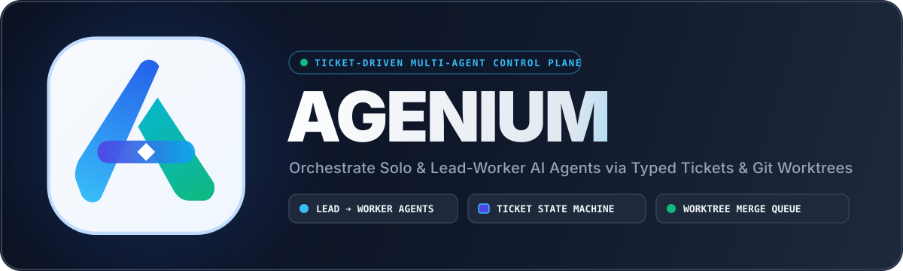
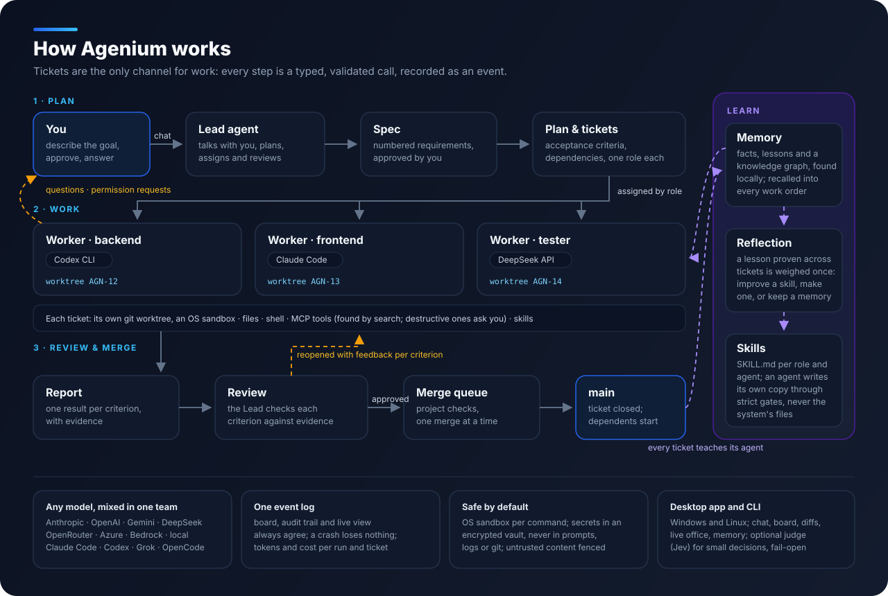

<p align="center">
  
</p>

<p align="center">
  
  
  
  
</p>

<p align="center">
  <b>Điều phối một nhóm agent AI viết code theo cách một đội kỹ sư giỏi tự vận hành: qua ticket.</b>
</p>

<p align="center">
  <a href="README.md">English</a> ·
  <a href="docs/PROGRESS.md">Tình trạng</a> ·
  <a href="docs/VERIFICATION.md">Kiểm chứng</a> ·
  <a href="docs/adr/README.md">Quyết định thiết kế</a> ·
  <a href="CHANGELOG.md">Changelog</a> ·
  <a href="docs/JEV.md">Jev</a>
</p>

---

Bạn nói với **Lead** của nhóm điều bạn muốn, bằng ngôn ngữ của bạn. Lead viết bản đặc tả (spec) để bạn duyệt, chia
thành kế hoạch gồm các ticket có tiêu chí nghiệm thu, rồi giao mỗi ticket cho agent có vai trò phù hợp. Mỗi agent làm
việc trong git worktree riêng, bên trong sandbox; không gì vào được `main` nếu chưa được review theo tiêu chí của
ticket và merge qua một hàng đợi duy nhất. Bạn theo dõi mọi thứ trong ứng dụng desktop, trả lời khi agent hỏi, và luôn
là người quyết định cuối cùng.

Một nhóm có thể trộn mọi loại model: model API của Anthropic, OpenAI, Google, DeepSeek và các hãng khác, model chạy
trên máy, và các CLI lập trình bạn đang dùng — Claude Code, Codex, Grok, Gemini (Antigravity), OpenCode. Lead là
Claude, worker là Codex, Grok và DeepSeek vẫn là một nhóm.

## Cách hoạt động

<p align="center">
  
</p>

1. **Lập kế hoạch.** Lead biến yêu cầu của bạn thành spec gồm các yêu cầu được đánh số. Khi bạn duyệt, mỗi hạng mục
   kế hoạch truy về một yêu cầu, mỗi ticket có tiêu chí nghiệm thu, phụ thuộc và vai trò cần có.
2. **Làm việc.** Mỗi ticket chạy trong git worktree riêng. Lệnh của agent chạy trong sandbox của hệ điều hành, chỉ ghi
   được vào worktree đó; mọi thứ ra ngoài — một tên miền mạng, cài đặt phần mềm, một tool MCP xoá hay gửi dữ liệu —
   đều chờ bạn duyệt. Câu hỏi của agent đến với bạn qua Lead.
3. **Review và merge.** Worker báo cáo từng tiêu chí kèm bằng chứng. Lead kiểm tra từng tiêu chí; ticket chưa đạt bị
   mở lại kèm nhận xét theo tiêu chí, ticket thất bại nhiều lần được chuyển lên bạn. Việc đã duyệt qua bước kiểm tra
   của dự án rồi merge qua một hàng đợi; các ticket phụ thuộc vào nó bắt đầu.
4. **Học.** Sau mỗi ticket, agent ghi nhớ điều đã học. Một bài học đã được kiểm chứng sẽ được cân nhắc một lần: cải
   thiện một skill — luôn là bản riêng của agent, không bao giờ là bản của hệ thống — thành skill mới, hoặc giữ làm
   ghi nhớ.

Ticket là kênh duy nhất để giao việc. Agent chỉ thay đổi trạng thái qua các lời gọi tool có kiểu và được kiểm tra
(`create_ticket`, `submit_report`, `review_ticket` …), mỗi lời gọi được ghi thành một sự kiện, nên bảng Kanban, nhật ký
kiểm toán và màn hình trực tiếp luôn khớp nhau, và sự cố không làm mất gì.

## Điểm nổi bật

| | |
|---|---|
| **Nhóm** | Một agent Solo, hoặc một Lead cùng các worker và một planner tuỳ chọn. Template cho lập trình, nghiên cứu, nội dung và kiểm thử bảo mật có uỷ quyền; thư viện vai trò dựng sẵn; ghép nhóm từ chính các agent của bạn. |
| **Mọi model, trộn lẫn** | Nhà cung cấp API có cấu hình sẵn, cùng mọi endpoint OpenAI-compatible với header và trường request riêng. CLI của các hãng được điều khiển không giao diện, mọi lời gọi tool do Agenium quyết định. Mức effort theo từng agent; agent hết quota sẽ chờ được giao model khác rồi chạy tiếp. |
| **Ứng dụng desktop** | Tổng quan, chat với Lead, bảng Kanban, trang ticket với diff song song, văn phòng trực tiếp cho thấy ai đang làm gì, nhật ký chạy kèm terminal, trình xem memory, chi phí, tổ chức nhóm. Tiếng Anh và tiếng Việt. |
| **Memory và skill** | Mỗi agent có fact, bài học và đồ thị tri thức, được tìm bằng model embedding chạy trên máy cùng tìm theo từ khoá và đồ thị, được dọn gọn mà không cần model đọc lại toàn bộ. Skill dạng `SKILL.md` theo vai trò và theo agent; thư viện ban đầu trống, chứa những gì bạn và agent thêm vào, được giữ nguyên khi nâng cấp. |
| **MCP** | Server qua stdio, Streamable HTTP và SSE, có OAuth, gắn theo từng agent với key riêng. Khi server có nhiều tool, agent tìm tool bằng tìm kiếm thay vì đọc hết; server đổi danh sách tool giữa chừng vẫn được theo dõi. |
| **An toàn** | Sandbox của hệ điều hành cho mỗi lệnh (bubblewrap trên Linux, Seatbelt trên macOS, process container trên Windows khi có). Bí mật nằm trong kho mã hoá gắn với keyring của hệ điều hành, không bao giờ vào prompt, log hay git; commit được quét bí mật. Nội dung bên ngoài được rào lại như dữ liệu. |
| **Kiểm soát** | Token và chi phí ước tính theo lượt chạy, ticket và agent; prompt caching; nén ngữ cảnh; tạm dừng, huỷ, chạy lại; sao lưu, khôi phục, gói hỗ trợ không chứa bí mật. |
| **Judge tuỳ chọn** | Jev của TypeSafe có thể gánh các quyết định nhỏ thay agent chính — một phiên có đáng ghi nhớ không, tool hay skill nào phù hợp — để tiết kiệm token. Không có Jev, Agenium vẫn chạy như thường. |

## Model được hỗ trợ

| Nhà cung cấp API | CLI lập trình |
|---|---|
| Anthropic · OpenAI · Google Gemini · DeepSeek · xAI · OpenRouter · Azure OpenAI · Amazon Bedrock · OpenCode Go · LM Studio / Ollama · mọi endpoint OpenAI-compatible | Claude Code · Codex · Grok · Gemini (Antigravity) · OpenCode |

Trên API của chính Anthropic và OpenAI, các biểu mẫu giao việc được giải mã chặt theo schema nên báo cáo luôn đọc được;
các nhà cung cấp khác dùng cùng bộ tool với một bộ đọc dễ dãi.

## Bắt đầu

### Ứng dụng desktop

Tải bộ cài cho hệ điều hành của bạn từ trang releases — `Agenium_0.1.0_x64-setup.exe` cho Windows 10/11,
`Agenium_0.1.0_amd64.deb` hoặc AppImage cho Linux. Agenium cần **Git**. Model embedding chạy trên máy đi kèm bộ cài.
Bộ cài Windows hỏi nơi Agenium lưu công việc của bạn (skill, MCP server, agent, dự án, memory), ví dụ một thư mục ở ổ
D:; trên Linux và macOS, app hỏi một lần khi mở lần đầu. Cập nhật không bao giờ đụng tới thư mục đó. Sau đó app mở
thẳng vào màn hình chính, theo ngôn ngữ của hệ điều hành (đổi bằng VI/EN ở trên cùng); thêm nhà cung cấp model (key đi
thẳng vào kho mã hoá) hoặc chọn một CLI lập trình bạn đã đăng nhập, tạo dự án, chọn nhóm và bắt đầu trò chuyện với Lead.

### Từ mã nguồn

```sh
# Cần: Rust stable 1.89+, trình biên dịch C/C++, Git 2.30+, Node.js 20+ (giao diện desktop)
npm --prefix apps/desktop/ui install
npm --prefix apps/desktop/ui run build
cd apps/desktop && cargo run --release --features tauri/custom-protocol
```

Trên Windows, repo build bằng toolchain GNU và gcc của MSYS2 (`.cargo/config.toml` ánh xạ `rc.exe` sang `windres` của
MinGW).

### Dòng lệnh

Mọi việc ứng dụng làm được đều có qua lệnh `agenium`:

```sh
agenium setup --user-language vi
agenium models download                                   # model embedding chạy trên máy (kiểm tra checksum)
agenium provider add deepseek --preset deepseek --key-env DEEPSEEK_API_KEY
agenium project create shop
agenium team create --project shop --template coding --model deepseek/deepseek-chat --prefix shop
agenium agent cli shop-lead --cli claude --model claude-opus-5-5   # Lead chạy qua Claude Code
agenium chat --project shop "Thêm trang tìm kiếm sản phẩm có bộ lọc"
agenium approve --project shop spec 1
agenium run --project shop                                 # làm, review và merge đến khi xong kế hoạch
agenium board --project shop
```

## Học mà không trôi dạt

Agent làm tốt hơn trong dự án nhờ chính công việc của nó, theo những quy tắc giữ cho nó không bị trôi dạt:

- **Mỗi quy tắc một bài học.** Bài học đến từ một tín hiệu — ticket bị mở lại, kiểm tra thất bại, một lời sửa — và
  khi được tinh chỉnh thì cập nhật bài học cũ thay vì thêm bản gần giống. Bài học gây hiểu sai bị giảm độ tin; một
  ticket đóng sạch không thể xoá bài học.
- **Kiểm chứng rồi mới ghi thành skill.** Bài học chỉ vào skill sau khi đã đúng qua nhiều ticket đã đóng, và phải qua
  các cổng: đúng cấu trúc, mỗi skill một chủ đề, không mâu thuẫn với skill khác, không chứa lệnh chèn vào hay bí mật.
- **Có giới hạn.** Agent chỉ cải thiện bản riêng của skill; skill của hệ thống, vai trò và agent khác không bao giờ bị
  sửa. Bạn có thể xem lại, huỷ hoặc nâng một thay đổi thành bản chung, và skill có bài học không còn đúng sẽ được đánh
  dấu.

## Tình trạng

**0.1.0 là bản ứng viên phát hành đầu tiên** cho Windows và Linux; macOS đã chạy đủ bộ test, bản desktop đi sau. Mỗi
hành vi đều có test tự động — unit, contract, end-to-end và test sự cố — và được kiểm chứng với model thật, qua API và
qua các CLI lập trình, trong các task một agent, các lượt chạy cả nhóm và các chuỗi memory. Bằng chứng nằm trong
[docs/VERIFICATION.md](docs/VERIFICATION.md); dữ liệu chạy thật nằm trong [`quality/eval/results`](quality/eval/results).

**Giới hạn đã biết.** Process container của Windows chưa có trong các bản Windows 11 ổn định hiện tại, nên ở đó mỗi lệnh
của agent đều chờ bạn duyệt, trừ khi bạn cho phép agent chạy không sandbox. Một số API được kiểm bằng contract test
nhưng chưa gọi bằng key thật. Bộ cài chưa được ký số.

## Cấu trúc repo

```
apps/            phần người dùng chạy: cli/ (lệnh agenium), desktop/ (ứng dụng Tauri 2 + giao diện React)
orchestration/   bộ điều phối: intent engine, scheduler, agent runtime, thao tác git, template
agent/           loop (vòng lặp agent), llm (nhà cung cấp), cli-backend (CLI của các hãng), tools, memory, skills, mcp
security/        sandbox (container Windows, bubblewrap, Seatbelt), secrets (kho, keyring, che, quét bí mật)
foundation/      core (domain, tool giao thức, máy trạng thái ticket), config, store (SQLite), bus, vcs (git)
quality/eval/    task chuẩn, kịch bản nhóm và memory, đánh giá judge; results/ chứa các lượt chạy model thật
devtools/        xtask, script CI cục bộ, UI smoke test
docs/            quyết định thiết kế (ADR), bản đồ kiểm chứng, đánh giá, tài nguyên thương hiệu
```

## Phát triển

```sh
.\devtools\scripts\ci-local.ps1 -Ui     # Windows: fmt, clippy -D warnings, test, schema, task chuẩn, UI smoke
devtools/scripts/ci-local.sh            # Linux / macOS
```

Mọi quyết định thiết kế được ghi thành ADR trong [docs/adr](docs/adr/README.md), kèm số liệu đã đo để đưa ra quyết định.

## Giấy phép

Apache-2.0 — xem [LICENSE](LICENSE) và [NOTICE](NOTICE) về mã và tài nguyên của bên thứ ba.
