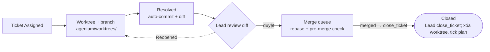
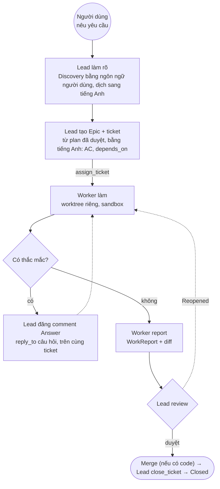
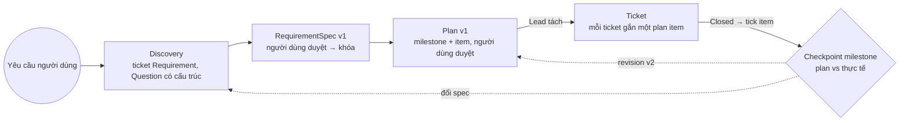
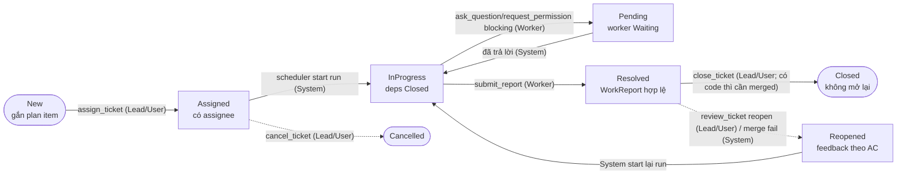
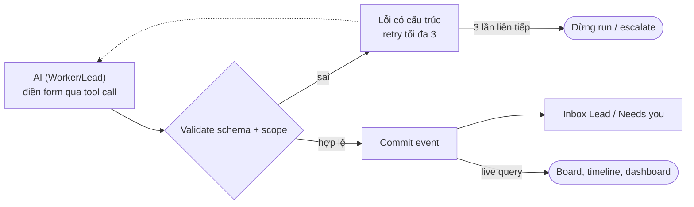
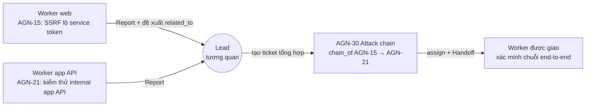

# Agenium – Kế hoạch kiến trúc

> App desktop (bản đầu: **Linux + macOS**; Windows hoãn — ADR-39) viết bằng Rust để điều phối AI solo hoặc team Lead + Workers, chạy YOLO trong sandbox kiểu Codex, phối hợp qua hệ thống ticket tích hợp sẵn. Trạng thái: FINAL v1.0 (2026-10-22), **đã cập nhật 2026-10-23** theo ADR-39…51 (xem khung "Cập nhật" ngay dưới).

> ## Cập nhật 2026-10-23 (ADR-39 … ADR-51) — đọc trước
>
> Tài liệu này giữ nguyên cấu trúc v1.0; các câu bị thay thế được gạch ngang (~~như thế này~~) và có chú thích **[CẬP NHẬT …]**. Khi mâu thuẫn, thứ tự ưu tiên: `DECISIONS.md` > tài liệu này > các file khác.
>
> | Chủ đề | v1.0 (cũ) | Hiện hành |
> |---|---|---|
> | Database | SurrealDB 3.x embedded (SurrealKV/RocksDB) | **SQLite là engine chính** (`rusqlite` bundled + `sqlite-vec` + FTS5, sidecar ANN `usearch` khi > 100 000 fact/agent). SurrealDB còn là backend **tùy chọn** sau cargo feature `surrealkv` (đối chứng/parity), không có trong bản release. **ADR-49, ADR-50**, `docs/STORE-PARITY.md`, `docs/STORE-SCALE.md` |
> | Realtime | SurrealDB `LIVE SELECT` | `tokio::broadcast` bus nuôi bởi `EventSink` của store (ADR-45) |
> | Nền tảng bản đầu | Windows / macOS / Linux | **Chỉ Linux + macOS** (ADR-39). Windows hoãn: không CI, không bundle; sandbox không hỗ trợ nên **fail-closed**; có `docs/WINDOWS-GUIDE.md` để thử build |
> | Ngôn ngữ | Mọi thứ theo `user_language` | Người dùng ↔ Lead: **ngôn ngữ tùy chọn** (`app.user_language`); từ **Lead trở xuống** (ticket, plan, handoff, memory, skill, tin nhắn giữa agent, tool-call) **chỉ tiếng Anh** (ADR-40) |
> | Sandbox | Fork Codex cho 3 OS | Vendoring Codex không sửa + lớp wrapper `agenium-sandbox` (ADR-41); Linux: bubblewrap ưu tiên / Landlock ABI ≥ 3, fail-closed (ADR-42); macOS Seatbelt v2 (ADR-43, thử nghiệm); Windows: không có backend |
> | VCS | git2/gix | git CLI (ADR-44) |
> | Backup/migration | JSONL export, rollback | SQLite: full = snapshot image zstd, incremental = JSONL; migration trong 1 transaction + pre-migrate backup (ADR-46/49) |
> | Embedder | fastembed cố định | Trait `Embedder` (ADR-47); số chiều cố định theo DB agent |
> | Memory (đồ thị) | fact + `superseded_by`; không graph | **ADR-51 (Proposed, chưa cài):** entity/edge có scope + thời hạn hiệu lực trong DB riêng của agent; truy xuất lai vec + BM25 + mở rộng graph 1–2 hop (RRF + xếp lại theo scope/recency/confidence); chia sẻ giữa agent chỉ qua ticket hoặc gói tri thức project (chờ chủ sở hữu duyệt). Đồ thị **ticket/phụ thuộc** vẫn là bảng join, tính trong `agenium-core` |
> | CI | GitHub Actions | Chạy **local**: `scripts/ci-local.sh` / `scripts/ci-local.ps1`; workflow GitHub chỉ còn `workflow_dispatch` (tùy chọn) |

## Mục lục

- Tổng quan
- Quyết định đã chốt
- Stack & crate
  - Crate Rust
  - Yêu cầu hệ thống
- Mô hình domain
- Lưu trữ
  - SurrealDB embedded **[CẬP NHẬT ADR-49: nay là tùy chọn; SQLite là chính]**
  - Bản đồ lưu trữ: DB vs root vs workspace
  - Agenium root
  - Backup, nhất quán & dọn dẹp
- Memory riêng tư: pipeline tự viết bằng Rust
  - Graph memory (ADR-51, Proposed)
- Agent, Role & Template
  - Agent registry
  - AI Solo
  - Template team & Role
  - SOUL.md, ROLE.md & Capability manifest
  - Skills
  - AgentBackend
- Project, workspace & Git
  - Project & portability
  - Tạo project & kết nối git
  - Worktree theo ticket
  - Khác biệt domain nằm trong template
- Ticket & điều phối
  - Vòng đời ticket
  - Từ yêu cầu đến plan
  - Schema ticket
  - State machine có guard
  - Orchestrator & event bus
  - Scheduler & vận hành
  - Câu hỏi, review và độ bền
  - Ví dụ vòng đời đầy đủ
- Giao thức Agent ↔ Hệ thống
  - Work order mỗi run
  - Nhìn thấy team
  - Tool theo role
  - Luật validate
  - Luồng giao việc, báo cáo, review
  - Payload & ví dụ JSON
- Phản hồi Lead, chuyên môn, Handoff & tiến độ
  - Lead phản hồi nhanh
  - Chuyên môn & phạm vi
  - Topology hình sao & tương quan (ví dụ pentest)
  - Handoff & cách ly context
  - Hiển thị tiến độ cho người dùng
- Sandbox, YOLO & mạng
  - Mode & approval
  - Cơ chế theo OS
  - Mạng & fetch
- Vendor API layer
  - Quyết định API bổ sung
  - Kiểu thống nhất, streaming & retry
  - MCP transport
  - Chiến lược prompt caching
  - Ánh xạ effort
  - Agent loop, tools & context
  - Giới hạn bước
- Tool set
  - Quy tắc hành vi
- Học từ kinh nghiệm (learning)
  - Lesson có scope
  - Skill overlay
  - Ý tưởng lấy từ harness2 & Hermes
- Bảo mật, log & báo cáo
- Kiểm thử & eval
- Phác thảo code Rust
- Lộ trình MVP
  - M0-spike: checklist kiểm chứng
- Ghi chú triển khai lộ trình
- Câu hỏi mở
  - Đã giải quyết

## Tổng quan

> **Ý chính** Mọi phối hợp giữa agent đi qua ticket và comment; agent không nói chuyện trực tiếp với nhau. Ticket là nguồn sự thật duy nhất, giúp kiểm tra, khôi phục và người dùng có thể can thiệp bất cứ lúc nào.

- **Solo mode**: Một agent đóng vai Lead: chạy cùng vòng plan + ticket, tự duyệt plan/ticket/review; người dùng được báo khi đổi scope.
- **Team mode**: 1 Lead (làm rõ yêu cầu, chia ticket, giao việc, trả lời comment, review) + N Worker (nhận ticket, làm việc, báo cáo).
- **Không có subagent**: Lead không tự sinh agent mới. Mọi agent được tạo trước trong registry, tồn tại lâu dài với memory, MCP và skill riêng.
- **YOLO + sandbox**: Agent chạy lệnh không hỏi, nhưng bị giới hạn ghi trong worktree của ticket và tắt mạng mặc định.

## Quyết định đã chốt

| # | Chủ đề | Quyết định |
|---|---|---|
| 1 | Database | **[CẬP NHẬT ADR-49/50: SQLite chính (rusqlite + sqlite-vec + FTS5 + usearch ANN); SurrealDB tùy chọn]** ~~SurrealDB 3.x embedded (crate `surrealdb`); SurrealKV đã ra 1.0 (13/10/2026, SurrealDB 3.3.4): engine SurrealKV hay RocksDB chốt bằng so sánh trực tiếp trong spike S1. Phương án B nếu S1 Kill: SQLite (`rusqlite`/`sqlx`) + `sqlite-vec` cho vector + FTS5 cho BM25, realtime bằng `tokio::broadcast`; Repo trait giữ nguyên~~ |
| 2 | Memory | Riêng tư tuyệt đối theo agent, như trí nhớ con người; chia sẻ thông tin chỉ qua ticket/comment. Pipeline tự viết bằng Rust (ý tưởng Mem0, không dùng thư viện/dịch vụ Mem0), lưu hoàn toàn trong SurrealDB **[CẬP NHẬT ADR-49/50: lưu trong SQLite `agent_<ulid>.db` (sqlite-vec + FTS5, ANN usearch từ 100k facts); mô tả SurrealDB ở đây là lịch sử]** |
| 2b | Embedding | Local, chỉ tiếng Anh: fastembed-rs + `bge-small-en-v1.5` (384 chiều); trait `Embedder` cho phép đổi sang API. Giữ chỉ tiếng Anh, xem lại theo số đo spike S6 (recall@5 Anh vs Việt, so với model đa ngữ như multilingual-e5-small / bge-m3) |
| 2c | Ngôn ngữ | Ngôn ngữ làm việc là tiếng Anh. Solo: agent tự dịch yêu cầu tiếng Việt sang tiếng Anh, memory bằng tiếng Anh. Team: Lead dịch yêu cầu sang tiếng Anh; ticket, comment, giao việc đều bằng tiếng Anh; worker làm hoàn toàn bằng tiếng Anh; Lead dịch kết quả/câu hỏi về ngôn ngữ của người dùng khi trao đổi với họ |
| 3 | Team | Mỗi agent thuộc đúng một team |
| 3a | UI & nền tảng | Tauri 2 + React (TypeScript), ~~đa nền tảng Windows/macOS/Linux~~ **[CẬP NHẬT ADR-39: bản đầu Linux + macOS, Windows hoãn]**; dnd-kit (kanban), Monaco (code/diff), xterm.js (terminal); cập nhật realtime qua ~~SurrealDB live query~~ **`tokio::broadcast` (EventSink, ADR-45/49)** rồi Tauri event. Mockup UI: `/workspace/agenium-mockup/` (`index.html`, `mockup.png`) |
| 3b | AI vendor (bản đầu) | 6 vendor cloud + Local: Anthropic (Claude), OpenAI, Google Gemini, OpenRouter, Opencode (API key gói subscription qua HTTP API, hoặc CLI `opencode`), DeepSeek (qua adapter OpenAI-compatible; thinking bằng `reasoning_effort`; KV cache đĩa tự động, khớp prefix từ token 0); Local / custom endpoint (quyết định 31). Tất cả implement trait `Provider`; API key lưu trong OS keyring qua `keyring` (không bao giờ trong Agenium root) |
| 3c | AgentBackend | Chỉ hai backend: API và CLI. `ApiBackend` là chính, cho cả 6 vendor cloud + Local (M1). `CliBackend` (M2.5): CLI chính chủ ở chế độ headless JSON-stream (`claude -p --output-format stream-json`, `codex exec --json`, `agy -p --output-format stream-json`, `opencode run --format json`) với 4 lớp kiểm soát: MCP của Agenium cho intent/tool, sandbox, giới hạn bước/lặp, bắt buộc report; memory/skill do Agenium inject. Opencode và Google dùng API hoặc CLI (`opencode`, `agy`) |
| 3d | Giao tiếp | Mọi giao tiếp giữa agent diễn ra trên ticket dưới dạng comment có kiểu; không có tin nhắn trực tiếp agent-agent. Comment là nguồn sự thật và audit duy nhất; người dùng xem thread live và có thể trả lời/override |
| 3e | Đa mục đích | Agenium không chỉ cho coding. WorkReport = phần lõi chung + phần mở rộng theo template (JSON Schema, có version, orchestrator validate). Không bắt buộc "tests pass" toàn cục; template có thể bắt buộc |
| 3f | Topology hình sao | Worker không bao giờ giao tiếp trực tiếp với nhau; mọi thứ qua Lead trên ticket. Worker chỉ được đề xuất liên kết `related_to`; Lead tương quan, tạo ticket tổng hợp, chuyển tiếp context giữa ticket, tất cả được ghi log |
| 3g | Handoff & cách ly context | TicketLink chỉ để truy vết; nội dung ticket liên kết không tự vào context. Chuyển thông tin chỉ qua comment `Handoff` do Lead/người dùng đăng trên ticket đích, bất biến. Worker chỉ đọc được ticket của mình |
| 3h | Từ yêu cầu đến plan | Discovery → RequirementSpec được người dùng duyệt (khóa v1) → Plan (milestone + item, trace về spec) được người dùng duyệt → mới tách ticket. Mọi ticket phải gắn plan item; thay đổi plan có version, đổi scope cần người dùng duyệt |
| 3i | Trạng thái ticket | New → Assigned → InProgress ⇄ Pending → Resolved → Closed (terminal, chỉ qua `close_ticket` của Lead/User, merge không tự đóng) hoặc Reopened → InProgress; Cancelled từ mọi trạng thái chưa kết thúc. Reopened quá 3 lần thì gắn cờ escalated. Agent: Idle, Working, Waiting, QuotaExhausted, Offline |
| 3j | QuotaExhausted | Chỉ khi provider báo hết quota/credit (402 hoặc 429 mã quota như `insufficient_quota`; 429 rate limit tạm thời chỉ xếp hàng + backoff): agent dừng, ticket giữ trạng thái + comment System, không được giao việc, escalate ưu tiên cao nhất + thông báo desktop. Đổi vendor/model hoặc nạp credit thì tiếp tục từ checkpoint |
| 3k | Không giới hạn budget | Không có budget token/chi phí/thời gian theo agent hay ticket; ưu tiên hoàn thành đúng chất lượng. Chi phí/token chỉ là chỉ số hiển thị: UI hiện token đã dùng + chi phí ước tính (theo bảng giá) cho từng run và ticket, không chặn, không cảnh báo dừng. Người dùng tự quản lý chi phí; an toàn do sandbox đảm nhận |
| 3l | Template team & Role | UX nhiều lớp: template có sẵn (Coding, Pentest, Research, Content) → Lead đề xuất role qua `propose_role`, chỉ tạo agent khi người dùng duyệt → tùy biến và lưu template riêng (YAML/JSON có version). Role là mô tả công việc, Agent là thực thể gắn một role và một team |
| 3m | SOUL.md, ROLE.md & manifest | SOUL.md (danh tính agent) + ROLE.md (mô tả role) có version, sửa trong UI, agent chỉ đề xuất. Capability manifest sinh tự động mỗi run từ cấu hình thật; skill nạp đầy đủ qua `load_skill`. Thứ tự context: work order của quyết định 36 |
| 4 | Duyệt quyền | Trong allowlist: Lead duyệt, chỉ có hiệu lực cho run hiện tại; ngoài allowlist: chuyển lên người dùng. "Luôn cho phép" (thêm vĩnh viễn vào allowlist project) chỉ người dùng cấp được; Lead không bao giờ cấp quyền vĩnh viễn |
| 5 | MCP | Mỗi agent có kết nối MCP riêng với credential binding riêng (key dùng chung hoặc riêng); secret trong OS keyring (Windows Credential Manager / macOS Keychain / Linux Secret Service) qua crate `keyring`. Kiểm chứng ở spike S5: Windows Credential Manager giới hạn blob ~2,5 KB (2.560 byte, ít hơn sau UTF-16), không chứa nổi token OAuth/khóa RSA lớn. Phương án B: keyring chỉ giữ một khóa chủ, mọi secret lưu trong vault mã hóa (XChaCha20-Poly1305 hoặc age) tại Agenium root **[CẬP NHẬT ADR-39: Windows hoãn khỏi bản đầu (chỉ Linux + macOS); phần Windows/3 OS ở đây là thiết kế hoãn hoặc lịch sử]** |
| 6 | AI Solo | Cùng vòng plan + ticket như team, agent solo chính là Lead: tự duyệt plan, ticket, review. Stall-nudge áp dụng cho mọi agent. Được tự sửa plan, tạo ticket theo cùng luật version; người dùng vẫn được báo khi đổi scope |
| 7 | Project & workspace | Project = folder (git repo) có `agenium.toml`, đặt ở đâu cũng được (mặc định `<root>/projects`); dữ liệu team/agent/plan/ticket nằm trong SurrealDB tại `<root>/db`, project chỉ được tham chiếu bằng đường dẫn trong DB `core`; mỗi team một project tại một thời điểm. Workspace riêng `<project>/agents/<agent_id>/`, cấm đọc chéo. Export `.agenium` (không chứa secret) |
| 8 | Skills | Skill là folder: SKILL.md kiểu Codex/Claude (frontmatter name/description + body) + tùy chọn `scripts/`, `references/`, `assets/`; lưu tại `<root>/agents/<id>/skills/<name>/` hoặc `<root>/roles/<role>/skills/<name>/`. Progressive disclosure: name + description → `load_skill` nạp body → file tham chiếu đọc khi cần; scripts chỉ chạy trong sandbox. Nguồn: built-in, người dùng viết trong UI, import từ folder/zip/URL. Base có version, gán theo role/agent; agent chỉ tiến hóa overlay riêng (quyết định 35) |
| 9 | Sandbox | Fork/adapt sandbox của OpenAI Codex (https://github.com/openai/codex, Apache-2.0) cho Windows/macOS/Linux; giữ LICENSE/NOTICE. Xin quyền là comment trên ticket, template team đặt network allowlist mặc định, Lead duyệt trong allowlist (theo run), ngoài thì người dùng. Sandbox Windows của Codex đã đổi kiến trúc (2026): hai local user riêng (offline/online), binary `codex-command-runner`, setup một lần cần quyền admin để tạo user + firewall rule, DPAPI; bản restricted token + proxy env cũ chỉ chặn mạng kiểu advisory. Kiểm chứng ở spike S2/S3. Phương án B cho Windows: (1) WSL2, (2) Docker/VM nhẹ theo project, (3) nhãn experimental: chỉ ghi-trong-workspace, không tuyên bố cách ly mạng, tắt YOLO mặc định trên Windows **[CẬP NHẬT ADR-39/41: chỉ Linux + macOS ở v1; Windows hoãn, fail-closed; Codex vendoring không sửa]** |
| 10 | Bảo mật & báo cáo | Secret chỉ trong keyring của OS; log là event log có cấu trúc (mức info/debug, che secret). Export báo cáo Markdown từ WorkReport/Plan có cấu trúc (PDF sau). Export audit trail theo project |
| 11 | Workspace theo ticket & Git | Một cấu trúc thống nhất cho mọi domain. Mọi project là git repo (không có remote thì `git init` local; remote tùy chọn với SSH key ed25519 + Test repo). Mọi ticket có git worktree + branch `agenium/<ticket-id>`; cùng luồng review diff → merge queue tuần tự. Layout chuẩn: `deliverables/`, `artifacts/`, `notes/`, `.agenium/`. Khác biệt domain chỉ nằm trong template (role, skill, report template, network allowlist, pre-merge check). File nhị phân lớn qua Git LFS hoặc store theo content hash ngoài git, commit tham chiếu |
| 12 | Agenium root (nơi lưu) | Người dùng chọn thư mục gốc trong setup wizard lần chạy đầu. Không chọn thì mặc định `~/.agenium` trên mọi OS (Windows `%USERPROFILE%\.agenium`), giống Hermes agent (`~/.hermes`), Codex (`~/.codex`), Claude (`~/.claude`). Thứ tự: env `AGENIUM_HOME` > root chọn lúc setup > mặc định. Root chứa `config.toml`, `db/`, `models/`, `logs/`, `projects/`, `agents/<id>/` (SOUL.md, `skills/`), `roles/<role>/` (ROLE.md, `skills/`), `templates/`, `backups/`. Secret luôn trong OS keyring, không bao giờ trong root. Đổi root sau trong Settings qua bước di chuyển/migrate **[CẬP NHẬT ADR-39: Windows hoãn khỏi bản đầu (chỉ Linux + macOS); phần Windows/3 OS ở đây là thiết kế hoãn hoặc lịch sử]** |
| 13 | Vendor API layer | 3 adapter M1 (Anthropic, Gemini, OpenAI-compatible cho OpenAI/OpenRouter/Opencode/DeepSeek/Local), tổng 6 vendor cloud + Local. Người dùng chọn model + effort (low/medium/high/max), không có công tắc thinking riêng. Prefix ổn định + history append-only để tối đa cache; Anthropic đặt `cache_control` cuối tools, cuối system tĩnh và message cuối. `max_steps` 200/run, chạm giới hạn thì tóm tắt + checkpoint + run mới. Danh sách model lấy từ API + cache, giá chỉ hiển thị từ file cấu hình; đếm token theo usage + ước lượng delta; ảnh/PDF khi model hỗ trợ; limiter theo API key; tool call sai 3 lần liên tiếp thì dừng run; thinking giữ trong history, không vào memory, ẩn mặc định. Layer hoàn tất cho M1 |
| 14 | Bản đồ lưu trữ | Dữ liệu điều phối/truy vấn ở DB (`core`, `agent_<ulid>`), sản phẩm công việc trong git của project, cấu hình/tài nguyên ở root, secret chỉ ở OS keyring |
| 15 | Retry & MCP transport | Retry: lỗi mạng, timeout, 5xx, 529, 429 tạm thời (theo `retry-after`), đứt stream; backoff 1s nhân đôi, trần 30s, jitter, tối đa 8 lần hoặc 5 phút, rồi agent → Offline + probe nền + tự resume. Đứt stream: bỏ output dở, gửi lại request y hệt, tool đã xong không chạy lại. 400/401 báo lỗi; 402/429 quota → QuotaExhausted. MCP: stdio (local, sandbox, tự restart) và Streamable HTTP (fallback SSE), OAuth/header token trong keyring, domain trong allowlist; tool chỉ đọc được retry, tool ghi trả lỗi về model |
| 16 | Tool set | Tool lõi: read_file, list_dir, glob, grep, write_file, edit_file, multi_edit, apply_patch, shell, fetch, todo, ticket intents, MCP. Read-before-edit, khớp duy nhất, apply_patch cho nhiều file, cắt output 30.000 ký tự / 256 dòng (bản đầy đủ lưu artifact), shell timeout 120 giây / tối đa 10 phút, path giới hạn trong worktree. Port từ Codex (Apache-2.0) có attribution; Claude Code chỉ học hành vi (clean-room) |
| 17 | Phát hiện lặp | Chỉ dừng run khi CÙNG một tool với args GIỐNG HỆT được gọi 3 lần liên tiếp; cùng tool nhưng args khác (vd. đọc nhiều file) là hợp lệ |
| 18 | Merge thất bại | Ticket giữ Resolved (chưa Closed). Merge queue rebase trên main mới nhất; pre-merge check fail → Reopened về đúng worker kèm log; conflict → hệ thống tự Reopened về đúng worker kèm danh sách file conflict + Handoff do hệ thống sinh chứa diff của ticket đã merge; worker sửa trong worktree rồi Resolved lại; conflict lớn/thiết kế → Lead quyết, có thể tạo ticket resolve. Phòng ngừa: Lead khai báo scope file/khu vực cho mỗi ticket trong plan, ticket chồng scope phải có depends_on; sau mỗi merge, ticket đang làm đụng cùng file nhận nudge rebase sớm |
| 19 | Khóa chỉnh sửa của người dùng | Khi project đang chạy, worktree và branch `agenium/*` là chỉ đọc với người dùng trên UI; thay đổi của người dùng đi qua comment `User` trên ticket hoặc gửi Lead; sửa từ bên ngoài bị phát hiện → revert và báo người dùng; sửa `main` trực tiếp chỉ khi project tạm dừng |
| 20 | Lead lỗi & câu hỏi worker | Lead lỗi/QuotaExhausted/Offline: worker làm tiếp, câu hỏi xếp hàng, quá SLA báo người dùng; người dùng gán agent khác làm Lead, không mất dữ liệu. Câu hỏi worker: Lead trả lời; Lead không chắc thì escalate người dùng |
| 21 | UI & thông báo | 5 màn hình: Dashboard, Board, Ticket, Agents, Settings. Thông báo chỉ cho QuotaExhausted, cần duyệt, escalation, epic xong. Agent view xem live kiểu Codex/Claude desktop. Worker trong team: chat chỉ đọc, người dùng pause/stop được, muốn lái thì comment ticket hoặc nhắn Lead. Lead và Solo: chat trực tiếp |
| 22 | Nhất quán khi crash | DB = trạng thái, git = nội dung; ghi event trước, thao tác git idempotent theo ticket + sha; reconcile khi khởi động, tự sửa hoặc báo người dùng |
| 23 | Backup & dọn dẹp | Incremental mỗi giờ + full mỗi ngày, JSONL nén zstd; giữ 24 bản giờ, 7 ngày, 4 tuần; full backup trước migrate schema, lỗi thì tự rollback; mặc định `<root>/backups` (đổi được); không chứa secret; không nhân đôi nội dung git, có remote thì push branch khi Closed. Tool output đầy đủ là artifact git, không vào DB; run log quá 90 ngày được nén gọn; Settings hiển thị dung lượng + dọn dẹp |
| 24 | Yêu cầu hệ thống | Tối thiểu CPU 64-bit 4 nhân, 8 GB RAM, 10 GB SSD trống; khuyến nghị 8 nhân, 16 GB RAM, 50 GB SSD; không cần GPU; ~~Windows 10 22H2/11,~~ macOS 12+, Linux kernel 5.13+ (Landlock) hoặc bubblewrap [ADR-39/42: Windows hoãn]; git 2.30+; internet ổn định. Máy yếu tự giảm mức song song |
| 25 | Gán project | Một team làm đúng một project tại một thời điểm; Solo cũng vậy. Team/Solo chỉ được gán sang project khác sau khi project hiện tại Cancelled hoặc Completed. Nhiều project chạy đồng thời trên máy chỉ khi mỗi project có team/Solo riêng; dùng chung giới hạn song song toàn cục + limiter theo API key. Memory: một memory mỗi agent (agent làm nhiều project tuần tự trong đời), fact gắn `project_id`, ưu tiên project hiện tại |
| 26 | Telemetry | Tắt mặc định, không gửi gì. Crash report tùy chọn (opt-in), che secret, không chứa prompt/code |
| 27 | Marketplace & đồng bộ ngoài | Không có marketplace (không nằm trong kế hoạch); thêm thủ công MCP/skill/template (dán MCP config, import skill từ folder/zip/URL, import template YAML) + danh sách nhỏ MCP phổ biến built-in. Ticket lưu duy nhất trong DB của app, tự chứa, không đồng bộ Jira/GitHub; export Markdown |
| 28 | Giá trị vận hành & quy tắc | Solo tự merge sau self-review, tự `close_ticket` + báo người dùng, có tùy chọn "duyệt trước khi merge" theo project. 1 ticket active/worker; tối đa 4 agent song song (tự giảm trên máy yếu); SLA câu hỏi blocking 10 phút; stall 5 phút, nudge 3 lần rồi escalate. Quyền đã duyệt có hiệu lực theo run của ticket; "luôn cho phép" (thêm vào allowlist project) chỉ người dùng cấp được, Lead không cấp (quyết định 4). Conflict lớn (> 5 file, hoặc ngoài `scope_paths`, hoặc worker sửa thất bại 2 lần) → Lead quyết |
| 29 | Kỹ thuật & phát hành | `schema_version` trong `core`, migrate lúc khởi động (backup/rollback theo quyết định 23). Test: unit/property cho state machine/guard/scheduler, mock provider record/replay, test xâm nhập sandbox trong CI cả 3 OS, e2e Tauri. UI tiếng Anh + tiếng Việt (i18next). Tauri updater có chữ ký, ký code Windows/macOS từ beta. Model trích xuất memory = model của agent, có thể đặt model rẻ hơn. Engine chốt theo spike S1; đổi engine về sau qua JSONL **[CẬP NHẬT ADR-39: Windows hoãn khỏi bản đầu (chỉ Linux + macOS); phần Windows/3 OS ở đây là thiết kế hoãn hoặc lịch sử]** |
| 30 | CLI: phát hiện & cách ly | Người dùng chọn API hoặc CLI cho từng agent. Agenium chỉ PHÁT HIỆN CLI đã cài trong PATH (`claude`, `codex`, `agy`, `opencode`): version + trạng thái đăng nhập; Agenium không xử lý đăng nhập, người dùng tự login bằng CLI của mình. Cách ly không cần clone binary: không bao giờ ghi vào config global của người dùng (`~/.claude`, `~/.codex`, ...); chỉ dùng lại auth của người dùng (read-only). Mỗi run Agenium tự cấp: MCP = MCP nội bộ Agenium + MCP riêng của agent; không hook; không memory/session resume của CLI; không file instruction global của người dùng. Ưu tiên cờ CLI bỏ qua config global (vd. cờ strict MCP config); nếu không có thì thư mục config tạm theo run, auth trỏ read-only về bản gốc. Binary pin trong `<root>/bin/` chỉ khi CLI không cách ly được hoặc cần ghim version. Cờ/env chính xác cho từng CLI: cần kiểm chứng ở M2.5. Process CLI chạy trong sandbox Agenium, tắt network/web tool riêng của CLI; usage đọc từ JSON stream. Khai báo phiên bản tối thiểu cho từng CLI + contract test trong CI; CLI không tương thích thì agent rơi về ApiBackend |
| 31 | Local / custom endpoint | Hỗ trợ chính thức trong MVP: provider "Local / custom endpoint" qua adapter OpenAI-compatible (Ollama, LM Studio, llama.cpp server, vLLM); base URL tùy chỉnh, key tùy chọn lưu trong OS keyring; danh sách model lấy từ endpoint; không có giá (cost 0); capability flags (tools, vision, context length) tự phát hiện hoặc đặt tay; cảnh báo nếu model không hỗ trợ tool calling; network allowlist tự thêm endpoint local đã cấu hình (localhost) |
| 32 | Xóa agent | Chỉ xóa hẳn, không có archive. Hộp thoại xác nhận mạnh: cảnh báo toàn bộ memory, skill tự học, lịch sử SOUL/ROLE và workspace của agent sẽ bị xóa vĩnh viễn; bắt gõ tên agent; bị chặn khi agent còn ticket mở (phải giao lại trước); có tùy chọn export trước khi xóa |
| 33 | Giấy phép | Mã nguồn mở Apache-2.0 (tương thích code port từ Codex, giữ NOTICE) |
| 34 | An toàn & vận hành bổ sung | Prompt injection: nội dung ngoài (fetch, MCP, file trong repo) đánh dấu untrusted trong context, không thể tự cấp quyền hay đổi allowlist. Quét secret (kiểu gitleaks) trước auto-commit và push, phát hiện thì chặn + báo. Model compact context = model của agent, có thể đặt model rẻ hơn. Bảng giá đi kèm bản cập nhật app, sửa được trong root. SOUL/ROLE/skill mặc định của template do Agenium viết, có version, kèm eval test nhỏ. Một người dùng, một máy; chuyển máy qua export/import `.agenium` |
| 35 | Learning | Học từ lỗi (Reopened, pre-merge fail, tool error, Lead sửa), ý tưởng tốt (Lead khen, cách làm hiệu quả), phản hồi người dùng. Lesson là memory fact có scope (vendor/product/version/language/project/domain) + cue + evidence + confidence; khớp chính xác mới áp dụng, gần khớp chỉ là gợi ý cần kiểm chứng; superseded không xóa; decay khi không dùng. Skill base bất biến; agent tiến hóa overlay copy-on-write riêng tại `<root>/agents/<id>/skills/<name>/` (base_version, diff, changelog, evidence, nhãn `updated`); `propose_skill_update` tự áp vào overlay của chính agent khi lesson validated ≥ 2 ngữ cảnh khác nhau, không cần người dùng duyệt, có audit log, không thông báo từng thay đổi (chỉ hiển thị trong UI, xem diff/revert bất cứ lúc nào); decay half-life 90 ngày không dùng, ẩn khi confidence < 0,2; review sau ticket chỉ khi có tín hiệu (Reopened, merge/pre-merge fail, Lead khen/sửa, phản hồi người dùng); Lead không ghi lesson vào memory của worker, chỉ góp ý qua Review, worker tự rút lesson; base cập nhật → overlay cần rebase (3-way merge); người dùng xem diff, revert, hoặc duyệt promote thành base mới |
| 36 | Giao thức Agent ↔ Hệ thống | Chỉ tool call đã validate theo schema mới được ghi; text tự do không phải hành động; lỗi trả về làm tool result, 3 lỗi liên tiếp dừng run, thiếu tool kết thúc thì nudge. Work order cố định theo thứ tự cache. Lead thấy team roster + `get_team`; worker chỉ thấy Lead + role mình. Tool tách theo role (Solo = Lead + Worker). Worker không kéo việc: Lead `assign_ticket`, scheduler khởi động run. `submit_report` → Resolved; `review_ticket` approve → merge queue (nếu có code), reopen kèm feedback theo AC. Merge không tự đóng: Lead quyết Closed bằng `close_ticket` (có reason, System thực thi); có code thì merge thành công là điều kiện bắt buộc, ticket không có code (vd. research) Lead đóng trực tiếp; Lead không chắc thì hỏi người dùng. Không có `split_ticket`: ticket quá lớn thì Lead `revise_plan` (có version), tạo ticket mới cho plan item mới và thu hẹp scope ticket gốc. Không có `request_reassign`: worker báo vướng (thiếu MCP/credential/skill, việc ngoài role) bằng `ask_question`, Lead quyết. Phụ thuộc: ticket phụ thuộc được mở khóa ngay khi ticket trước được Lead approve (`review_ticket` approve, cờ `approved`) và, nếu có code, merge thành công (cờ `merged` trên ticket Resolved); không cần chờ `close_ticket`, không có trạng thái Merging |
| 37 | Spike M0 trước khi dựng khung | Mốc M0-spike (tối đa 10 ngày) trả lời bằng code bỏ đi: S0 build môi trường sạch, S1 SurrealDB (cổng), S2 sandbox Windows (cổng), S3 sandbox macOS/Linux, S4 worktree/merge queue/reconcile (cổng), S5 keyring, S6 embedding, S7 realtime → UI. Ngưỡng Pass/Yellow/Kill chốt trước khi chạy, timebox cứng (hết giờ = Yellow), đo trên máy tối thiểu (quyết định 24), evidence tái lập được, mỗi spike một biên bản + ADR. Phương án B ghi sẵn ở quyết định 1, 5, 9. Cổng Go/No-Go ngày 10; kết quả cập nhật ngược vào Page trong tuần **[CẬP NHẬT: S0–S7 đã chạy xong; kết quả → ADR-49 (SQLite), ADR-39 (bỏ Windows)]** |
| 38 | Kiểm thử & eval | Ngoài test tất định (quyết định 29): bộ golden task cố định chấm tự động + người chấm, bắt đầu 5 task ở M1 và tăng dần, chạy lại sau mỗi thay đổi lớn về prompt/orchestrator/model. Trang chẩn đoán (run log có cấu trúc theo ticket) và nút xuất gói hỗ trợ (log đã che secret + cấu hình + phiên bản), không gửi tự động |

## Stack & crate

| Lớp | Lựa chọn | Lý do |
|---|---|---|
| Shell desktop | Tauri 2 (Windows/macOS/Linux) | Nhẹ hơn Electron, backend Rust thuần. Webview khác nhau: WebView2 (Windows), WKWebView (macOS), WebKitGTK (Linux), cần test UI trên cả 3 OS **[CẬP NHẬT ADR-39: v1 chỉ Linux (WebKitGTK) + macOS (WKWebView); WebView2/Windows hoãn]** |
| UI libs | dnd-kit, Monaco Editor, xterm.js | Kanban kéo thả, xem code/diff, terminal theo dõi lệnh của agent |
| Frontend | React + TypeScript + Vite, TanStack Query | Hệ sinh thái lớn, đã chốt |
| Realtime | ~~SurrealDB `LIVE SELECT`~~ `tokio::broadcast` (ADR-45/49) → Tauri event | UI cập nhật ticket/comment/approval tức thì |
| Runtime | tokio | Mỗi agent là một task async; channel, timeout, cancel |
| DB | ~~SurrealDB 3.x embedded~~ **SQLite (rusqlite bundled + sqlite-vec + FTS5 + usearch ANN) — ADR-49/50; SurrealDB tùy chọn** | Graph RELATE, vector HNSW + BM25 trong một engine, live query cho UI |
| Embedding | fastembed-rs + bge-small-en-v1.5 | Chạy local qua ONNX, không gửi memory ra ngoài |
| HTTP/LLM | reqwest + eventsource-stream | Streaming SSE cho Anthropic, OpenAI, Gemini, OpenRouter, Opencode, DeepSeek, Local (Ollama, LM Studio, llama.cpp, vLLM) |
| Sandbox | Fork Codex: Seatbelt (macOS), `landlock` + `seccompiler` (Linux), ~~windows-rs Job Object / Restricted Token / AppContainer (Windows)~~ **[ADR-39: Windows hoãn, không có backend; fail-closed]** | Tương đương cơ chế của Codex |
| Git | git CLI + gix (crate `agenium-vcs`) | Mỗi ticket một worktree + branch riêng, merge queue tuần tự |
| Log/trace | tracing + tracing-subscriber | Trace theo agent_id/ticket_id |
| Secret | OS keyring qua crate `keyring` (Credential Manager / Keychain / Secret Service) | Không lưu API key dạng plain text, không bao giờ trong Agenium root |
| Đường dẫn | crate `dirs` | Tìm home để dựng Agenium root mặc định `~/.agenium` |
| Nén backup | crate `zstd` | Backup JSONL nén |

### Yêu cầu hệ thống

|   | Tối thiểu | Khuyến nghị |
|---|---|---|
| CPU | 64-bit, 4 nhân | 8 nhân |
| RAM | 8 GB | 16 GB |
| Ổ đĩa | 10 GB SSD trống | 50 GB SSD |
| GPU | Không cần | Không cần |
| OS | Windows 10 22H2 / 11, macOS 12+, Linux kernel 5.13+ (Landlock) | Như tối thiểu **[CẬP NHẬT ADR-39: v1 chỉ macOS 12+ và Linux kernel 5.13+; Windows hoãn]** |
| Khác | git 2.30+, internet ổn định | Như tối thiểu |

Máy yếu hơn mức khuyến nghị: tự giảm số agent chạy song song.

### Crate Rust

| Crate | Trách nhiệm |
|---|---|
| `agenium-core` | Domain types, state machine ticket, lỗi, ID |
| `agenium-config` | `resolve_root`, layout Agenium root, `config.toml`, setup wizard backend |
| `agenium-store` | Repo trait (`TicketRepo`, `AgentRegistry`, `EventLog`, `ConversationStore`) + impl **SQLite (chính, ADR-49)** + SurrealDB tùy chọn, schema SQL (`schemas/sql`), backup/export |
| `agenium-memory` | Memory pipeline tự viết bằng Rust: LLM trích xuất fact, embedding fastembed (`Embedder`), LLM quyết định ADD/UPDATE/DELETE, ghi vào SurrealDB qua `MemoryStore` |
| `agenium-llm` | Trait `Provider`; adapter Anthropic, Gemini và một adapter OpenAI-compatible dùng chung cho OpenAI, OpenRouter, Opencode, DeepSeek, Local (cần kiểm chứng OpenRouter/Opencode tương thích OpenAI; DeepSeek có thêm `reasoning_content` và `prompt_cache_hit_tokens`); retry, caching, effort mapping, đếm token |
| `agenium-mcp` | `McpHub`, kết nối MCP theo agent (stdio / Streamable HTTP), credential binding qua `keyring` |
| `agenium-tools` | Tool set: file, glob/grep, apply_patch, shell, fetch, todo, ticket tools |
| `agenium-sandbox` | Trait `Sandbox` + impl macos (Seatbelt) / linux (bubblewrap/Landlock+seccomp); ~~windows~~ hoãn (ADR-39) |
| `agenium-vcs` | Trait `Vcs`: git init/remote test, worktree theo ticket, commit, diff, rebase, merge queue |
| `agenium-bus` | Event bus (broadcast) + dispatcher |
| `agenium-secrets` | Trait `SecretStore`: impl OS keyring (crate `keyring`) và impl vault mã hóa với khóa chủ trong keyring (phương án B quyết định 5, chọn theo spike S5) |
| `agenium-orchestrator` | Agent runtime, scheduler, Lead/Worker loop, watchdog/stall-nudge, thống kê usage (không budget) |
| `apps/desktop` (src-tauri) | Tauri commands, emit event lên UI |
| `apps/desktop/ui` | React: Kanban, ticket detail, agent console, settings |

## Mô hình domain

| Entity | Trường chính |
|---|---|
| AgentProfile | id (ULID), name, role_id (role kind Lead/Worker; solo = Lead không có worker), soul (`SOUL.md`), team (đúng một, qua edge `member_of`), memory_db (`agent_<ulid>`), mcp_bindings, skill_bindings, model_binding (đổi được), sandbox_policy, status (Idle / Working / Waiting / QuotaExhausted / Offline) |
| TeamTemplate | id, version, name, roles[], report_template mặc định; file YAML/JSON, built-in hoặc custom |
| Role | id, kind (lead/worker), prompt chuyên gia (ROLE.md), capability tags, allowed tools/MCP/skills, allowed_paths, report_template, default_model, network allowlist |
| ModelBinding | provider_id, model, effort (low/medium/high/max), params (max_tokens); đổi bất cứ lúc nào, không chạm memory/MCP/skill |
| Fact (memory) | id, kind (fact / lesson; lesson thêm cue, scope, evidence, confidence, validated_contexts, last_used — quyết định 35), project_id (ưu tiên project hiện tại khi truy xuất), text (nguồn sự thật), embedding[384], model_id, source_ticket, created_at, updated_at, superseded_by |
| McpServer | id, name, transport (stdio / Streamable HTTP), command/url, env template |
| McpBinding | agent_id, server_id, credential_ref, tool allowlist; mỗi agent một kết nối riêng |
| CredentialRef | id, label (vd. key1 = admin, key2 = dev), keyring service/account; dùng chung hoặc riêng giữa các binding |
| Approval | id, ticket, requester, kind (network / path / command), command, domains/paths, in_allowlist, decided_by (Lead/user), expires_at |
| Skill / SkillBinding | skill: id, folder (SKILL.md + scripts/, references/, assets/), owner (agent hoặc role), version; binding: agent_id, skill_id |
| Message | định dạng chuẩn hóa: role, parts (text / tool_call / tool_result / thinking), độc lập vendor |
| Team | id, name, lead_slot (agent_id), worker_slots (agent_id[]), project_id, max_parallel |
| Project | id, path (folder có `agenium.toml`, bất kỳ đâu, mặc định `<root>/projects/<name>`), team (một), git: luôn có repo local (main branch, LFS bật/tắt), remote: Option (URL, ssh_key_ref trong keyring, last_test_result), default_policy, network allowlist mặc định |
| TicketWorkspace | ticket_id, worktree path, branch `agenium/<ticket-id>`, base_sha, head_sha, merged_sha |
| AgentWorkspace | agent_id, path `<project>/agents/<agent_id>/`, private; orchestrator cấm agent khác đọc |
| RequirementSpec | id, version, goals, scope, out_of_scope, requirements (id + AC), constraints, approved_by, locked_at |
| Plan / PlanItem | plan: id, version, spec_version, reason, diff, approved_by; item: id, milestone, AC, deps, role, trace_to (requirement id), done |
| Ticket | id, key (AGN-12), kind, plan_item (bắt buộc), parent/epic, title, description, acceptance, required_role/tags, scope_paths, report_template, status (New / Assigned / InProgress / Pending / Resolved / Reopened / Closed / Cancelled), escalated, reopen_count, assignee, priority, depends_on |
| Comment | id, ticket_id, kind (Question / Answer / Progress / Report / Review / Permission / Handoff / System / User), author (agent / user / system), reply_to, payload (form có kiểu theo kind), body_md, resolved_by, created_at; edge `comment->on->ticket` |
| ReportTemplate | id, name, version, domain (coding / pentest / ...), extension_schema (JSON Schema), required_fields; gắn theo team hoặc ticket |
| TicketLink | from, to, kind (blocks / related_to / chain_of / duplicate_of / follow_up_of), proposed_by, confirmed_by (Lead), note |
| Run | id, ticket_id, agent_id, bắt đầu/kết thúc, steps, tokens, cache_read/write, cost, diff, exit |
| Event | seq, type, payload JSON, ts (append-only, để replay) |

## Lưu trữ

> **Nguyên tắc** Dữ liệu điều phối và truy vấn nằm trong DB; sản phẩm công việc nằm trong git của project; cấu hình và tài nguyên nằm trong root; secret chỉ nằm trong OS keyring.

### SurrealDB embedded  **[CẬP NHẬT ADR-49: mục này mô tả backend tùy chọn `--features surrealkv`; SQLite là engine chính — xem docs/STORE-SCALE.md]**

> **[CẬP NHẬT ADR-49: mục này mô tả engine v1.0. Engine chính hiện là SQLite (xem `docs/adr/ADR-49`, `ADR-50`, `docs/STORE-PARITY.md`, `docs/STORE-SCALE.md`); SurrealDB/SurrealKV còn là backend tùy chọn `--features surrealkv`. Số liệu so sánh: SurrealKV chậm hơn 5–9 lần khi ingest, to hơn 7 lần trên đĩa ở 100 000 fact; bản build 293 s/122 MB so với 52 s/10 MB.]**

| Phạm vi | Nội dung | Ghi chú |
|---|---|---|
| Namespace `agenium` | Bao toàn bộ dữ liệu app | Một thư mục dữ liệu local tại `<root>/db` |
| Database `core` | Dữ liệu điều phối (chi tiết ở bản đồ lưu trữ bên dưới) | Mọi agent truy cập qua tool có kiểm soát |
| Edge graph | `agent->member_of->team`, `agent->assigned->ticket`, `comment->on->ticket` | ~~Dùng `RELATE`; truy vấn kiểu "ticket của worker X" bằng graph traversal~~ **[CẬP NHẬT ADR-49/51: chỉ áp dụng cho backend SurrealDB tùy chọn. Trên SQLite (chính): quan hệ ticket/agent/team là bảng join + khóa ngoại, truy vấn bằng JOIN; đồ thị *memory* là kế hoạch riêng — ADR-51]** |
| Database `agent_<ulid>` | fact (HNSW vector 384 chiều + BM25 full-text), quan hệ fact, run context có thể resume (Message chuẩn hóa) | Mỗi agent một database, cô lập memory riêng tư |
| Live query | `LIVE SELECT` trên ticket/comment/approval/event | Đẩy thay đổi thẳng lên Tauri UI |

- **Engine**: SurrealKV 1.0 đã phát hành (13/10/2026); spike S1 so trực tiếp SurrealKV vs RocksDB trên cùng fixture (đúng/sai truy vấn, recall vector, crash 20 lần, kích thước, thời gian mở) rồi mới chốt. Phương án B: SQLite + sqlite-vec (quyết định 1). RocksDB trên Windows cần toolchain C++ (MSVC Build Tools, LLVM/clang) để build.
- **Trừu tượng hóa**: Giữ repo trait (`TicketRepo`, `AgentRegistry`, `EventLog`, `MemoryStore`, `ConversationStore`) để có thể đổi DB sau này.
- **ID & vector**: ID dạng ULID; mỗi vector lưu `model_id` để biết khi nào cần re-index.
- **Sao lưu**: Export/import JSONL cho từng database, không phụ thuộc định dạng file của engine.

> **Giấy phép và rủi ro** SurrealDB dùng BSL 1.1: nhúng vào app desktop được phép, cấm cung cấp dưới dạng DBaaS; mỗi phiên bản chuyển sang Apache 2.0 sau 4 năm. Rủi ro: 3.x còn mới, API và định dạng lưu trữ có thể thay đổi, SurrealKV chưa ổn định, thời gian build và kích thước binary lớn. Giảm rủi ro bằng repo trait và export JSONL.

### Bản đồ lưu trữ: DB vs root vs workspace

| Nơi lưu | Nội dung |
|---|---|
| DB `core` (`<root>/db`) | Project registry + đường dẫn, team, agent, role, template, RequirementSpec, plan có version, ticket, comment (gồm Handoff), TicketLink, lịch sử trạng thái, permission/approval, merge queue, run log (LLM call, tool call, token), cấu hình MCP (không secret), cache danh sách model, event log |
| DB `agent_<ulid>` | Memory fact, embedding, quan hệ giữa fact, run context có thể resume |
| File trong root | `config.toml` (kèm file giá hiển thị), `models/`, `logs/`, `agents/<id>/` (SOUL.md + `skills/<name>/`), `roles/<role>/` (ROLE.md + `skills/<name>/` dùng chung), `templates/`; mỗi skill là folder `SKILL.md` + `scripts/`, `references/`, `assets/` |
| Workspace project (git) | `deliverables/`, `artifacts/` (gồm `tool-output/`), `notes/`, `agenium.toml`, báo cáo Markdown đã export, `.agenium/worktrees/` |
| OS keyring | Mọi secret: API key, credential MCP, SSH private key |

### Agenium root

| Đường dẫn trong root | Nội dung |
|---|---|
| `config.toml` | Cấu hình app, root đã chọn, vendor, mặc định |
| `db/` | ~~Dữ liệu SurrealDB~~ **SQLite: `db/core.db` + `db/agents/<agent_id>.db` (+ `.ann` sidecar, `event-archive/`) — ADR-49/50** |
| `models/` | Cache model embedding (fastembed, `bge-small-en-v1.5`) |
| `logs/` | Event log/trace có cấu trúc, đã che secret |
| `projects/` | Nơi tạo project mới mặc định; project có thể nằm bất kỳ đâu, đường dẫn lưu trong DB `core` |
| `agents/<agent_id>/` | `SOUL.md`, `skills/<name>/` (SKILL.md + scripts/, references/, assets/) |
| `roles/<role>/` | `ROLE.md`, `skills/<name>/` dùng chung cho role |
| `templates/` | Team template YAML (built-in + custom) |

- **Setup wizard**: Lần chạy đầu, người dùng chọn Agenium root; bỏ qua thì dùng `~/.agenium` (Windows `%USERPROFILE%\.agenium`), như Hermes `~/.hermes`, Codex `~/.codex`, Claude `~/.claude`. **[CẬP NHẬT ADR-39: Windows hoãn khỏi bản đầu (chỉ Linux + macOS); phần Windows/3 OS ở đây là thiết kế hoãn hoặc lịch sử]**
- **Thứ tự ưu tiên**: Env `AGENIUM_HOME` > root chọn lúc setup (ghi vào file bootstrap tại vị trí config chuẩn của OS) > mặc định `dirs::home_dir()/.agenium`.
- **Đổi root**: Trong Settings: dừng agent, di chuyển/migrate dữ liệu sang root mới, kiểm tra, cập nhật bootstrap; project nằm ngoài root giữ nguyên đường dẫn.

### Backup, nhất quán & dọn dẹp

| Mục | Quyết định |
|---|---|
| Lịch backup | Incremental mỗi giờ + full mỗi ngày, export JSONL nén zstd (cả `core` và `agent_<ulid>`) |
| Giữ lại | 24 bản theo giờ, 7 bản theo ngày, 4 bản theo tuần |
| Migrate schema | Full backup trước khi migrate; migrate lỗi thì tự rollback từ bản đó |
| Vị trí | Mặc định `<root>/backups`, đổi được trong Settings |
| Không chứa | Secret (luôn ở keyring); nội dung git (không nhân đôi). Project có remote thì push branch khi ticket Closed |
| Nhất quán khi crash | DB = trạng thái, git = nội dung; ghi event trước, thao tác git idempotent theo ticket + sha; khởi động chạy reconcile, tự sửa hoặc báo người dùng |
| Dọn dẹp | Tool output đầy đủ là artifact git, không lưu trong DB; run log quá 90 ngày được nén gọn (giữ tóm tắt + usage); Settings hiển thị dung lượng theo nhóm + nút dọn dẹp |

> **Ước lượng** Dung lượng (ước lượng, chưa đo): DB vài trăm MB đến vài GB sau nhiều tháng dùng; model embedding khoảng 130 MB; backup nén zstd thường nhỏ hơn nhiều so với DB gốc. Số liệu thật cần đo ở M0–M1.

## Memory riêng tư: pipeline tự viết bằng Rust

> **Nguyên tắc** Memory của agent giống trí nhớ con người: chỉ agent đó đọc/ghi. Muốn truyền thông tin cho agent khác thì viết vào ticket hoặc comment. Đây là memory pipeline tự viết bằng Rust (lấy ý tưởng từ Mem0, không dùng thư viện/dịch vụ Mem0), lưu hoàn toàn trong SurrealDB.

| Thành phần | Trách nhiệm |
|---|---|
| SurrealDB (`agent_<ulid>`) | Lưu trữ fact, embedding và run context có thể resume, vector index HNSW, full-text BM25, quan hệ graph (fact ↔ ticket, `superseded_by`) **[CẬP NHẬT ADR-49: dòng này nay là SQLite `agent_<ulid>.db` — fact, vec0 (exact) + usearch HNSW (≥ 100k), FTS5 BM25; quan hệ fact↔ticket là bảng/khóa ngoại thay cho graph]** |
| `agenium-memory` (Agenium) | LLM trích xuất fact, embedding bằng fastembed, LLM quyết định ADD / UPDATE / DELETE / NOOP, rồi ghi kết quả vào SurrealDB **[CẬP NHẬT ADR-49: ghi vào SQLite]** |

1. **1. Kích hoạt**: Khi ticket Closed hoặc Reopened, hoặc phiên chat đóng.
2. **2. Trích xuất**: LLM của chính agent rút ra các fact ngắn, tiếng Anh, từ hội thoại và kết quả ticket (không lấy thinking block).
3. **3. So khớp**: Embed fact mới, hybrid search (HNSW + BM25) lấy fact gần nhất trong database của agent.
4. **4. Quyết định**: LLM chọn ADD / UPDATE / DELETE / NOOP cho từng fact; UPDATE giữ lịch sử qua `superseded_by`.
5. **5. Truy xuất**: Trước mỗi run, hybrid search theo ticket hiện tại, chèn top-k fact vào context.

### Graph memory (ADR-51, Proposed — thiết kế, chưa cài)

> **Nguyên tắc** Giữ memory riêng tư theo agent (quyết định 2) nhưng cho phép *tái sử dụng tri thức đã học* qua nhiều ticket và (có kiểm soát) nhiều agent, mà không áp nhầm bài học sai ngữ cảnh (bài học TP-Link không áp cho Netgear).

- **Mô hình** (cùng DB `agent_<id>.db`, DDL nháp `SCHEMAS/sql/drafts/agent_003_graph_memory.sql`): `entity` (type, name, aliases, scope, confidence, evidence, created/updated, `valid_from/valid_to/superseded_by`), `edge` (kiểu: is_a, part_of, depends_on, uses, configured_with, causes, fixes, workaround_for, conflicts_with, applies_to, replaced_by, observed_in, related_to; có scope, evidence, hiệu lực), `fact_entity`, `fact_usage`, `entity_merge_log`. Không xóa tri thức sai: chỉ đặt `valid_to`/`superseded_by`.
- **Trích xuất** (LLM, chỉ tiếng Anh): sau ticket Resolved/Closed/Reopened và khi Lead sửa; entity/relation + fact; nội dung từ web/tool là `untrusted`, không tạo lesson/edge `fixes`.
- **Gộp entity:** exact → alias → FTS5 → embedding (≥ 0.90 và giống chuỗi: tự gộp; 0.80–0.90: LLM xác nhận; ngưỡng tạm chờ benchmark); không gộp khác type/scope/phiên bản; có log để hoàn tác.
- **Scope:** key scope của fact/edge lệch ngữ cảnh → loại cứng; thiếu key trong ngữ cảnh → phạt mềm.
- **Truy vấn:** `WITH RECURSIVE` hai nhánh theo `edge_out`/`edge_in`, sâu ≤ 3 (mặc định 2), chống chu trình, trần hub, giới hạn thời gian 25 ms. **Truy xuất lai:** vec KNN + FTS5 BM25 + mở rộng graph 1–2 hop → RRF → xếp lại (scope × recency × confidence × usage).
- **Vòng tái sử dụng:** truy xuất trước ticket → làm việc → trích xuất sau ticket; Reopened và sửa của Lead là tín hiệu âm làm giảm confidence/thu hẹp scope; consolidation/forgetting định kỳ.
- **Chia sẻ:** (A) riêng tư mặc định; (B) Lead gửi `knowledge_note` trong comment ticket; (C) gói tri thức project `.agenium/knowledge/*.jsonl` do Lead/người dùng duyệt (opt-in); (D) DB chung bị từ chối. B/C cần chủ sở hữu xác nhận.
- **Giới hạn:** probe khả thi (python, đồ thị tổng hợp): 1M cạnh, 3 hop p50 ≈ 1–2 ms, p95 ≤ 16 ms; hub rất lớn (1 761 cạnh vào) 3 hop = 319 ms → trần hub; cache kề trong RAM là phương án dự phòng chưa xây. Benchmark thật trong store Rust: **chưa chạy** (kế hoạch ở `docs/STORE-SCALE.md` §8, ADR-51 §13).
- **Milestone:** M1 hook; **M1.5** lõi graph + benchmark; **M4.5** tín hiệu/consolidation/gói tri thức.

Embedding: fastembed-rs với `bge-small-en-v1.5` (384 chiều), chạy local. Trait `Embedder` cho phép đổi sang API; đổi model embedding thì re-index từ text gốc. Đổi vendor LLM không cần re-index.

## Agent, Role & Template

### Agent registry

> **Nguyên tắc** Agent là thực thể lâu dài do người dùng tạo trước. Model chỉ là một tham chiếu đổi được; memory, MCP và skill thuộc về agent, không thuộc về vendor.

| Thành phần | Thiết kế | Khi đổi model/vendor |
|---|---|---|
| Memory | Database SurrealDB riêng `agent_<ulid>`; text là nguồn sự thật; vector HNSW ghi `model_id` | Giữ nguyên; embedding độc lập LLM nên không cần re-index **[CẬP NHẬT ADR-49: SQLite riêng cho mỗi agent; `model_id` vẫn ghi cùng vector]** |
| MCP | `McpHub` mở kết nối MCP riêng cho từng agent, credential lấy từ `keyring` theo binding | Schema tool chuẩn hóa, dịch sang định dạng tool của từng vendor |
| Skills | Thư mục kiểu SKILL.md (mô tả + hướng dẫn + file kèm), nạp vào context dạng text | Không đổi, vì là text thuần |
| Run context | Lưu dạng `Message` chuẩn hóa, adapter chuyển đổi khi gọi | Tiếp tục được với provider mới (thinking block của vendor cũ bị bỏ) |
| Persona | `SOUL.md` của agent trong `<root>/agents/<agent_id>/`, không gắn với vendor | Không đổi |

- **Tạo team**: Chọn agent có sẵn vào slot Lead và các slot Worker; mỗi agent thuộc đúng một team (ràng buộc unique trên edge `member_of`).
- **Giao ticket**: Lead chỉ được giao cho worker có trong team; `assign_ticket` từ chối agent_id lạ, Offline/QuotaExhausted hoặc thiếu skill.
- **Mở rộng**: Không sinh agent mới: Lead chọn worker phù hợp từ team roster (`get_team`); worker bận thì ticket chờ ở Assigned tới khi worker Idle, scheduler mới khởi động run.

### AI Solo

- **Agent solo là Lead**: Cùng Discovery → Spec → Plan → ticket; tự duyệt plan, ticket và review của chính mình.
- **Nhắc khi dừng**: Dùng chung cơ chế stall-nudge cho mọi agent (xem Scheduler & vận hành).
- **Tự do trong luật**: Tự sửa plan và tạo ticket theo cùng luật version; thay đổi nhỏ tự duyệt, đổi scope thì người dùng được báo.

### Template team & Role

1. **1. Template có sẵn**: Coding, Pentest, Research, Content. Mỗi template định nghĩa các role (vd. Pentest: Lead, Web, Mobile, Recon) cùng skill, MCP, model mặc định và report template cho từng role. "Tạo team từ template" sẽ tạo các agent tương ứng.
2. **2. Lead đề xuất**: Trong Discovery, Lead có thể đề xuất thay đổi cấu trúc team (vd. thiếu chuyên gia API) bằng intent có kiểu `propose_role`. Hệ thống chỉ tạo agent sau khi người dùng duyệt.
3. **3. Tùy biến hoàn toàn**: Sửa role, skill, MCP, model, report template rồi lưu thành template riêng. Template là file YAML/JSON có version, export/chia sẻ được, thân thiện với git.

|   | Role | Agent |
|---|---|---|
| Bản chất | Mô tả công việc | Thực thể cụ thể, tồn tại lâu dài |
| Nội dung | Prompt chuyên gia, capability tags, tool/MCP/skill được phép, phạm vi path, report template | Memory riêng, model binding, credential MCP, trạng thái |
| Quan hệ | Một role dùng lại cho nhiều agent | Gắn với đúng một role và một team |
| Đổi model | Không đổi role | Chỉ đổi model binding |

```yaml
# templates/pentest.yaml
id: pentest
version: 1.2.0
name: Pentest team
report_template: pentest-findings@1
roles:
  - id: lead
    kind: lead
    prompt: roles/pentest-lead/ROLE.md
    tags: [pentest, triage, correlation]
    skills: [attack-chain-analysis, cvss-scoring]
    default_model: anthropic/claude-opus
  - id: web
    kind: worker
    prompt: roles/web-tester/ROLE.md
    tags: [web, owasp]
    skills: [owasp-top10, burp-workflow]
    mcp: [{ server: burp, credential: shared:burp-dev }]
    allowed_paths: ["deliverables/web/**", "artifacts/web/**"]
    default_model: openai/gpt-5
    count: 2
  - id: mobile
    kind: worker
    tags: [android, ios]
    skills: [mobsf, frida]
    allowed_paths: ["deliverables/mobile/**", "artifacts/mobile/**"]
  - id: recon
    kind: worker
    tags: [osint, recon]
    skills: [subdomain-enum]
    network: { allowlist: ["*.target.example"] }
```

### SOUL.md, ROLE.md & Capability manifest

| Thành phần | Nội dung | Gắn với | Ai sửa |
|---|---|---|---|
| `SOUL.md` | Danh tính, tính cách, giọng văn, nguyên tắc của agent | Một agent, độc lập vendor | Người dùng (UI); agent chỉ đề xuất |
| `ROLE.md` | Mô tả công việc, phạm vi, điều không được làm, chuẩn chất lượng, hướng dẫn report | Một role, dùng chung cho các agent của role đó | Người dùng (UI); agent chỉ đề xuất |
| Capability manifest | MCP đã kết nối + quyền (vd. MCP A role dev), skill (tên + mô tả ngắn), tool được phép, sandbox mode, allowed paths, trạng thái mạng, team/Lead, intent được phép | Mỗi run, sinh tự động từ cấu hình thật | Orchestrator, không ai sửa tay |

Thứ tự nạp các thành phần này vào mỗi run: xem "Giao thức Agent ↔ Hệ thống → Work order mỗi run". Manifest của Lead kèm team roster (xem "Nhìn thấy team").

- **Version & chỉnh sửa**: SOUL.md/ROLE.md có version, sửa trong UI. Agent không sửa trực tiếp; chỉ gửi intent `propose_soul_change` / `propose_role_change`, người dùng duyệt.

### Skills

- **Định dạng**: Skill là một folder: `SKILL.md` (frontmatter `name`, `description` + body, kiểu Codex/Claude) + tùy chọn `scripts/`, `references/`, `assets/`.
- **Progressive disclosure**: 3 tầng: manifest chỉ có name + description → `load_skill` nạp body SKILL.md (orchestrator kiểm tra skill có trong binding) → file được tham chiếu nạp khi cần bằng `read_file`.
- **Scripts**: File trong `scripts/` chỉ chạy bên trong sandbox khi agent gọi (qua `shell`), cùng chính sách mạng/path của run.
- **Nơi lưu**: Skill riêng của agent: `<root>/agents/<id>/skills/<name>/`; skill dùng chung theo role: `<root>/roles/<role>/skills/<name>/`. Folder skill được mount chỉ đọc vào sandbox.
- **Nguồn**: Built-in, người dùng viết trong UI, import từ folder/zip/URL (giữ nguyên cấu trúc thư mục).
- **Validate**: Mọi path được SKILL.md tham chiếu phải tồn tại trong folder skill; path thoát ra ngoài folder bị từ chối.
- **Version**: Base có version, gán theo role hoặc agent; người dùng cập nhật base. Agent chỉ tiến hóa overlay riêng qua `propose_skill_update` (xem Skill overlay, quyết định 35).

### AgentBackend

Tầng trên (scheduler, ticket, Lead/Worker loop) chỉ thấy: giao ticket, nhận luồng event, nhận report. Cách agent thực sự chạy nằm sau trait `AgentBackend`.

| Backend | Cách chạy | Kiểm soát | Khi nào dùng |
|---|---|---|---|
| `ApiBackend` | Agenium tự chạy agent loop (xem Vendor API layer); adapter native Anthropic, Gemini; adapter OpenAI-compatible dùng chung cho OpenAI/OpenRouter/Opencode/DeepSeek/Local | Toàn quyền sandbox, MCP, memory, skill; đáp ứng yêu cầu đổi vendor | Mặc định, M1 |
| `CliBackend` | Spawn CLI chính chủ ở chế độ headless JSON-stream: `claude -p --output-format stream-json`, `codex exec --json`, `agy -p --output-format stream-json` (Antigravity CLI, thay Gemini CLI), `opencode run --format json` | 4 lớp kiểm soát: (1) MCP server của Agenium cung cấp intent ticket/tool, (2) process CLI chạy trong sandbox Agenium, (3) giới hạn bước/lặp do Agenium đếm từ event stream, (4) bắt buộc `submit_report` mới được Resolved; memory/skill do Agenium inject qua prompt/file config | M2.5; dùng khi muốn gói subscription/harness của vendor |

> **Đã kiểm chứng (10/2026)** Gemini CLI được chuyển thành Antigravity CLI (`agy`, repo google-antigravity/antigravity-cli) từ 19/05/2026; `agy -p --output-format json|stream-json` là chế độ headless. Opencode và Google dùng API hoặc CLI; OpenRouter, DeepSeek chỉ qua API.

## Project, workspace & Git

> **Nguyên tắc** Một cấu trúc duy nhất cho mọi domain: project là git repo, mỗi ticket là một worktree. Khác biệt giữa coding, pentest, research, content chỉ nằm trong template.

### Project & portability

| Cấp | Đường dẫn / nội dung | Quyền |
|---|---|---|
| Project | Folder git có `agenium.toml` + layout chuẩn; plan/ticket lưu trong `<root>/db` | Mỗi team một project tại một thời điểm |
| Nhánh chính | `main` của project | Agent chỉ đọc; chỉ merge queue ghi |
| Worktree ticket | `<project>/.agenium/worktrees/<ticket-id>` | Writable root duy nhất của assignee (trong allowed paths của role) |
| Workspace agent | `<project>/agents/<agent_id>/` (scratch riêng, không commit) | Chỉ agent đó; cấm đọc chéo như ticket |
| Đổi project | Team/Solo chỉ chuyển sang project B sau khi A Cancelled hoặc Completed | Không có trạng thái chung; project khác chạy song song thì cần team/Solo riêng |
| Export / import | Archive `.agenium`: toml + export JSONL dữ liệu project từ DB + md/skill của agent + template + cấu hình git remote | Không chứa secret; nhập lại vào keyring trên máy mới |

| Thư mục chuẩn | Nội dung |
|---|---|
| `deliverables/` | Sản phẩm chính: code, báo cáo, bài viết, findings registry |
| `artifacts/` | Evidence, output thô, `tool-output/`; file lớn qua Git LFS hoặc store theo content hash ngoài git, commit file tham chiếu |
| `notes/` | Ghi chú làm việc, nguồn tham khảo |
| `.agenium/` | Worktree, metadata (trong `.git/info/exclude`) |

### Tạo project & kết nối git

1. **1. Luôn là git repo**: Không có remote thì Agenium chạy `git init` local; muốn đồng bộ thì dán repo URL.
2. **2. SSH key**: Agenium hiển thị SSH public key của máy (tạo ed25519 cho mỗi bản cài nếu chưa có; private key lưu trong OS keyring) để người dùng thêm làm deploy key hoặc SSH key trên repo host.
3. **3. Test repo**: Kiểm tra đọc (`git ls-remote`, fetch) và ghi (dry-run push lên ref tạm rồi xóa); hiển thị kết quả từng bước.

### Worktree theo ticket



Học từ Orca (https://github.com/stablyai/orca, tài liệu https://www.onorca.dev/docs/model/worktrees).

- **Tạo**: Worktree `<project>/.agenium/worktrees/<ticket-id>`, branch `agenium/<ticket-id>`, ghi `base_sha`; thêm `.agenium/` vào `.git/info/exclude`.
- **Sandbox**: Writable root = worktree đó; `.git` chỉ đọc; chỉ orchestrator ghi ref.
- **Chuẩn bị**: `agenium.toml` (mục `[worktree]`): `shared_dirs` (symlink, vd. cache), `include_files` (copy, vd. `.env.example`); secret đưa vào qua env từ keyring.
- **Resolved**: Auto-commit với trailer `Ticket: AGN-xx`, đính diff vào WorkReport.
- **Review**: Lead xem diff; Reopened kèm feedback theo dòng. Solo tự review, merge rồi `close_ticket`.
- **Merge queue tuần tự**: Rebase trên main mới nhất, chạy pre-merge check của template, merge; thành công thì đánh dấu merged và báo Lead, ticket vẫn Resolved cho tới khi Lead `close_ticket` (rồi mới tick plan item). Thất bại thì ticket giữ Resolved cho tới khi xử lý xong.
- **Pre-merge check fail**: Hệ thống chuyển Reopened về đúng worker kèm log check.
- **Conflict**: Hệ thống tự Reopened về đúng worker kèm danh sách file conflict + một Handoff do hệ thống sinh chứa diff của ticket đã merge gây conflict; worker sửa trong worktree của mình rồi Resolved lại. Conflict lớn hoặc liên quan thiết kế: Lead quyết định, có thể tạo ticket resolve.
- **Phòng ngừa**: Lead khai báo scope file/khu vực (`scope_paths`) cho mỗi ticket trong plan; ticket chồng scope bắt buộc có `depends_on`. Sau mỗi merge, ticket đang InProgress đụng cùng file nhận nudge rebase sớm.
- **Khóa chỉnh sửa**: Khi project đang chạy, worktree và branch `agenium/*` chỉ đọc với người dùng trên UI. Thay đổi đi qua comment `User` trên ticket hoặc gửi Lead. Sửa từ bên ngoài (editor khác) bị file watcher phát hiện → revert và báo người dùng. Sửa `main` trực tiếp chỉ khi project tạm dừng.
- **Dọn dẹp**: Xóa worktree khi Closed; giữ branch chưa merge.
- **Rust**: Crate `agenium-vcs` với trait `Vcs`; gọi git CLI cho worktree/rebase/merge, `gix` cho đọc nhanh (mức hỗ trợ worktree của gix cần kiểm chứng).

### Khác biệt domain nằm trong template

| Template | Network allowlist | Pre-merge check | Quy ước |
|---|---|---|---|
| Coding | Registry package (crates.io, npm) | Chạy test | Code trong `deliverables/` |
| Pentest | Target in-scope từ spec | Validate schema findings | Findings registry trong `deliverables/`; dedupe `duplicate_of`, nối `chain_of`; evidence/PoC trong `artifacts/` |
| Research | Nguồn được phép | Kiểm tra trích dẫn | Nguồn trong `notes/`, kết quả trong `deliverables/` |
| Content | Tùy template | Tùy template | Bản nháp trong `notes/`, bản cuối trong `deliverables/` |

## Ticket & điều phối

> **Nguyên tắc** AI chỉ đề xuất hành động bằng tool call có schema; orchestrator tất định kiểm tra, áp luật, thực thi, lưu trữ và lập lịch. Danh sách tool theo role, luật validate, work order và ví dụ payload: xem "Giao thức Agent ↔ Hệ thống".

### Vòng đời ticket



### Từ yêu cầu đến plan



- **Discovery**: Trên một ticket Requirement, Lead hỏi người dùng bằng Question có cấu trúc; kết quả là RequirementSpec: goals, scope, out-of-scope, acceptance criteria, constraints. Người dùng duyệt thì khóa v1.
- **Plan**: Milestone + item; mỗi item có AC, phụ thuộc, role, và trace về một requirement trong spec. Người dùng duyệt plan ban đầu; chỉ sau đó Lead mới tách item thành ticket.
- **Ép theo plan**: Mọi ticket phải gắn plan item, không có ticket ngoài plan. Khi mọi ticket của một item Closed, hệ thống tick item đó; tiến độ cộng dồn lên milestone.
- **Revision có version**: Plan v1, v2... kèm lý do và diff. Thay đổi nhỏ (tách item, sắp xếp lại, item kỹ thuật, cùng scope): Lead tự duyệt, người dùng được báo. Ticket quá lớn: Lead `revise_plan` thêm plan item, tạo ticket mới cho item đó và thu hẹp scope ticket gốc (không có `split_ticket`). Đổi scope (thêm/bớt requirement, đổi AC): người dùng phải duyệt. Đổi spec: quay lại Discovery.
- **Checkpoint milestone**: Lead viết review plan so với thực tế; drift hiển thị trên dashboard.
- **Ngôn ngữ**: Plan, spec, ticket, comment, handoff giữa Lead và worker đều bằng tiếng Anh; Lead nói chuyện với người dùng bằng ngôn ngữ của họ.

### Schema ticket

| Trường | Kiểu / ý nghĩa |
|---|---|
| `id` | `AGN-n` (tăng dần theo project) + ULID nội bộ |
| `kind` | Epic / Story / Task / Bug / Requirement (ticket Discovery) |
| `title`, `description` | Tiếng Anh, markdown |
| `acceptance` | Danh sách AC có id, worker phải đánh dấu từng mục trong report |
| `priority` | 0–3 (P0–P3) |
| `parent` / subtasks | Edge `child_of`; epic → story/task |
| `depends_on` | Phụ thuộc, phải là DAG (kiểm tra chu trình khi thêm); link `blocks` hiển thị suy ra từ đây |
| `report_template` | Template WorkReport của ticket (mặc định theo role/team) |
| `assignee`, `reporter` | AgentId hoặc User |
| `labels`, `estimate`, `required_role`, `required_tags` | Nhãn tự do; ước lượng; điều kiện ghép worker |
| `plan_item` | Bắt buộc; trace về RequirementSpec |
| `scope_paths` | Scope file/khu vực do Lead khai báo trong plan; ticket chồng scope phải có `depends_on` |
| `status`, `reopen_count`, `escalated` | Trạng thái hiện tại; số lần Reopened; cờ chuyển người dùng |
| `approved` / `merged` | Cờ trên ticket Resolved: Lead đã approve; ticket code đã merge thành công. Đủ cờ thì ticket phụ thuộc được mở khóa, không chờ Closed |
| `usage` | Tokens + chi phí ước tính theo run và ticket (chỉ hiển thị, không chặn, không giới hạn) |
| timestamps | created, updated, started, submitted, closed |
| artifacts | File, diff, commit, log liên kết |

### State machine có guard



| Chuyển | Lead | Worker | User | System | Điều kiện |
|---|---|---|---|---|---|
| New → Assigned | có | không | có | không | assignee là worker trong team; ticket gắn plan item |
| Assigned / Reopened → InProgress | không | không | không | có | scheduler khởi động run khi mọi `depends_on` đã thỏa (Closed, hoặc Resolved + `approved` và, nếu có code, `merged`) và assignee Idle; agent → Working (worker không tự kéo việc) |
| InProgress → Pending | không | assignee | không | không | có Question/Permission blocking đang mở; agent → Waiting (không nhận việc mới) |
| Pending → InProgress | không | không | có | có | mọi mục blocking đã được trả lời |
| InProgress → Resolved | không | assignee | không | không | WorkReport hợp lệ (đủ AC, đúng template) |
| Resolved → Reopened | có | không | có | có | Lead/User: feedback theo từng AC. System: merge thất bại (pre-merge check fail kèm log, hoặc conflict kèm file list + Handoff diff). reopen_count + 1 |
| Resolved → Closed | có | không | có | thực thi | `close_ticket` kèm reason; ticket có code thì merge phải thành công (merge không tự đóng); ticket không có code (vd. research) Lead đóng trực tiếp; Lead không chắc thì hỏi người dùng. Terminal; làm tiếp = ticket mới `follow_up_of` |
| chưa kết thúc → Cancelled | có | không | có | không | `cancel_ticket` có lý do (vd. đổi plan); hủy run đang chạy |

Reopened quá 3 lần thì hệ thống gắn cờ `escalated` và đăng comment `System` chuyển cho người dùng; đây là cờ, không phải trạng thái. QuotaExhausted và Offline là trạng thái của agent, không phải của ticket: ticket giữ nguyên trạng thái kèm comment `System`.

### Orchestrator & event bus

1. **Event-driven**: Mọi thay đổi ghi SurrealDB trong transaction và append vào event log; orchestrator nhận qua `tokio::broadcast`, UI nhận qua live query rồi Tauri `emit`. **[CẬP NHẬT ADR-45/49: transaction SQLite + event log; bus `tokio::broadcast` do `EventSink` của store nuôi, không còn live query SurrealDB]**
2. **Worker run**: Scheduler spawn run cho ticket sẵn sàng; run dùng agent loop chung (xem Vendor API layer → Agent loop) đến khi `submit_report`, `ask_question`, chạm `max_steps` hoặc lỗi.
3. **Lead run**: Thức dậy khi có comment mới trong inbox (Question, Permission, Report), ticket Resolved, hoặc yêu cầu mới từ người dùng; `answer_question`, `approve_permission`, approve/reopen qua `review_ticket`, đóng bằng `close_ticket`. Lead là cầu nối ngôn ngữ với người dùng.
4. **Khôi phục**: Khi app khởi động lại: reconcile DB ↔ git (quyết định 22), ticket InProgress không có run sống được đưa về Assigned và resume từ run context; replay event log để dựng UI.
5. **Lead lỗi**: Lead QuotaExhausted/Offline/lỗi: worker làm tiếp ticket đang làm, câu hỏi/review xếp hàng trong inbox, quá SLA thì báo người dùng. Người dùng gán agent khác vào slot Lead; mọi trạng thái nằm trong DB nên không mất dữ liệu.
6. **Câu hỏi worker**: Lead trả lời; Lead không chắc (vd. đụng scope/AC) thì escalate người dùng.

### Scheduler & vận hành

- **DAG phụ thuộc**: Ticket vào hàng đợi sẵn sàng khi mọi `depends_on` đã thỏa: ticket trước được Lead approve và (nếu có code) merge thành công, hoặc đã Closed. Không chờ `close_ticket`.
- **Hàng đợi ưu tiên**: Theo priority, rồi tuổi ticket; ticket đã chờ lâu được tăng điểm (aging) để công bằng.
- **Idle pool**: Lead giao việc bằng `assign_ticket` (khớp skill/tags/role); scheduler không tự chọn worker, chỉ khởi động run khi assignee Idle. Worker Waiting, QuotaExhausted, Offline không nhận run mới.
- **Giới hạn song song**: Mặc định một ticket active mỗi worker (cấu hình được); semaphore toàn cục `max_parallel_agents` và theo team; limiter đồng thời theo từng API key.
- **Công bằng**: Round-robin giữa các worker cùng mức phù hợp để không dồn việc cho một agent.
- **Stall-nudge (mọi agent)**: Áp dụng cho solo, Lead và worker. Kích hoạt khi agent còn plan item chưa xong hoặc ticket mở được giao, đang Idle/dừng (không phải Waiting, QuotaExhausted, Offline) quá idle timeout. Hệ thống đăng comment `System` và đánh thức agent bằng nudge `resume_work` (message của System, không phải tool của agent) liệt kê các mục còn lại; mặc định Idle quá 5 phút, bị bỏ qua 3 lần thì escalate người dùng (quyết định 28).
- **Giới hạn vòng lặp**: `max_steps` 200 mỗi run; `max_reopen` 3 mỗi ticket rồi chuyển người dùng; cùng một tool với args giống hệt gọi 3 lần liên tiếp thì dừng run sớm (args khác nhau, vd. đọc nhiều file, không tính).
- **Tự giảm song song**: Khi khởi động đo CPU/RAM; máy dưới mức khuyến nghị thì tự hạ `max_parallel_agents` (vd. 4 nhân/8 GB → 2 agent).
- **Chi phí chỉ để xem**: Không có budget theo agent/ticket; token/chi phí/thời gian chỉ là chỉ số hiển thị. Hết quota/credit thì xem QuotaExhausted (quyết định 3j).
- **Chọn model theo vai**: Gợi ý trong template: Lead dùng model mạnh, Worker có thể dùng model rẻ hơn; người dùng quyết định qua model binding.
- **Kill switch**: Nút dừng tất cả: hủy token tokio + đóng Job Object / process group của mọi run.

### Câu hỏi, review và độ bền

- **Luồng câu hỏi (qua comment)**: Worker đăng comment `Question` (payload = form Question) → nếu blocking thì ticket Pending và worker Waiting, đưa vào inbox Lead → Lead đăng comment `Answer` (reply_to) → orchestrator đánh dấu resolved, đưa câu trả lời vào context bước kế của worker và resume.
- **Cùng một mẫu**: Permission, Progress, Report, Review đều là comment có kiểu trên ticket; mọi intent giao tiếp đều được lưu thành comment.
- **Vòng review**: Reopened tăng `reopen_count`; quá 3 lần thì gắn cờ escalated, người dùng quyết.
- **Heartbeat**: Run gửi heartbeat mỗi bước; mất heartbeat quá hạn thì watchdog hủy run và mở lại từ checkpoint. Lỗi mạng/vendor theo retry policy (quyết định 15).
- **Event sourcing**: Mọi thay đổi là event append-only (khôi phục khi khởi động: xem Orchestrator & event bus).
- **Idempotency**: Mỗi intent có `intent_id`; xử lý trùng trả về kết quả cũ, không tạo ticket/comment hai lần.
- **Audit trail**: Ai (agent/user/system) làm gì, intent gốc, kết quả kiểm tra, lúc nào; xem được trên UI.
- **User override**: Người dùng có thể đổi trạng thái, assignee, priority, model, trả lời thay Lead; mọi override được ghi event.

### Ví dụ vòng đời đầy đủ

1. **1. User → Lead**: "Thêm đăng nhập bằng Google" (tiếng Việt). Lead hỏi lại 1 câu trong Discovery, cập nhật spec/plan, dịch sang tiếng Anh.
2. **2. Lead: create_ticket**: Epic AGN-10; AGN-11 (OAuth backend, plan item PI-1), AGN-12 (UI nút đăng nhập, PI-2, depends_on AGN-11). System kiểm tra DAG và plan item, lưu event.
3. **3. Lead: assign_ticket AGN-11 → worker-1**: System kiểm tra team/role/skill/status; New → Assigned; tạo worktree.
4. **4. Scheduler: khởi động run**: worker-1 Idle → InProgress, agent Working; dựng work order, chạy backend.
5. **5. Worker: request_permission**: Cần `cargo add oauth2` (mạng tới crates.io, trong allowlist) → Pending, worker Waiting → Lead approve_permission → InProgress.
6. **6. Worker: ask_question**: "Redirect URI dev là gì?" → Pending → Lead answer_question → System resume InProgress.
7. **7. Worker: submit_report**: WorkReport hợp lệ, checklist AC 3/3 → Resolved, auto-commit + diff.
8. **8. Lead: review_ticket reopen**: AC-3 thiếu test refresh token → Reopened (reopen_count = 1) → System start lại run cho worker-1 → InProgress → Resolved.
9. **9. Lead: review_ticket approve → merge queue → close_ticket**: Rebase + test, merge thành công → báo Lead; Lead `close_ticket` (reason) → Closed; xóa worktree; plan item được tick khi mọi ticket của nó Closed. AGN-12 (đã được Lead giao) hết phụ thuộc, scheduler khởi động run khi assignee Idle.
10. **10. Lead → User**: Tóm tắt kết quả bằng tiếng Việt khi epic xong. Mỗi agent cập nhật memory riêng.

## Giao thức Agent ↔ Hệ thống

> **Nguyên tắc** Agent chỉ tác động lên hệ thống bằng tool call có schema. Chỉ tool call đã validate mới được ghi thành event/comment; văn bản tự do của model không phải hành động (chỉ hiện trong run log/agent view). AI không bao giờ ghi trực tiếp vào DB.

- **Validate**: Schema JSON sinh từ kiểu Rust (`schemars` + `serde`); orchestrator kiểm tra schema, quyền theo role, guard state machine, luật nghiệp vụ. Sai thì không làm gì, trả lỗi có cấu trúc (mã + lý do + trạng thái hiện tại) làm tool result.
- **3 lỗi liên tiếp**: 3 tool call sai liên tiếp → dừng run, comment `System`, stall-nudge/escalate như thường (quyết định 13).
- **Thiếu tool kết thúc**: Model trả text mà không gọi tool → hệ thống nhắc gọi `submit_report` hoặc `ask_question` (Lead: tool phù hợp với việc đang xử lý). Không có report thì ticket không thể Resolved.
- **Idempotency**: Mỗi tool call mang `intent_id`; gửi trùng trả kết quả cũ.



### Work order mỗi run

Mỗi run được dựng lại từ dữ liệu đã lưu (crash hay đổi vendor không mất gì), theo thứ tự ổn định để tối đa prompt cache (xem Chiến lược prompt caching).

| # | Thành phần | Nguồn | Cache |
|---|---|---|---|
| 1 | Tool list theo role (protocol tools + work tools + MCP), sắp theo tên | Role + binding | Tĩnh |
| 2 | System rules (protocol, ngôn ngữ tiếng Anh, form) | Agenium | Tĩnh |
| 3 | SOUL.md | `<root>/agents/<id>/` | Tĩnh |
| 4 | ROLE.md + skills index (name + description; overlay gắn `updated`) | `<root>/roles/<role>/`, SkillRegistry | Tĩnh, ranh giới cache sau mục này |
| 5 | Capability manifest (Lead: kèm team roster) | Sinh mỗi run từ cấu hình thật | Động |
| 6 | Memory + lesson liên quan (top-k, theo mức khớp scope) | `agent_<ulid>` | Động |
| 7 | Ticket có cấu trúc: key, kind, title, description, acceptance, plan_item, depends_on, scope_paths, report_template; tóm tắt epic/cha | `core` | Động |
| 8 | Comment liên quan + Handoff vào ticket | `core` | Append ở cuối |

### Nhìn thấy team

- **Lead**: Manifest liệt kê thành viên team: name, role, skills, MCP, model, status (Idle / Working / Waiting / QuotaExhausted / Offline), current ticket. Tool `get_team` trả bản mới nhất giữa run.
- **Worker**: Chỉ thấy Lead (name, status) và role của chính mình; không thấy worker khác (topology hình sao).
- **Solo**: Thấy chính mình như Lead của team một người.

### Tool theo role

| Role | Protocol tools | Ghi chú |
|---|---|---|
| Lead | `propose_spec`, `create_plan`, `revise_plan`, `create_ticket`, `assign_ticket`, `answer_question`, `review_ticket`, `close_ticket`, `create_handoff`, `approve_permission`, `propose_role`, `get_team`, `confirm_link`, `create_aggregate`, `cancel_ticket`, `load_skill`, `propose_skill_update`, `propose_soul_change`, `propose_role_change` | Lead không có tool ghi file trong worktree của worker |
| Worker | `post_progress`, `ask_question`, `request_permission`, `submit_report`, `load_skill`, `propose_skill_update`, `suggest_link`, `propose_soul_change`, `propose_role_change` + work tools (Tool set) + MCP của agent | Không có tool nhận việc: worker không thể tự kéo ticket. Vướng (thiếu MCP/credential/skill, việc ngoài role) → `ask_question` category Blocker, Lead quyết |
| Solo | Bộ Lead + bộ Worker | Tự review, tự merge, tự `close_ticket` (quyết định 28) |

### Luật validate

| Tool | Kiểm tra |
|---|---|
| `propose_spec` | Đủ goals/scope/requirements + AC; tạo bản chờ người dùng duyệt |
| `create_plan` / `revise_plan` | Spec đã khóa; mỗi item trace về requirement; depends_on không có chu trình; revise kèm reason + diff, tăng version; đổi scope chờ người dùng duyệt. Ticket quá lớn: revise thêm plan item mới, thu hẹp AC/`scope_paths` của ticket gốc, rồi `create_ticket` cho item mới |
| `create_ticket` | `plan_item` tồn tại; acceptance không rỗng, có id; `depends_on` acyclic; ticket chồng `scope_paths` phải có depends_on; parent tồn tại |
| `assign_ticket` | Assignee thuộc team, không Offline/QuotaExhausted, có `required_role`/`required_tags`/skill cần thiết; ticket đang New (hoặc Reopened để đổi người) |
| `answer_question` | `reply_to` là Question đang mở trên ticket của team |
| `review_ticket` | Ticket Resolved; approve đưa vào merge queue nếu có code; reopen phải có feedback cho từng AC chưa đạt |
| `close_ticket` | Ticket Resolved, có reason; có code thì đã merge thành công; không có code thì Lead đóng trực tiếp; Lead không chắc thì `ask_question` lên người dùng thay vì đóng |
| `create_handoff` | Ticket nguồn/đích tồn tại, source_items có thật; tự tạo TicketLink |
| `approve_permission` | Request trong allowlist (ngoài allowlist chỉ người dùng duyệt) |
| `ask_question` / `request_permission` | Là assignee; blocking → ticket Pending, agent Waiting |
| `submit_report` | Là assignee; WorkReport hợp lệ theo `report_template` của ticket, đủ mọi AC id |
| `propose_skill_update` | Lesson validated ≥ 2 ngữ cảnh, lint, quét secret/injection; chỉ ghi overlay của chính agent (quyết định 35) |

### Luồng giao việc, báo cáo, review

1. **Giao việc**: Lead `assign_ticket` → ticket Assigned. Khi mọi depends_on đã thỏa (approved + merged nếu có code, hoặc Closed) và worker Idle, scheduler khởi động run với work order. Worker không kéo việc.
2. **Làm việc**: Worker dùng work tools, `post_progress`; vướng thì `ask_question`/`request_permission` (Pending/Waiting) → Lead `answer_question`/`approve_permission` → resume.
3. **Báo cáo**: `submit_report` theo `report_template` → comment `Report`, ticket Resolved, auto-commit + diff, bản Markdown lưu vào `deliverables/`.
4. **Review**: Lead `review_ticket`: approve → merge queue nếu có code (merge không tự đóng). Reopen → feedback theo từng AC, `reopen_count + 1`, về đúng worker.
5. **Đóng**: Lead `close_ticket` kèm reason → System chuyển Closed → plan item được tick khi mọi ticket của nó Closed. Có code: chỉ sau khi merge thành công. Không có code (research): Lead đóng sau review. Lead không chắc thì hỏi người dùng.

```text
User        Lead               Orchestrator            Scheduler      Worker
 |  yêu cầu   |                       |                      |              |
 |----------->| propose_spec          |                      |              |
 |<-----------|---------------------->| (chờ duyệt)          |              |
 |  duyệt     | create_plan           |                      |              |
 |----------->|---------------------->| validate, event      |              |
 |            | create_ticket x N     |                      |              |
 |            |---------------------->| New                  |              |
 |            | assign_ticket         |                      |              |
 |            |---------------------->| Assigned ----------->| deps Closed, |
 |            |                       |                      | worker Idle  |
 |            |                       |                      |-- run ------>| work order
 |            |                       |<---------------------------- ask_question (blocking)
 |            |<-- inbox -------------| Pending / Waiting    |              |
 |            | answer_question       |                      |              |
 |            |---------------------->| InProgress ------------------------>| resume
 |            |                       |<---------------------------- submit_report
 |            |<-- inbox -------------| Resolved + diff      |              |
 |            | review_ticket approve |                      |              |
 |            |---------------------->| merge queue (nếu có code)           |
 |            |<-- inbox -------------| merged               |              |
 |            | close_ticket (reason) |                      |              |
 |            |---------------------->| Closed, tick plan    |              |
 |<-- báo cáo |                       |                      |              |
```

### Payload & ví dụ JSON

| Form | Trường chính |
|---|---|
| `WorkReport` (lõi) | ticket_id, summary, AC checklist (met / partial / not_met + evidence), artifacts, risks, follow_ups, cost/tokens/time, confidence, `extension` (theo template) |
| Template coding | tests đã chạy + kết quả, diffs, commits (có thể bắt buộc tests pass) |
| Template pentest | findings: title, severity (CVSS), asset, steps to reproduce, PoC, evidence, CWE/CVE, remediation |
| `Question` | ticket_id, category (requirement / technical / permission / blocker), question, context, options đề xuất + recommendation, blocking: bool, urgency |
| `PermissionRequest` | ticket_id, kind (network / path / command), command, domains/paths, reason, duration |
| `ProgressUpdate` | ticket_id, percent hoặc bước k/n, current step, next step, eta |
| `ReviewDecision` | decision: Approve / Reopen; ac_feedback theo từng AC; required_changes |
| `RequirementSpec` (Lead) | goals, scope, out_of_scope, requirements + AC, constraints |
| `TicketPlan` (Lead) | milestones, items (AC, deps, role/tags, estimate, trace_to requirement); revision kèm reason + diff |

```jsonc
// create_plan
{ "intent_id": "01J...", "spec_version": 1,
  "milestones": [{ "id": "M1", "title": "Google login" }],
  "items": [
    { "id": "PI-1", "milestone": "M1", "title": "OAuth backend", "trace_to": ["REQ-2"],
      "acceptance": [{ "id": "AC-1", "text": "Login via Google returns a session" }],
      "role": "backend", "depends_on": [], "estimate": "M" },
    { "id": "PI-2", "milestone": "M1", "title": "Login button", "trace_to": ["REQ-2"],
      "acceptance": [{ "id": "AC-1", "text": "Button starts OAuth flow" }],
      "role": "frontend", "depends_on": ["PI-1"], "estimate": "S" } ] }

// create_ticket
{ "intent_id": "01J...", "kind": "Task", "plan_item": "PI-1", "parent": "AGN-10",
  "title": "Implement Google OAuth callback", "description": "...",
  "acceptance": [{ "id": "AC-1", "text": "..." }, { "id": "AC-2", "text": "..." }],
  "priority": 1, "depends_on": [], "required_role": "backend", "required_tags": ["rust"],
  "scope_paths": ["src/auth/**"], "report_template": "coding@1" }

// assign_ticket
{ "intent_id": "01J...", "ticket_id": "AGN-11", "worker": "agent_01HZ...", "note": "Start with AC-1" }

// ask_question
{ "intent_id": "01J...", "ticket_id": "AGN-11", "category": "Requirement",
  "question": "Which redirect URI should dev use?", "context": "No value in spec or .env.example",
  "options": [{ "label": "http://localhost:3000/cb" }, { "label": "http://127.0.0.1:8080/cb" }],
  "recommendation": 0, "blocking": true, "urgency": "High" }

// submit_report
{ "intent_id": "01J...", "ticket_id": "AGN-11", "summary": "Callback + session issuing done",
  "acceptance": [{ "ac_id": "AC-1", "status": "Met", "evidence": "tests/auth.rs::callback_ok" },
                 { "ac_id": "AC-2", "status": "Partial", "evidence": "refresh not tested" }],
  "artifacts": [{ "kind": "diff", "ref": "agenium/AGN-11" }],
  "extension": { "tests": { "ran": 12, "passed": 12 } },
  "risks": [], "follow_ups": ["Add refresh token test"], "confidence": 0.8 }

// review_ticket
{ "intent_id": "01J...", "ticket_id": "AGN-11", "decision": "Reopen",
  "ac_feedback": [{ "ac_id": "AC-2", "feedback": "Add a test for refresh token expiry" }],
  "required_changes": ["tests/auth.rs: refresh expiry case"] }

// close_ticket (sau khi merge thành công)
{ "intent_id": "01J...", "ticket_id": "AGN-11", "reason": "All AC met, merged into main" }
```

## Phản hồi Lead, chuyên môn, Handoff & tiến độ

### Lead phản hồi nhanh

- **Inbox theo event**: Inbox là danh sách comment chưa xử lý (Question, Permission, Report) trên ticket của team; Lead được đánh thức khi comment mới được commit, không polling.
- **Trả lời trên ticket**: Lead gọi `answer_question` → comment `Answer` (reply_to = id câu hỏi, resolution, tùy chọn decision/đổi AC) trên chính ticket đó; không gửi tin trực tiếp cho worker.
- **Hàng đợi ưu tiên**: Câu hỏi blocking và xin quyền trước, rồi review, rồi mục không gấp.
- **SLA timer**: Câu hỏi phải được giải quyết bằng một comment Answer; quá SLA (mặc định 10 phút với câu hỏi blocking) thì orchestrator đăng comment `System` và escalate lên người dùng.
- **Trả lời hoặc escalate**: Lead trả lời từ kiến thức/memory của mình, hoặc chuyển lên người dùng kèm form gốc.
- **Gom lô**: Mục không gấp (ProgressUpdate, câu hỏi non-blocking) xử lý theo lô để tiết kiệm token.
- **Interrupt**: Tùy chọn: mục blocking tạm dừng việc Lead đang làm (lập plan, review dài), xử lý xong thì tiếp tục.
- **Chỉ số tải**: Độ dài inbox, thời gian phản hồi trung bình, số mục quá SLA; hiển thị trên dashboard.

### Chuyên môn & phạm vi

- **Capability**: role + capability tags (vd. `frontend`, `rust`, `db`) + tool/MCP/skill được phép + allowed paths (scope).
- **Ghép việc**: Ticket có `required_role` và `required_tags`; `assign_ticket` của Lead chỉ hợp lệ với agent khớp.
- **Ép phạm vi**: Orchestrator từ chối hành động ngoài scope (vd. worker frontend sửa `backend/**`); muốn làm thì phải gửi PermissionRequest.
- **Báo vướng**: Thiếu MCP/credential/skill hoặc việc ngoài role: worker gọi `ask_question` (category Blocker); Lead quyết: giao lại (`assign_ticket`), cấp quyền, hoặc `revise_plan` + ticket mới.

### Topology hình sao & tương quan (ví dụ pentest)



Worker web tìm SSRF (AGN-15), đề xuất `related_to` AGN-21 nhưng không nói chuyện với worker kia. Lead xác nhận liên kết, tạo AGN-30 (`chain_of`: web → app), chuyển evidence cần thiết bằng comment `Handoff` có trích dẫn nguồn, rồi giao cho một worker xác minh chuỗi. Mọi tương quan tập trung ở Lead và có log.

### Handoff & cách ly context

- **TicketLink chỉ để truy vết**: Link dựng graph và hiển thị; nội dung ticket liên kết không bao giờ tự động vào context worker.
- **Comment Handoff**: Do Lead hoặc người dùng đăng trên ticket đích: source_ticket, source_items (finding/artifact cụ thể), tóm tắt do Lead chọn lọc, instruction. Hệ thống tự tạo link nếu chưa có; worker nhận ở context bước kế.
- **Quy tắc**: Chỉ Lead/người dùng tạo Handoff; worker chỉ đề xuất `related_to`. Handoff bất biến; nếu kết quả ticket nguồn thay đổi, hệ thống báo Lead để quyết định có Handoff mới hay không.
- **Cách ly context**: Context worker = ticket của mình + comment của nó + các Handoff vào nó + memory/skill riêng. `read_ticket` ngoài phạm vi bị từ chối, tránh rò rỉ và phân tán.

1. **AGN-15 (worker web)**: Tìm SSRF đọc được service token nội bộ; report finding F-1 và đề xuất `related_to` AGN-21.
2. **Lead**: Xác nhận link, đăng Handoff trên AGN-21: source AGN-15/F-1, tóm tắt "token bearer cho internal app API, scope read:users", instruction "thử token trên các endpoint /api/admin/*".
3. **AGN-21 (worker app API)**: Chỉ thấy Handoff đó, không đọc được toàn bộ AGN-15; dùng token để kiểm thử và report finding.
4. **Nếu AGN-15 thay đổi**: Ví dụ token bị thu hồi: hệ thống báo Lead, Lead quyết định đăng Handoff mới.

### Hiển thị tiến độ cho người dùng

| Màn hình | Nội dung |
|---|---|
| Dashboard | "Needs you" (QuotaExhausted đứng đầu, rồi escalation, approval), tiến độ plan theo milestone/epic (AC đạt %, ticket Closed/tổng), drift plan, cảnh báo kẹt/Offline, chi phí hôm nay, tóm tắt ngày/epic sinh từ WorkReport |
| Board | Kanban ticket theo project, cập nhật live |
| Ticket | Timeline comment/event, form WorkReport/Question dạng thẻ, diff (Monaco), terminal (xterm.js), artifact; thinking ẩn mặc định; người dùng comment `User` để lái |
| Agents | Panel agent: trạng thái (Idle / Working / Waiting / QuotaExhausted / Offline), nút đổi model/nạp credit khi QuotaExhausted, ticket hiện tại, bước k/n, tokens/chi phí; bấm vào để mở agent view xem live |
| Settings | Vendor/model, MCP, skill, template, Agenium root, backup + dung lượng + dọn dẹp |

- **Thông báo desktop**: Chỉ cho: QuotaExhausted, cần duyệt (approval ngoài allowlist, spec/plan, đổi scope), escalation, epic hoàn tất.
- **Agent view (xem live)**: Bấm vào agent để xem như Codex/Claude desktop: text stream, tool call có args/result mở rộng được, diff, output terminal, reasoning (tùy chọn, ẩn mặc định); header hiển thị trạng thái, ticket hiện tại, tiến độ; replay các run đã qua.
- **Worker trong team**: Chat chỉ đọc: hiển thị yêu cầu/Handoff của Lead, Question của worker + Answer của Lead, report. Người dùng được pause/stop worker; muốn lái thì comment trên ticket hoặc nhắn Lead (giữ topology hình sao).
- **Lead và Solo**: Người dùng chat trực tiếp được.

| Form trong Settings (validate live) | Nội dung |
|---|---|
| MCP | Transport (stdio / HTTP), command hoặc URL, args, env, kiểu auth; token lưu vào OS keyring; nút "Test connection" liệt kê tool của server; dán JSON config để tự điền form |
| Skill | Name, description, body SKILL.md Markdown có preview; file manager cho `scripts/`, `references/`, `assets/` (upload/tạo/sửa file bằng Monaco); kiểm tra path được SKILL.md tham chiếu có tồn tại; import folder/zip/URL giữ nguyên cấu trúc và tự đọc frontmatter |
| Template (wizard) | Roles, skill, MCP, model, report template, network allowlist, pre-merge check; lưu YAML; import/export |

## Sandbox, YOLO & mạng

> **Đã chốt** Fork/adapt sandbox của OpenAI Codex (https://github.com/openai/codex, Apache-2.0) thay vì tự viết: copy và tùy biến code Seatbelt, Landlock + seccomp, Windows restricted token vào crate `agenium-sandbox`, giữ các mode và approval policy, giữ LICENSE/NOTICE. Tùy biến của Agenium: xin quyền là comment trên ticket, template team đặt network allowlist mặc định (vd. target pentest), Lead duyệt trong allowlist, ngoài allowlist thì người dùng. **[CẬP NHẬT ADR-39: Windows hoãn khỏi bản đầu (chỉ Linux + macOS); phần Windows/3 OS ở đây là thiết kế hoãn hoặc lịch sử]**

> **Điểm then chốt** Sandbox chỉ áp lên lệnh do agent sinh ra (shell, MCP stdio), không áp lên harness. Lời gọi API tới LLM và tool `fetch` do orchestrator chạy bên ngoài sandbox, có kiểm soát riêng.

### Mode & approval

Codex tách hai trục: sandbox mode và approval policy. YOLO của Agenium = approval `never` + `workspace-write` (writable root = worktree của ticket), mạng tắt mặc định.

| Sandbox mode | Quyền file | Mạng |
|---|---|---|
| `read-only` | Chỉ đọc | Tắt |
| `workspace-write` | Ghi trong worktree + tmp | Tắt mặc định, bật theo allowlist |
| `danger-full-access` | Không giới hạn | Bật (Agenium không dùng mặc định) |

| Approval policy (Codex) | Hành vi |
|---|---|
| `untrusted` | Hỏi trước mọi lệnh không nằm trong danh sách tin cậy |
| `on-request` | Model tự quyết khi nào xin nâng quyền |
| `on-failure` | Chạy trong sandbox, thất bại thì hỏi để chạy lại không sandbox |
| `never` | Không bao giờ hỏi (YOLO trong sandbox); Agenium thay "hỏi" bằng PermissionRequest trên ticket |

### Cơ chế theo OS

| OS | Cơ chế Codex dùng | Agenium áp dụng |
|---|---|---|
| macOS | Seatbelt (`sandbox-exec`) với profile chỉ cho ghi workspace + tmp, chặn mạng | Sinh profile .sb động |
| Linux | Landlock (giới hạn FS) + seccomp (chặn socket); có lựa chọn bubblewrap | Crate `landlock` + `seccompiler` |
| Windows | **[CẬP NHẬT ADR-39: HOÃN — bản đầu không hỗ trợ; fail-closed]** ~~Sandbox thử nghiệm: restricted token / user sandbox riêng, ACL chỉ cho ghi workspace, chặn mạng bằng firewall~~ | Xem các lớp bên dưới |

> **[CẬP NHẬT ADR-39/41/42/43 — các lớp Windows dưới đây là THIẾT KẾ HOÃN, không được cài trong bản đầu.]** Bản đầu: Linux (bubblewrap hoặc Landlock ABI ≥ 3, **fail-closed** nếu thiếu cả hai) và macOS (Seatbelt profile v2, thử nghiệm). Windows: không có backend; app từ chối chạy agent (fail-closed) và các test sandbox bị SKIP.

1. **1. Job Object**: `KILL_ON_JOB_CLOSE`, giới hạn CPU/RAM/số process, timeout; kill cả cây process khi hủy.
2. **2. Restricted token hoặc AppContainer**: `CreateRestrictedToken` bỏ quyền admin, Low integrity; hoặc AppContainer profile riêng mỗi agent, không có capability mạng.
3. **3. ACL workspace**: Chỉ cấp quyền ghi cho SID của sandbox trên worktree và thư mục tmp riêng; phần còn lại chỉ đọc hoặc không truy cập.
4. **4. Mạng**: AppContainer không có `internetClient` là tắt mạng; với restricted token dùng Windows Filtering Platform/firewall rule theo SID. Mở theo ticket khi PermissionRequest được duyệt (Lead trong allowlist, người dùng ngoài allowlist).
5. **5. Lớp chính sách**: Chặn lệnh nguy hiểm trước khi spawn (`git push --force`, xóa ngoài workspace), ghi log mọi lệnh, env sạch không chứa API key.
6. **Dự phòng**: Cho phép chạy trong WSL2 hoặc Windows Sandbox/Docker cho dự án cần cách ly mạnh hơn.

> **Cần kiểm chứng (spike S2/S3)** Sandbox Windows của Codex đã đổi kiến trúc năm 2026: hai local user riêng (offline/online), binary `codex-command-runner`, bước setup một lần cần quyền admin để tạo user và kiểm tra firewall, DPAPI. Bản đầu (restricted token + proxy qua biến môi trường) chỉ chặn mạng kiểu advisory, raw socket qua mặt được. Spike S2 audit lại code Codex hiện tại trước khi fork; Kill nếu raw socket/DNS lọt. Phương án B: WSL2 → Docker/VM nhẹ → nhãn experimental (chỉ ghi-trong-workspace, tắt YOLO mặc định trên Windows). Viết test xâm nhập (ghi ra ngoài workspace, gọi mạng) chạy trong CI cho từng OS.

### Mạng & fetch

- **Shell worker không có mạng**: Mặc định `workspace-write` + mạng tắt + approval `never`.
- **Fetch là tool của orchestrator**: Domain allowlist, ghi log mọi request, giới hạn kích thước và thời gian, loại bỏ header nhạy cảm (như web fetch của Codex chạy ở harness).
- **Xin mạng/nâng quyền qua ticket**: Worker tạo PermissionRequest gắn ticket (lệnh, lý do, domain/path). Trong allowlist: Lead duyệt. Ngoài allowlist: người dùng. Quyền Lead cấp chỉ có hạn cho run đó; "Luôn cho phép" (ghi vĩnh viễn vào allowlist project) chỉ người dùng cấp được (quyết định 4).
- **MCP HTTP**: Domain của MCP server remote phải nằm trong allowlist.
- **Endpoint local**: Endpoint Local / custom đã cấu hình (vd. `localhost:11434`) tự được thêm vào allowlist (quyết định 31).
- **Nội dung untrusted**: Kết quả fetch/MCP và file trong repo được đánh dấu untrusted trong context; không thể tự cấp quyền hay đổi allowlist (quyết định 34).
- **Sau này: egress proxy**: Proxy HTTP(S) cục bộ lọc theo domain; sandbox chỉ cho kết nối tới proxy, nên `npm`/`cargo` chạy được với registry đã cho phép.

## Vendor API layer

> **Đã chốt** M1 có 3 adapter: Anthropic (Messages API), Gemini (generateContent) và một adapter OpenAI-compatible dùng chung cho OpenAI, OpenRouter, Opencode, DeepSeek và Local / custom endpoint (quyết định 31). Không có công tắc extended thinking riêng: người dùng chọn model + effort.

> **Hoàn tất thiết kế** Vendor API layer đã chốt đủ cho M1. `CliBackend` làm ở M2.5.

### Quyết định API bổ sung

| # | Chủ đề | Quyết định |
|---|---|---|
| 1 | Danh sách model & giá | Lấy danh sách model từ API của vendor và cache lại (trong `core`, làm mới định kỳ/khi mở Settings). Giá chỉ để hiển thị, đọc từ file cấu hình cập nhật được trong root |
| 2 | Đếm token | Dùng `Usage` vendor trả về cho phần đã gửi + ước lượng phần delta mới; con số này quyết định khi nào compact |
| 3 | Đầu vào đa phương tiện | M1 hỗ trợ ảnh + PDF khi model hỗ trợ (theo khả năng trong model registry); không hỗ trợ thì báo lỗi rõ ràng, không âm thầm bỏ |
| 4 | Đồng thời & rate limit | Limiter đồng thời theo từng API key; 429 rate limit tạm thời → xếp hàng + backoff, không phải QuotaExhausted. Chỉ lỗi hết quota/credit mới chuyển QuotaExhausted |
| 5 | Tool call sai định dạng | Trả lỗi có cấu trúc về model để sửa; 3 lần sai liên tiếp thì dừng run (comment `System`, stall-nudge/escalate như thường) |
| 6 | Reasoning/thinking | Giữ thinking block trong history đúng như vendor yêu cầu (vd. chữ ký Anthropic khi có tool use); không đưa vào memory; ẩn trên UI mặc định, mở được khi cần |

### Kiểu thống nhất, streaming & retry

- **Kiểu chung**: `Message { role, parts }` với `Part` = Text / ToolCall / ToolResult / Thinking (giữ nguyên chữ ký vendor để gửi lại); `ToolSpec` JSON Schema; `Usage { input, output, cache_read, cache_write, reasoning }` chuẩn hóa từ `cache_read_input_tokens`, `cached_tokens`, `cachedContentTokenCount`, `prompt_cache_hit_tokens`.
- **Streaming**: SSE qua reqwest + eventsource-stream; adapter dịch sang `ChatEvent` (TextDelta, ThinkingDelta, ToolCall đã ghép đủ args, Usage, Done).
- **Retry được**: Lỗi mạng, timeout, 5xx, 529/overloaded, 429 tạm thời (tôn trọng `retry-after`), đứt stream giữa chừng. Exponential backoff bắt đầu 1 giây, nhân đôi, trần 30 giây, có jitter; tối đa 8 lần hoặc 5 phút.
- **Hết lượt retry**: Agent → Offline, chạy probe kết nối lại ở nền, có mạng/vendor trở lại thì tự resume từ checkpoint.
- **Đứt stream giữa chừng**: Bỏ output dở dang, gửi lại đúng request đã đóng băng (history append-only nên vẫn trúng cache); tool đã chạy xong không bao giờ chạy lại.
- **Không retry**: 400/401 → lỗi rõ ràng (sai request/key); 402 hoặc 429 mã quota (vd. `insufficient_quota`) → QuotaExhausted, lưu checkpoint, escalate người dùng qua "Needs you".

### MCP transport

| Transport | Cách chạy | Auth & mạng | Lỗi & retry |
|---|---|---|---|
| stdio | Process local chạy trong sandbox của agent; crash thì tự khởi động lại | Env/credential lấy từ OS keyring lúc spawn | Restart với cùng backoff; tool call đang dở báo lỗi về model |
| Streamable HTTP (fallback SSE cũ) | Kết nối HTTP tới server remote | OAuth hoặc header token lưu trong OS keyring; domain phải nằm trong allowlist | Reconnect với cùng backoff (1s nhân đôi, trần 30s) |

Tool MCP chỉ đọc được retry an toàn; tool có ghi (side effect) không tự retry mà trả lỗi về model để agent quyết định.

### Chiến lược prompt caching

| Vendor | Cơ chế | Agenium làm gì |
|---|---|---|
| Anthropic | Explicit `cache_control`, tối đa 4 breakpoint, TTL 5 phút (mặc định) hoặc `1h` (ghi giá 2x); lookback 20 block; có automatic caching ở top-level | BP1 cuối tools, BP2 cuối phần system tĩnh (rules/SOUL/ROLE/skills index), BP3 tự động ở message cuối; TTL 1h cho agent chạy lâu, TTL dài phải đứng trước TTL ngắn |
| OpenAI | Tự động khi prefix ≥ 1024 token, khớp prefix chính xác; route theo hash phần đầu prompt; `prompt_cache_key` giúp route (quan trọng với model trước GPT-5.6), khoảng 15 req/phút mỗi key | `prompt_cache_key = agent_id:ticket_id`; tools và system không đổi trong run |
| Gemini | Implicit (2.5 trở lên, tối thiểu 2.048–4.096 token, không đảm bảo); explicit `cachedContents` TTL mặc định 1h, tính phí lưu, chỉ 2.5/3 (không có ở Gemini 4) | Dựa vào implicit; explicit chỉ khi prefix rất lớn và tái dùng nhiều, tắt mặc định |
| DeepSeek / OpenRouter | DeepSeek: cache đĩa tự động, khớp từ token 0, đơn vị 64 token, giá hit khoảng 1/10 miss, không phí lưu. OpenRouter chuyển tiếp cơ chế của provider gốc | Cùng luật prefix ổn định; với Anthropic qua OpenRouter vẫn gửi `cache_control` |

1. **1. Thứ tự cố định**: tools (sắp xếp theo tên, schema ổn định) → system rules → SOUL.md → ROLE.md → skills index → [ranh giới động] → manifest/memory/ticket → lịch sử. Giống `SYSTEM_PROMPT_DYNAMIC_BOUNDARY` của Claude Code.
2. **2. Không đưa dữ liệu biến động vào prefix**: Không timestamp, không đếm token, không trạng thái agent trong system. Thông tin thay đổi (trạng thái ticket mới, Answer, Handoff) được append thành message mới ở cuối.
3. **3. History append-only**: Không sửa message cũ; tool result giữ nguyên byte. Đổi tool/MCP hay đổi model giữa run sẽ mất cache: chỉ làm ở ranh giới run.
4. **4. Breakpoint**: Anthropic: tối đa 3 marker như trên; Claude Code chỉ đặt đúng một marker cấp message ở message cuối mỗi request. Vendor khác: không có marker, chỉ dựa vào prefix ổn định.
5. **5. Compaction**: Compaction thay thế lịch sử nên mất cache từ token đầu tiên bị thay; phần prefix trước đó vẫn dùng lại được (như deepseek-harness). Chỉ compact khi gần ngưỡng (vd. còn khoảng 13k token buffer như Claude Code), giữ nguyên tools + system, thay một khối lịch sử cũ bằng tóm tắt, rồi append tiếp.
6. **6. Đo đạc**: Lưu `cache_read`/`cache_write` theo run; hash prefix mỗi request để phát hiện cache bị phá và ghi log lý do.

### Ánh xạ effort

| Effort Agenium | Anthropic | OpenAI | Gemini 3/4 | Gemini 2.5 | DeepSeek |
|---|---|---|---|---|---|
| low | `effort: low` | `reasoning_effort: low` | `thinkingLevel: low` | `thinkingBudget` 1024 | `reasoning_effort: low` |
| medium | `effort: medium` | `medium` | `medium` | `thinkingBudget` 8192 | `high` |
| high | `effort: high` | `high` | `high` | `thinkingBudget` 24576 / -1 | `high` |
| max | `max` (hoặc `xhigh` tùy model) | `xhigh` nếu model hỗ trợ, không thì `high` | `high` | budget tối đa của model | `max` |

Model đời mới của Anthropic dùng adaptive thinking và từ chối `budget_tokens`; model cũ chỉ có extended thinking thì đổi effort thành `budget_tokens`. Mỗi model khai báo trong registry các mức được hỗ trợ; adapter chọn mức gần nhất và ghi lại mức thực tế dùng. `max_tokens` vẫn là giới hạn cứng riêng.

### Agent loop, tools & context

- **Loop (chung cho Lead, Worker, Solo)**: Dựng context → gọi model (stream) → chạy tool call trong sandbox (song song nếu tool read-only) → append kết quả → lặp đến khi agent gọi `submit_report`/`ask_question`, chạm `max_steps`, phát hiện lặp hoặc lỗi. Text không kèm tool call được xử lý theo "Giao thức Agent ↔ Hệ thống" (nudge tool kết thúc).
- **Tools**: Work tools (xem Tool set), protocol tools theo role và tool MCP, tất cả qua `ToolSpec` chung; output dài được cắt và lưu artifact kèm đường dẫn.
- **Context**: Theo dõi token từ `Usage` + ước lượng delta; gần ngưỡng cửa sổ thì compact như trên; cắt tool result cũ trước, tóm tắt sau.

### Giới hạn bước

| Agent | Mặc định | Nguồn |
|---|---|---|
| OpenAI Agents SDK | `DEFAULT_MAX_TURNS = 10` | `src/agents/run_config.py` |
| Claude Agent SDK | `maxTurns` không giới hạn | code.claude.com/docs/en/agent-sdk/agent-loop |
| Claude Code | Không giới hạn khi tương tác; `--max-turns` cho chế độ print | code.claude.com/docs |
| Gemini CLI | `maxSessionTurns: -1` (không giới hạn); giới hạn nội bộ `MAX_TURNS = 100` mỗi prompt | `settingsSchema.ts`, `core/client.ts` |
| Opencode | `steps` không đặt thì không giới hạn; chạm giới hạn thì tắt tool, buộc trả lời bằng text | `v1/config/agent.ts`, `runner/max-steps.ts` |
| Codex CLI | Không có giới hạn số lượt; dựa vào auto-compact | repo `openai/codex` |
| Cursor | Dừng sau 25 tool call (bấm tiếp tục được) | forum.cursor.com (không phải tài liệu chính thức) |
| Aider | `max_reflections = 3` vòng tự sửa | `aider/coders/base_coder.py` |

> **Đã chốt** `max_steps = 200` mỗi run (cấu hình được theo role/template). Chạm giới hạn: tắt tool, buộc agent viết ProgressUpdate tóm tắt, lưu checkpoint; scheduler mở run mới tiếp tục chứ không fail ticket. Chỉ dừng sớm khi cùng một tool với args giống hệt được gọi 3 lần liên tiếp; args khác nhau (vd. đọc nhiều file) là hợp lệ.

## Tool set

| Tool | Mục đích | Học từ | Port / tự viết | Rủi ro | Sandbox / duyệt |
|---|---|---|---|---|---|
| `read_file` | Đọc file theo offset/limit, có số dòng | Claude Code Read, Codex read | Tự viết | Thấp | Trong worktree; không cần duyệt |
| `list_dir` | Liệt kê thư mục (tôn trọng .gitignore) | Codex list_dir | Port (Apache-2.0) hoặc tự viết | Thấp | Trong worktree |
| `glob` | Tìm file theo pattern, sắp theo mtime | Claude Code Glob | Tự viết (crate `globset`, `ignore`) | Thấp | Trong worktree |
| `grep` | Tìm nội dung bằng regex (ripgrep) | Claude Code Grep, Codex grep_files | Tự viết (crate `grep`/`ignore`) | Thấp | Trong worktree |
| `write_file` | Tạo/ghi đè cả file | Claude Code Write | Tự viết | Trung bình | Trong allowed paths; ghi đè file có sẵn phải đọc trước |
| `edit_file` | Thay chuỗi: `old_string` phải duy nhất, hoặc `replace_all` | Claude Code Edit | Tự viết | Trung bình | Read-before-edit; allowed paths |
| `multi_edit` | Nhiều thay thế trong một file, áp dụng nguyên tử | Claude Code MultiEdit | Tự viết | Trung bình | Như `edit_file` |
| `apply_patch` | Patch nhiều file: `*** Begin Patch` / `Add File` / `Update File` / `Delete File` / `Move to` | Codex `apply-patch` crate | Port (Apache-2.0, giữ NOTICE) | Trung bình | Mọi path trong worktree; xóa/move ngoài allowed paths bị từ chối |
| `shell` | Chạy lệnh (`cmd`, `workdir`, `timeout_ms`) | Codex exec / unified_exec, Claude Code Bash | Port phần exec + sandbox từ Codex | Cao | Sandbox `workspace-write`, mạng tắt; lệnh nguy hiểm bị chặn; xin quyền qua ticket |
| `fetch` | Lấy URL, chuyển HTML sang markdown | Claude Code WebFetch | Tự viết, chạy ở orchestrator | Trung bình | Domain allowlist; ngoài allowlist xin quyền |
| `todo` | Checklist bước làm của run, hiển thị trên UI | Claude Code TodoWrite, Codex plan | Tự viết | Thấp | Ghi vào ProgressUpdate của ticket |
| Protocol tools | Theo role: xem "Giao thức Agent ↔ Hệ thống → Tool theo role" | Riêng của Agenium | Tự viết | Thấp | Orchestrator validate |
| MCP tools | Tool từ MCP server của agent | Codex `rmcp-client` | Port/dùng crate `rmcp` | Tùy server | Tool allowlist theo binding |

### Quy tắc hành vi

- **Read-before-edit**: `edit_file`, `multi_edit` và ghi đè bằng `write_file` bị từ chối nếu agent chưa đọc file trong run, hoặc file đã đổi (mtime/hash) kể từ lần đọc.
- **Khớp duy nhất**: `old_string` phải xuất hiện đúng một lần; 0 hoặc nhiều hơn một lần trả lỗi có cấu trúc (số lần khớp) để agent thêm ngữ cảnh hoặc dùng `replace_all`.
- **Nhiều file dùng apply_patch**: Sửa nhiều file hoặc thêm/xóa/đổi tên dùng `apply_patch`, áp dụng nguyên tử (lỗi một hunk thì không ghi gì).
- **Cắt output**: Đã chốt: output trả về model bị cắt ở 30.000 ký tự / 256 dòng (giữ đầu + cuối, đánh dấu số byte bị bỏ); output đầy đủ lưu thành artifact `artifacts/tool-output/<run>/<call>.log` kèm đường dẫn để đọc lại.
- **Timeout**: Đã chốt: `shell` mặc định 120 giây, tối đa 10 phút (cấu hình theo template); quá hạn thì kill cả cây process qua Job Object / process group. Lệnh chạy lâu dùng chế độ phiên (như unified_exec của Codex).
- **Giới hạn path**: Mọi path được chuẩn hóa (canonicalize, giải symlink) và phải nằm trong worktree của ticket hoặc workspace riêng của agent; `.git` chỉ đọc; path ngoài trả `OutOfScope`.
- **Duyệt & sandbox**: Tool khai báo mức rủi ro; YOLO = không hỏi trong sandbox; cần mạng/path ngoài hoặc lệnh bị chặn thì tạo PermissionRequest trên ticket (Lead trong allowlist, người dùng ngoài allowlist).
- **Mô tả tool**: Mô tả và schema do Agenium tự viết bằng tiếng Anh, giữ ổn định byte-by-byte để không phá prompt cache.

> **Giấy phép** openai/codex dùng Apache-2.0 (đã kiểm tra file `LICENSE` và `NOTICE` trong repo): được port code (vd. `apply-patch`, exec, sandbox) nếu giữ LICENSE, NOTICE, ghi chú thay đổi và attribution. Repo tanbiralam/claude-code là bản rò rỉ mã nguồn độc quyền của Anthropic (README ghi rõ là leaked source, không có file LICENSE): không copy code, prompt hay mô tả tool; chỉ học hành vi và ý tưởng thiết kế, tự viết lại theo cách clean-room.

## Học từ kinh nghiệm (learning)

> **Nguyên tắc** Learning mở rộng memory và skill sẵn có, không phải hệ thống riêng: lesson là memory fact có scope trong `agent_<ulid>`; cải tiến quy trình là skill overlay riêng của agent. Skill base/hệ thống bất biến; mọi thay đổi có evidence, audit và đảo ngược được.

| Nguồn học | Tín hiệu | Kích hoạt |
|---|---|---|
| Lỗi | Reopened (feedback theo AC), pre-merge check fail, tool error lặp lại, Lead sửa cách làm | Khi ticket Closed/Reopened, merge thất bại |
| Ý tưởng tốt | Lead khen trong Review, cách làm hiệu quả (ít bước, pass ngay lần đầu) | Khi ticket Closed |
| Người dùng | Comment `User`, override, câu trả lời escalation | Ngay khi có comment |

1. **1. Review sau ticket**: Chỉ chạy khi có tín hiệu: Reopened, merge/pre-merge fail, Lead khen/sửa, phản hồi người dùng. Lead không ghi lesson vào memory của worker; chỉ góp ý qua comment Review, worker tự rút lesson. Bước riêng sau run (như background review của Hermes): cùng model của agent (hoặc model rẻ hơn đã cấu hình), chỉ có tool memory/skill, không chạm context/cache của run chính.
2. **2. Trích lesson**: Bắt buộc đủ `cue` (khi nào áp dụng), `lesson`, `evidence` (ticket/comment/run/diff), `confidence`; thiếu một trường thì bỏ (như harness2).
3. **3. Gắn scope**: vendor / product / version / language / project / domain, suy ra từ ticket + spec + evidence; lesson không có scope rõ bị gắn confidence thấp.
4. **4. Ghi qua pipeline memory**: ADD / UPDATE / DELETE / NOOP như memory thường; UPDATE dùng `superseded_by`, không xóa.
5. **5. Đề xuất skill**: Lesson đã được xác nhận ở ≥ 2 ngữ cảnh khác nhau mới được đề xuất `propose_skill_update`.

### Lesson có scope

- **Khớp chính xác → áp dụng**: Mọi tag scope có giá trị đều khớp ngữ cảnh ticket thì lesson vào context như quy tắc.
- **Gần khớp → gợi ý cần kiểm chứng**: Chỉ khớp một phần (vd. cùng domain firmware, khác vendor) thì hiển thị dạng "hint, verify first", không bao giờ là quy tắc. Lesson firmware TP-Link không tự áp cho Netgear.
- **Chống khái quát hóa quá mức**: Lesson chỉ được mở rộng scope khi có evidence ở ngữ cảnh mới; ghi `validated_contexts`.
- **Superseded, không xóa**: Lesson sai/lỗi thời được thay bằng bản mới qua `superseded_by`; lịch sử giữ để audit.
- **Decay**: Confidence giảm theo thời gian không dùng (half-life 90 ngày); dưới 0,2 thì không truy xuất nữa nhưng vẫn lưu. Dùng lại và đúng thì tăng.
- **Riêng tư**: Như memory: lesson thuộc agent; chia sẻ chỉ qua ticket/comment hoặc qua promote skill lên base.

### Skill overlay

| Thành phần | Thiết kế |
|---|---|
| Base | Skill built-in/role/người dùng viết: bất biến với agent, có version |
| Overlay | Copy-on-write tại `<root>/agents/<id>/skills/<name>/`, ghi `base_version`, diff, changelog, evidence; gắn nhãn `updated` trong UI và skills index |
| Ai dùng | Chỉ agent sở hữu dùng overlay; agent khác dùng base |
| Áp dụng | Agent gửi `propose_skill_update` (patch + lesson + lý do). Orchestrator kiểm tra ngưỡng (lesson validated ≥ 2 ngữ cảnh), lint, quét secret/prompt injection, rồi tự áp vào overlay của chính agent, không cần người dùng duyệt; ghi audit log, không thông báo từng thay đổi (hiển thị trong UI, xem diff/revert bất cứ lúc nào) |
| Base cập nhật | Overlay gắn cờ `needs_rebase`; 3-way merge (base cũ, base mới, overlay); conflict thì người dùng review, trong lúc chờ agent tiếp tục dùng overlay cũ |
| Người dùng | Xem diff overlay vs base, revert overlay về base, hoặc promote overlay thành base version mới (cần duyệt) |
| Giới hạn | Không đổi `name`, không thêm script chạy mạng ngoài allowlist; script mới vẫn chỉ chạy trong sandbox |

### Ý tưởng lấy từ harness2 & Hermes

- **Lesson = cue + lesson + evidence + confidence**: harness2 chỉ lưu "transferable lesson" khi đủ cue/lesson/evidence (https://github.com/google-research/harness2, `harness2/core/selection.py`, `core/library.py`).
- **Truy xuất theo domain**: Experience library của harness2 chia theo domain, "retrieval is by construction": thư viện domain chỉ chứa entry cùng domain. Agenium dùng scope tag tương tự.
- **Evidence là file, không phải tóm tắt**: harness2 đưa evidence (trajectory, output) dưới dạng cây file cho reflector đọc; Agenium trỏ evidence về ticket/run/diff/artifact.
- **Tách invariant và domain**: harness2 tách chỉnh sửa INVARIANT (cách làm việc, tool) và DOMAIN (theo chủ đề). Agenium: lesson về quy trình chung → ứng viên skill; lesson theo sản phẩm/vendor → giữ scope hẹp.
- **Background review**: Hermes fork agent sau mỗi lượt với tool whitelist chỉ memory/skill, không chạm prompt cache chính (https://github.com/NousResearch/hermes-agent, `agent/background_review.py`).
- **Ưu tiên sửa skill đang dùng**: Hermes: sửa skill vừa load trước, rồi skill umbrella, rồi thêm file `references/`; skill cấp class, không mỗi phiên một skill; lesson là quy tắc + lý do, không phải nhật ký sự cố (https://hermes-agent.nousresearch.com/docs/user-guide/features/skills).
- **Write-approval & bảo vệ bản gốc**: Hermes có `skills.write_approval`/`memory.write_approval` để stage thay đổi chờ duyệt (/skills pending, diff, approve), và không ghi đè skill bundled đã bị sửa (so hash) (https://hermes-agent.nousresearch.com/docs/user-guide/features/memory).

## Bảo mật, log & báo cáo

- **Secret**: Chỉ trong OS keyring (Credential Manager, Keychain, Secret Service): API key, credential MCP, SSH private key. Không bao giờ trong root, DB, git hay log.
- **Env sạch**: Lệnh trong sandbox không nhận API key; secret cần cho project đi qua env từ keyring theo cấu hình `[worktree]`.
- **Log**: Event log có cấu trúc trong `core` + trace trong `<root>/logs`, mức info/debug, tự động che secret.
- **Báo cáo**: Export Markdown (chính) sinh từ WorkReport và Plan có cấu trúc, lưu vào workspace project; PDF là tùy chọn sau.
- **Audit**: Export audit trail theo project.

## Kiểm thử & eval

> **Đã chốt (quyết định 38)** Test tất định (state machine, guard, scheduler, sandbox, mock provider, e2e Tauri) theo quyết định 29 chưa đủ: giá trị của Agenium nằm ở phần không tất định (Lead chia plan, worker đạt AC, review bắt lỗi), nên cần eval hành vi chạy lại được.

- **Bộ golden task**: Bộ việc mẫu cố định (bắt đầu 5 task coding thực tế ở M1, tăng dần theo mốc và theo template), mỗi task có repo fixture, AC, tiêu chí chấm tự động (test/check) + người chấm. Chạy lại sau mỗi thay đổi lớn về prompt, orchestrator, model hoặc SOUL/ROLE mặc định; lưu kết quả theo phiên bản để so sánh. Chi phí token của eval tính vào ngân sách dự án.
- **Chỉ số theo dõi**: Tỉ lệ đạt AC, số lần reopen, số lần lỗi tool call/validate, số bước/run, token + chi phí ước tính, thời gian tới Resolved; so với lần chạy trước để biết thay đổi giúp hay hại.
- **Trang chẩn đoán**: Trong app: run log có cấu trúc theo ticket (event, tool call, lỗi, retry, trạng thái agent/provider), lọc theo ticket/agent/thời gian; chỉ đọc, local.
- **Gói hỗ trợ**: Nút xuất gói hỗ trợ: log đã che secret + cấu hình (không secret) + phiên bản app/OS/CLI/model; người dùng tự gửi khi cần, không gửi tự động (telemetry vẫn tắt, quyết định 26).

## Phác thảo code Rust

### Domain

```rust
pub enum TicketStatus { New, Assigned, InProgress, Pending, Resolved, Reopened, Closed, Cancelled }
pub enum AgentStatus { Idle, Working, Waiting, QuotaExhausted, Offline }
// Waiting: chờ trả lời, không nhận việc mới
// QuotaExhausted: provider báo hết quota/credit (402 hoặc 429 mã quota); dừng, chờ người dùng đổi model/nạp credit
// Offline: hết lượt retry mạng/vendor; probe nền, tự resume khi kết nối lại

pub struct Ticket {
    pub id: TicketId, pub key: TicketKey, pub project: ProjectId, pub parent: Option<TicketId>,
    pub kind: TicketKind,                      // Epic | Story | Task | Bug | Requirement
    pub title: String, pub description: String, pub acceptance: Vec<AcceptanceCriterion>, // có id
    pub status: TicketStatus, pub assignee: Option<AgentId>, pub plan_item: PlanItemId, // bắt buộc
    pub priority: u8, pub depends_on: Vec<TicketId>, pub reopen_count: u8, pub escalated: bool,
    pub required_role: Option<RoleId>, pub required_tags: Vec<String>, pub scope_paths: Vec<String>,
    pub report_template: TemplateRef,
    pub approved: bool,                        // Lead review_ticket approve
    pub merged: bool,                          // ticket code: merge queue thành công (vẫn Resolved tới close_ticket)
    pub usage: UsageSummary,                   // chỉ thống kê: token + chi phí ước tính, không chặn
}

pub enum RoleKind { Lead, Worker }   // solo = agent Lead không có worker
// Agent đầy đủ: xem tab Template/Role (role: RoleId, team: TeamId, model: ModelBinding, memory_db)
```

### Provider/Retry

```rust
// Message chuẩn hóa, độc lập vendor
pub enum Part { Text(String), ToolCall(ToolCall), ToolResult(ToolResult),
                Thinking { text: String, signature: Option<String> } } // giữ để gửi lại, không vào memory
pub struct Message { pub role: Role, pub parts: Vec<Part> }

#[async_trait]
pub trait Provider: Send + Sync {
    fn id(&self) -> &str;
    async fn list_models(&self) -> Result<Vec<ModelInfo>>;   // cache trong core; giá đọc từ file cấu hình
    // adapter dịch Message + ToolSpec chuẩn sang định dạng của vendor
    async fn chat(&self, req: &ChatRequest) -> Result<BoxStream<'static, ChatEvent>>; // model, effort, msgs, tools
}
pub enum ChatEvent { TextDelta(String), ThinkingDelta(String), ToolCall(ToolCall), Usage(Usage), Done }

pub struct RetryPolicy { base: Duration, cap: Duration, max_attempts: u32, max_total: Duration }
impl Default for RetryPolicy {
    fn default() -> Self { Self { base: secs(1), cap: secs(30), max_attempts: 8, max_total: secs(300) } }
}
pub enum Classified { Retry(Option<Duration>), Fatal, Quota }   // Option = retry-after
fn classify(e: &LlmError) -> Classified {
    match e {
        LlmError::Network | LlmError::Timeout | LlmError::StreamDropped => Classified::Retry(None),
        LlmError::Http { status: 500..=599, .. } => Classified::Retry(None),       // gồm 529
        LlmError::Http { status: 429, quota: false, retry_after, .. } => Classified::Retry(*retry_after),
        LlmError::Http { status: 402, .. } | LlmError::Http { status: 429, quota: true, .. } => Classified::Quota,
        _ => Classified::Fatal,                                                    // 400, 401...
    }
}
impl RetryPolicy {
    fn delay(&self, attempt: u32, retry_after: Option<Duration>) -> Duration {
        let exp = self.base.saturating_mul(1 << attempt.min(5)).min(self.cap);
        let jittered = rand_between(exp / 2, exp);              // jitter
        retry_after.map_or(jittered, |ra| ra.max(jittered))     // tôn trọng retry-after
    }
}
// Hết max_attempts hoặc max_total => agent Offline + probe nền; Quota => QuotaExhausted
// Request đã đóng băng được gửi lại y hệt; tool call đã hoàn tất không bao giờ chạy lại

pub struct AgentProfile {
    pub id: AgentId, pub name: String, pub role: RoleId, pub team: TeamId,
    pub soul_md: PathBuf,                 // <root>/agents/<id>/SOUL.md
    pub model: ModelBinding,              // provider + model + effort; đổi được, không ảnh hưởng phần dưới
    pub memory: MemoryStoreId,
    pub mcp: Vec<McpBinding>, pub skills: Vec<SkillId>,
}
```

### Comment

```rust
pub enum CommentKind { Question, Answer, Progress, Report, Review, Permission, Handoff, System, User }

pub struct Handoff {                           // chỉ Lead/User tạo, bất biến
    pub source_ticket: TicketId,
    pub source_items: Vec<ItemRef>,            // finding/artifact cụ thể
    pub summary: String,                       // Lead chọn lọc
    pub instruction: String,
}
// Context worker = ticket của mình + comment + Handoff vào nó + memory/skill riêng
// read_ticket(other) bởi Worker => Err(RuleError::OutOfScope)
pub enum Author { Agent(AgentId), User, System }

pub enum CommentPayload {
    Question(Question), Answer(Answer), Handoff(Handoff), Progress(ProgressUpdate), Report(WorkReport),
    Review(ReviewDecision), Permission(PermissionRequest), None,
}
pub struct Answer {
    pub resolution: String,
    pub decision: Option<String>,
    pub ac_changes: Vec<AcChange>,            // tùy chọn đổi acceptance criteria
}

pub struct Comment {
    pub id: CommentId, pub ticket: TicketId, pub kind: CommentKind, pub author: Author,
    pub reply_to: Option<CommentId>,          // Answer phải trỏ tới Question
    pub payload: CommentPayload, pub body_md: String,
    pub resolved_by: Option<CommentId>, pub created_at: Timestamp,
}

// Orchestrator xử lý comment mới
match c.kind {
    CommentKind::Question => { if q.blocking { set_pending(c.ticket); agent_waiting(c.author) } inbox.push(lead, c.id, sla) }
    CommentKind::Answer   => { resolve(c.reply_to?)?; ctx.queue_for_worker(c); maybe_resume(c.ticket) }
    CommentKind::Permission => approvals.route(c),   // allowlist → Lead, ngoài → User
    _ => {}
}
```

### Template/Role

```rust
#[derive(Serialize, Deserialize, JsonSchema)]
pub struct TeamTemplate {
    pub id: String, pub version: semver::Version, pub name: String,
    pub report_template: TemplateRef, pub roles: Vec<RoleSpec>,
}
#[derive(Serialize, Deserialize, JsonSchema)]
pub struct RoleSpec {
    pub id: RoleId, pub kind: RoleKind,          // Lead | Worker
    pub prompt: PathBuf, pub tags: Vec<String>,
    pub skills: Vec<SkillId>, pub mcp: Vec<McpBindingSpec>,
    pub allowed_paths: Vec<String>, pub report_template: Option<TemplateRef>,
    pub default_model: Option<ModelRef>, pub network: Option<NetworkPolicy>,
    #[serde(default = "one")] pub count: u8,
}
// Agent gắn với đúng một role và một team; đổi model không đổi role
pub struct Agent { pub id: AgentId, pub role: RoleId, pub team: TeamId, pub model: ModelBinding, pub memory_db: String }

// Intent của Lead trong Discovery; hệ thống chỉ tạo agent sau khi người dùng duyệt
pub struct ProposeRole { pub role: RoleSpec, pub reason: String, pub for_requirements: Vec<RequirementId> }
fn instantiate(t: &TeamTemplate) -> Vec<NewAgent> { /* mỗi role × count => một agent */ }
```

### Manifest

```rust
#[derive(Serialize)]
pub struct CapabilityManifest {
    pub agent: String, pub role: RoleId, pub team: TeamId, pub lead: AgentId,
    pub mcp: Vec<McpCap>,            // { server, credential_label: "dev", tools }
    pub skills: Vec<SkillMeta>,      // chỉ name + description
    pub tools: Vec<String>, pub sandbox: SandboxMode,
    pub allowed_paths: Vec<String>, pub network: NetworkState, // Off | Allowlist(..)
    pub intents: Vec<&'static str>,
    pub team: Option<Vec<TeamMember>>, // chỉ Lead/Solo; worker = None (chỉ thấy lead)
}
#[derive(Serialize)]
pub struct TeamMember {
    pub agent: AgentId, pub name: String, pub role: RoleId, pub skills: Vec<String>,
    pub mcp: Vec<String>, pub model: String, pub status: AgentStatus, pub current_ticket: Option<TicketKey>,
}

fn build_manifest(a: &Agent, cfg: &Config, hub: &McpHub, skills: &SkillRegistry) -> CapabilityManifest {
    let role = cfg.role(&a.role);
    CapabilityManifest {
        agent: a.name.clone(), role: role.id.clone(), team: a.team, lead: cfg.team(a.team).lead,
        mcp: hub.connected_caps(a.id),                 // từ kết nối thật, không từ config mong muốn
        skills: skills.list_for(a.id),
        tools: role.allowed_tools(), sandbox: a.sandbox.mode,
        allowed_paths: role.allowed_paths.clone(), network: a.sandbox.network_state(),
        intents: allowed_intents(role.kind, cfg.is_solo(a.team)),
        team: (role.kind == RoleKind::Lead).then(|| cfg.team_roster(a.team)),   // get_team trả cùng kiểu
    }
}

// Work order: tools (theo role, sắp tên) → rules → SOUL → ROLE → skills index | manifest → memory → ticket → comments/Handoffs
fn assemble_work_order(a: &Agent, t: &Ticket, ...) -> (Vec<ToolSpec>, Vec<Message>) {
    (tools_for_role(a),
     vec![system_rules(), soul_md(a), role_md(&a.role), skills_index(a), /* ranh giới động */
          manifest_msg(build_manifest(..)), memory_msg(top_k), ticket_msg(t), comments_msg(t, handoffs)])
}
```

### Agenium root

```rust
// Agenium root: AGENIUM_HOME > root chọn lúc setup > ~/.agenium
pub fn resolve_root() -> Result<PathBuf> {
    if let Some(p) = std::env::var_os("AGENIUM_HOME") {
        return Ok(PathBuf::from(p));
    }
    if let Some(b) = Bootstrap::load()? {          // ghi bởi setup wizard / Settings
        return Ok(b.root);
    }
    let home = dirs::home_dir().ok_or(Error::NoHome)?;
    Ok(home.join(".agenium"))                     // Windows: %USERPROFILE%\.agenium
}

pub struct RootLayout { pub root: PathBuf }
impl RootLayout {
    pub fn config(&self) -> PathBuf { self.root.join("config.toml") }
    pub fn db(&self) -> PathBuf { self.root.join("db") }
    pub fn models(&self) -> PathBuf { self.root.join("models") }
    pub fn logs(&self) -> PathBuf { self.root.join("logs") }
    pub fn default_projects(&self) -> PathBuf { self.root.join("projects") }
    pub fn ensure(&self) -> Result<()> { /* create_dir_all từng thư mục */ Ok(()) }
}
// Secret không bao giờ nằm trong root: dùng keyring
```

### Workspace/VCS

```rust
// Một implementation cho mọi domain
pub struct TicketWorkspaces { vcs: Arc<dyn Vcs>, root: PathBuf }
impl TicketWorkspaces {
    pub async fn create(&self, t: &Ticket) -> Result<TicketWorkspace> {
        let branch = format!("agenium/{}", t.key);
        let path = self.root.join(".agenium/worktrees").join(&t.key);
        let base = self.vcs.add_worktree(&path, &branch, "main").await?;
        Ok(TicketWorkspace { ticket: t.id, path, branch, base_sha: base, ..Default::default() })
    }
    pub async fn on_resolved(&self, ws: &TicketWorkspace, t: &Ticket) -> Result<String> {
        self.vcs.commit_all(&ws.path, &t.title, ("Ticket", &t.key)).await?;
        self.vcs.diff(&ws.path, &ws.base_sha).await       // đính vào WorkReport
    }
    pub async fn merge(&self, ws: &TicketWorkspace, tpl: &TeamTemplate) -> Result<MergeOutcome> {
        // merge queue tuần tự gọi hàm này
        self.vcs.rebase(&ws.branch, "main").await?;
        tpl.pre_merge_checks.run(&ws.path).await?;       // test | schema findings | citation
        self.vcs.merge(&ws.branch, "main").await
    }
}
// Merge queue: ticket giữ Resolved cả khi thành công lẫn thất bại; merge KHÔNG tự đóng ticket
match ws_mgr.merge(&ws, &tpl).await {
    Ok(_) => { mark_merged(t); inbox.push(lead, MergeDone(t.id)); nudge_rebase(overlapping_in_progress(&ws.changed_files)) }
    // Lead close_ticket => Closed (System thực thi) => tick_plan(t), push_if_remote(&ws), xóa worktree
    Err(MergeError::Check(log)) => reopen_system(t, Feedback::CheckLog(log)),          // về đúng worker
    Err(MergeError::Conflict { files, against }) if !is_large(&files) =>
        { reopen_system(t, Feedback::Conflict(files)); post_system_handoff(t, diff_of(against)) }
    Err(MergeError::Conflict { .. }) => escalate_to_lead(t),                          // Lead có thể tạo ticket resolve
}

// Crash consistency: event trước, git idempotent theo (ticket, sha)
async fn merge_step(t: &Ticket, sha: Sha) -> Result<()> {
    events.append(MergeStarted { ticket: t.id, sha }).await?;
    if !vcs.is_merged(&sha).await? { vcs.merge(..).await?; }   // chạy lại an toàn
    events.append(MergeDone { ticket: t.id, sha }).await
}
// Khởi động: reconcile(MergeStarted không có MergeDone, worktree mồ côi, branch lệch) => tự sửa hoặc báo người dùng

// Phát hiện lặp: chỉ khi cùng tool + args giống hệt 3 lần liên tiếp
fn is_loop(last: &[ToolCall]) -> bool {
    last.len() >= 3 && last[last.len()-3..].windows(2).all(|w| w[0].name == w[1].name && w[0].args == w[1].args)
}

// crate agenium-vcs
#[async_trait]
pub trait Vcs: Send + Sync {
    async fn test_remote(&self, url: &str) -> Result<RepoTest>;       // ls-remote + dry-run push ref tạm
    async fn add_worktree(&self, path: &Path, branch: &str, base: &str) -> Result<Sha>; // git CLI
    async fn commit_all(&self, wt: &Path, msg: &str, trailer: (&str, &str)) -> Result<Sha>;
    async fn diff(&self, wt: &Path, base: &Sha) -> Result<String>;   // gix đọc nhanh
    async fn init_local(&self, root: &Path) -> Result<()>;            // git init khi không có remote
    async fn rebase(&self, branch: &str, onto: &str) -> Result<()>;  // lỗi Conflict
    async fn merge(&self, branch: &str, into: &str) -> Result<MergeOutcome>;
}
```

### Forms

```rust
#[derive(Serialize, Deserialize, JsonSchema, Validate)]
pub struct WorkReport {
    pub ticket_id: TicketKey,
    #[validate(length(max = 800))] pub summary: String,
    #[validate(length(min = 1))]   pub acceptance: Vec<AcResult>,
    pub artifacts: Vec<Artifact>,  // file, diff, commit, log, ảnh chụp... chung mọi domain
    pub extension: serde_json::Value, // validate theo ReportTemplate của ticket (coding: tests; pentest: findings)
    pub risks: Vec<String>, pub follow_ups: Vec<String>,
    pub usage: UsageSummary,       // time, tokens
    #[validate(range(min = 0.0, max = 1.0))] pub confidence: f32,
}
#[derive(Serialize, Deserialize, JsonSchema)]
pub struct AcResult { pub ac_id: String, pub status: AcStatus, pub evidence: String }
#[derive(Serialize, Deserialize, JsonSchema)]
pub enum AcStatus { Met, Partial, NotMet }

#[derive(Serialize, Deserialize, JsonSchema, Validate)]
pub struct Question {
    pub ticket_id: TicketKey, pub category: QuestionCategory, // Requirement|Technical|Permission|Blocker
    #[validate(length(min = 10, max = 500))] pub question: String,
    #[validate(length(max = 1500))] pub context: String,
    pub options: Vec<OptionProposal>, pub recommendation: Option<usize>,
    pub blocking: bool, pub urgency: Urgency,
}

// Orchestrator: schema cho LLM + kiểm tra ngữ nghĩa
let schema = schemars::schema_for!(WorkReport);
fn accept_report(r: WorkReport, t: &Ticket, tpl: &ReportTemplate) -> Result<(), FormError> {
    r.validate()?;
    jsonschema::validator_for(&tpl.extension_schema)?
        .validate(&r.extension).map_err(FormError::Extension)?;
    let ids: HashSet<_> = r.acceptance.iter().map(|a| &a.ac_id).collect();
    ensure!(t.acceptance.iter().all(|ac| ids.contains(&ac.id)), FormError::MissingAc);
    Ok(())
}
```

### Template/Link

```rust
pub struct ReportTemplate {
    pub id: TemplateId, pub name: String, pub version: semver::Version,
    pub extension_schema: serde_json::Value,   // JSON Schema cho phần mở rộng
}
pub struct WorkReportCore {                    // phần lõi chung mọi domain
    pub ticket_id: TicketKey, pub summary: String, pub acceptance: Vec<AcResult>,
    pub artifacts: Vec<Artifact>, pub risks: Vec<String>, pub follow_ups: Vec<String>,
    pub usage: UsageSummary, pub confidence: f32,
    pub template: (TemplateId, semver::Version),
    pub extension: serde_json::Value,          // validate bằng extension_schema
}
fn validate_report(r: &WorkReportCore, tpl: &ReportTemplate) -> Result<(), FormError> {
    let v = jsonschema::validator_for(&tpl.extension_schema)?;
    v.validate(&r.extension).map_err(FormError::Extension)
}

pub enum LinkKind { Blocks, RelatedTo, ChainOf, DuplicateOf, FollowUpOf }
pub struct TicketLink {
    pub from: TicketId, pub to: TicketId, pub kind: LinkKind,
    pub proposed_by: AgentId, pub confirmed_by: Option<AgentId>, // Worker đề xuất, Lead xác nhận
}
// Intent mới
// Worker: SuggestLink { from, to, kind: RelatedTo, note }
// Lead:   ConfirmLink, CreateAggregate { children, kind: ChainOf }, CreateHandoff(Handoff) (chuyển context giữa ticket)
```

### Ticket rules

```rust
pub enum TicketStatus { New, Assigned, InProgress, Pending, Resolved, Reopened, Closed, Cancelled }
pub enum Actor { Lead(AgentId), Worker(AgentId), User, System }

pub fn check_transition(t: &Ticket, ctx: &Ctx, actor: &Actor, to: TicketStatus) -> Result<(), RuleError> {
    use TicketStatus::*;
    let is_assignee = |a: &AgentId| Some(*a) == t.assignee;
    match (t.status, to, actor) {
        (New, Assigned, Actor::Lead(_) | Actor::User) => ctx.is_team_worker(t.assignee).and(ctx.has_plan_item(t)),
        (Assigned | Reopened, InProgress, Actor::System) => ctx.deps_satisfied(t).and(ctx.assignee_idle(t)), // chỉ scheduler
        (InProgress, Pending, Actor::Worker(a)) if is_assignee(a) => ctx.has_open_blocking_item(t), // agent -> Waiting
        (Pending, InProgress, Actor::System | Actor::User) => ctx.all_blocking_resolved(t),
        (InProgress, Resolved, Actor::Worker(a)) if is_assignee(a) => ctx.valid_work_report(t),
        (Resolved, Reopened, Actor::Lead(_) | Actor::User) => ctx.has_per_ac_feedback(t), // reopen_count += 1
        (Resolved, Reopened, Actor::System) => ctx.merge_failed(t),   // check fail / conflict, về đúng worker
        // Closed chỉ khi Lead/User gọi close_ticket (có reason); System thực thi. Merge không tự đóng.
        (Resolved, Closed, Actor::Lead(_) | Actor::User) =>
            ctx.has_close_reason(t).and(if ctx.has_code_changes(t) { ctx.merged(t) } else { Ok(()) }),
        (s, Cancelled, Actor::Lead(_) | Actor::User) if !matches!(s, Closed | Cancelled) => Ok(()),
        (Closed, _, _) => Err(RuleError::Terminal),      // làm tiếp = ticket mới follow_up_of
        _ => Err(RuleError::Forbidden { from: t.status, to }),
    }
}
// Sau Reopened: nếu reopen_count > 3 => t.escalated = true + comment System lên người dùng (không phải status)

// Phụ thuộc mở khóa khi ticket trước được Lead approve (+ merged nếu có code); không chờ close_ticket, không có trạng thái Merging
pub fn dep_satisfied(d: &Ticket, has_code: bool) -> bool {
    match d.status {
        TicketStatus::Closed => true,
        TicketStatus::Resolved => d.approved && (!has_code || d.merged),
        _ => false,
    }
}
// review_ticket approve => t.approved = true; Reopened => approved = false, merged = false
```

### Intent/Loop

```rust
// Tên variant <-> tên tool (snake_case qua serde): CreateTicket <-> "create_ticket"
#[derive(Serialize, Deserialize, JsonSchema)]
#[serde(tag = "tool", content = "args", rename_all = "snake_case")]
pub enum Intent {
    // Lead
    ProposeSpec(RequirementSpec), CreatePlan(TicketPlan), RevisePlan { plan: TicketPlan, reason: String },
    // Ticket quá lớn: RevisePlan (thêm plan item) + CreateTicket mới + thu hẹp scope ticket gốc (không có split_ticket)
    CreateTicket(NewTicket),
    AssignTicket { ticket_id: TicketKey, worker: AgentId, note: Option<String> },
    AnswerQuestion { reply_to: CommentId, answer: Answer },
    ReviewTicket(ReviewDecision),            // Approve -> approved = true, merge queue nếu có code | Reopen { ac_feedback } -> approved = merged = false
    CloseTicket { ticket_id: TicketKey, reason: String }, // Lead quyết; có code thì phải merge xong
    CreateHandoff(Handoff), ApprovePermission { request: CommentId },
    ProposeRole(ProposeRole), GetTeam, ConfirmLink(TicketLink),
    CreateAggregate { children: Vec<TicketId>, kind: LinkKind }, CancelTicket { ticket_id: TicketKey, reason: String },
    // Worker (thiếu MCP/credential/skill, việc ngoài role => AskQuestion category Blocker; không có request_reassign)
    PostProgress(ProgressUpdate), AskQuestion(Question), RequestPermission(PermissionRequest),
    SubmitReport(WorkReport), SuggestLink(TicketLink),
    // Cả hai
    LoadSkill(SkillId), ProposeSkillUpdate(ProposeSkillUpdate),
    ProposeSoulChange(Diff), ProposeRoleChange(Diff),
}
pub enum IntentGroup { Lead, Worker, Both }
impl Intent {
    fn group(&self) -> IntentGroup { /* theo comment ở trên */ }
    pub fn allowed(&self, kind: RoleKind, solo: bool) -> bool {
        match (self.group(), kind) {
            (IntentGroup::Both, _) | (IntentGroup::Lead, RoleKind::Lead) | (IntentGroup::Worker, RoleKind::Worker) => true,
            (IntentGroup::Worker, RoleKind::Lead) => solo,   // Solo = bộ Lead + bộ Worker
            _ => false,
        }
    }
}
// Không có tool "start"/"claim": InProgress do scheduler (Actor::System). resume_work là nudge của System.
pub struct IntentEnvelope { pub id: IntentId, pub actor: Actor, pub intent: Intent } // id cho idempotency

// Orchestrator loop
loop {
    tokio::select! {
        Some(env) = intents.recv() => {
            let res = match validate(&env, &state) {          // quyền + guard + schema
                Ok(plan) => store.commit(plan.events()).await,  // event sourcing, idempotent theo env.id
                Err(e) => Err(e),
            };
            reply_to_agent(env.id, res);                      // lỗi trả về AI làm tool result
        }
        _ = tick.tick() => {
            scheduler.dispatch_ready(&state).await;           // DAG + priority + idle pool
            watchdog.check_heartbeats(&state).await;
            watchdog.stall_nudge(&state).await;               // agent có việc dở, Idle quá timeout => resume_work
        }
        _ = cancel.cancelled() => break,
    }
}
```

### Backend

```rust
pub struct RunInput {
    pub ticket: Ticket, pub comments: Vec<Comment>,
    pub memory: Vec<Fact>, pub skills: Vec<SkillMeta>, pub mcp: Vec<McpBinding>, // Agenium inject
    pub sandbox: SandboxPolicy,
}
pub enum RunEvent { Text(String), ToolRun(ToolRunInfo), Question(String),
                    PermissionRequest(ApprovalRequest), Usage(Usage), Report(Report) }

#[async_trait]
pub trait AgentBackend: Send + Sync {
    fn kind(&self) -> BackendKind;            // Api | Cli
    async fn start(&self, agent: &AgentProfile, input: RunInput)
        -> Result<(RunHandle, BoxStream<'static, RunEvent>)>;
    async fn answer(&self, run: &RunHandle, msg: AgentInput) -> Result<()>; // trả lời câu hỏi/approval
    async fn cancel(&self, run: &RunHandle) -> Result<()>;
}
// ApiBackend { provider: Arc<dyn Provider>, ... } (M1) | CliBackend { cmd, ... } (M2.5)
```

### Repo

```rust
#[async_trait]
pub trait TicketRepo: Send + Sync {
    async fn create(&self, t: NewTicket) -> Result<TicketId>;
    async fn assign(&self, t: TicketId, worker: AgentId) -> Result<()>; // SQLite: INSERT/UPDATE bảng ticket (assignee_id) [v1.0/SurrealDB: RELATE agent->assigned->ticket]
    async fn transition(&self, t: TicketId, actor: Actor, to: TicketStatus) -> Result<()>;
    async fn comment(&self, t: TicketId, c: NewComment) -> Result<CommentId>; // SQLite: bảng comment(ticket_id) [v1.0/SurrealDB: RELATE comment->on->ticket]
}
#[async_trait]
pub trait AgentRegistry: Send + Sync {
    async fn get(&self, id: AgentId) -> Result<AgentProfile>;
    async fn join_team(&self, id: AgentId, team: TeamId) -> Result<()>; // lỗi nếu đã có team
    async fn idle_workers(&self, team: TeamId) -> Result<Vec<AgentId>>;
}
#[async_trait]
pub trait EventLog: Send + Sync {
    async fn append(&self, e: DomainEvent) -> Result<u64>;
    async fn export_jsonl(&self, w: &mut (dyn AsyncWrite + Unpin + Send)) -> Result<()>;
}
```

### Memory

```rust
pub trait Embedder: Send + Sync {
    fn model_id(&self) -> &str;               // "bge-small-en-v1.5"
    fn dim(&self) -> usize;                   // 384
    fn embed(&self, texts: &[String]) -> Result<Vec<Vec<f32>>>;
}

// Mỗi instance gắn với database agent_<ulid>, không thể đọc agent khác
#[async_trait]
pub trait MemoryStore: Send + Sync {
    async fn search(&self, query: &str, k: usize) -> Result<Vec<Fact>>; // SQLite: sqlite-vec/usearch ANN + FTS5 BM25, RRF (ADR-49/50; thêm kênh graph: ADR-51)
    async fn apply(&self, ops: Vec<MemoryOp>) -> Result<()>;
    async fn reindex(&self, embedder: &dyn Embedder) -> Result<()>;
}
pub enum MemoryOp { Add(String), Update { id: FactId, text: String }, Delete(FactId), Noop }

// Run context có thể resume, lưu trong agent_<ulid>
#[async_trait]
pub trait ConversationStore: Send + Sync {
    async fn append(&self, session: SessionId, msg: Message) -> Result<()>;
    async fn load(&self, session: SessionId) -> Result<Vec<Message>>;
}
```

### MCP/Skill

```rust
pub struct McpBinding {
    pub agent: AgentId, pub server: McpServerId,
    pub credential: CredentialRef,            // key1 (admin) hoặc key2 (dev), dùng chung hoặc riêng
    pub tool_allowlist: Option<Vec<String>>,
}
pub enum McpTransport { Stdio { cmd: CommandSpec }, StreamableHttp { url: Url, sse_fallback: bool } }
pub struct CredentialRef { pub label: String, pub keyring_service: String, pub keyring_account: String }

#[async_trait]
pub trait McpHub: Send + Sync {
    // mở kết nối riêng cho agent, secret đọc từ keyring lúc kết nối
    async fn connect(&self, b: &McpBinding) -> Result<McpSessionId>;
    async fn tools_for(&self, agent: AgentId) -> Result<Vec<ToolSpec>>;
    async fn call(&self, agent: AgentId, tool: &str, args: Value) -> Result<ToolOutput>; // chỉ retry tool read-only
}
// Skill = folder: SKILL.md + scripts/ + references/ + assets/
// <root>/agents/<id>/skills/<name>/ hoặc <root>/roles/<role>/skills/<name>/
pub struct Skill { pub meta: SkillMeta, pub dir: PathBuf, pub body: String, pub files: Vec<PathBuf> }
pub trait SkillRegistry: Send + Sync {
    fn list_for(&self, agent: AgentId) -> Vec<SkillMeta>;      // tầng 1: tên + mô tả vào prompt
    fn load(&self, skill: &SkillId) -> Result<String>;         // tầng 2: body SKILL.md
    // tầng 3: file tham chiếu đọc bằng read_file; dir mount chỉ đọc vào sandbox, scripts chạy trong sandbox
    fn mount_dir(&self, skill: &SkillId) -> Result<PathBuf>;
    fn validate(&self, dir: &Path) -> Result<(), SkillError>;  // frontmatter + path tham chiếu tồn tại, không thoát folder
    fn import(&self, src: SkillSource, owner: SkillOwner) -> Result<SkillId>; // Folder | Zip | Url, giữ cấu trúc
}
```

### Learning

```rust
// Lesson = memory fact có scope; lưu trong agent_<ulid>
pub enum LessonSource { Reopen, PreMergeFail, ToolError, LeadCorrection, LeadPraise, EffectiveApproach, UserFeedback }
pub struct Scope { pub vendor: Option<String>, pub product: Option<String>, pub version: Option<VersionReq>,
                   pub language: Option<String>, pub project: Option<ProjectId>, pub domain: Option<String> }
pub struct Lesson {
    pub id: FactId, pub cue: String, pub lesson: String,   // cue = khi nào áp dụng (ý tưởng harness2)
    pub scope: Scope, pub evidence: Vec<EvidenceRef>,       // ticket/comment/run/diff
    pub source: LessonSource, pub confidence: f32,
    pub validated_contexts: u8, pub last_used: Timestamp, pub superseded_by: Option<FactId>,
}
pub enum Applicability { Rule, HintToVerify, Skip }
fn applicability(l: &Lesson, ctx: &Scope) -> Applicability {
    match l.scope.match_level(ctx) {
        Match::Exact => Applicability::Rule,            // mọi tag có giá trị đều khớp
        Match::Near  => Applicability::HintToVerify,    // vd. cùng domain, khác vendor: TP-Link -> Netgear
        Match::None  => Applicability::Skip,
    }
}
pub const PROMOTE_MIN: u8 = 2;               // validated ở >= 2 ngữ cảnh khác nhau
pub const DECAY_HALF_LIFE_DAYS: f32 = 90.0;  // tính từ last_used
pub const HIDE_BELOW_CONFIDENCE: f32 = 0.2;  // ẩn, không xóa
pub const REVIEW_SIGNALS: &[LessonSource] = &[LessonSource::Reopen, LessonSource::PreMergeFail,
    LessonSource::LeadCorrection, LessonSource::LeadPraise, LessonSource::UserFeedback]; // chỉ review khi có tín hiệu
// decay: confidence *= 0.5^(ngày_không_dùng / DECAY_HALF_LIFE_DAYS)
// Lead không ghi vào memory worker: chỉ comment Review, worker tự rút lesson

// Skill overlay copy-on-write: base bất biến
pub struct SkillOverlay {
    pub agent: AgentId, pub skill: SkillId, pub base_version: semver::Version,
    pub dir: PathBuf,                       // <root>/agents/<id>/skills/<name>/
    pub diff: String, pub changelog: Vec<ChangeEntry>, pub evidence: Vec<EvidenceRef>,
    pub needs_rebase: bool,                 // base có version mới
}
pub struct ProposeSkillUpdate { pub skill: SkillId, pub patch: Patch, pub lessons: Vec<FactId>, pub reason: String }
fn apply_skill_update(p: &ProposeSkillUpdate, a: &Agent) -> Result<Outcome> {
    let validated = p.lessons.iter().all(|l| lesson(l).validated_contexts >= PROMOTE_MIN); // 2
    ensure!(validated && !p.patch.touches_frontmatter_name(), Rejected::Threshold);
    lint(&p.patch)?; secret_and_injection_scan(&p.patch)?;
    let o = overlay_cow(a.id, &p.skill)?;   // copy base nếu chưa có
    o.apply(&p.patch)?; audit(a.id, &o);   // không thông báo từng thay đổi; hiển thị trong UI
    Ok(Outcome::AppliedToOwnOverlay)        // base: chỉ qua PromoteToBase + user duyệt
}
```

### Tool/Sandbox

```rust
#[async_trait]
pub trait Tool: Send + Sync {
    type Args: DeserializeOwned + JsonSchema;  // schema sinh bằng schemars
    fn name(&self) -> &'static str;
    fn description(&self) -> &'static str;     // tự viết, ổn định cho cache
    fn risk(&self) -> Risk;                    // Low | Medium | High
    fn read_only(&self) -> bool { false }      // read-only được chạy song song
    async fn call(&self, ctx: &ToolCtx, args: Self::Args) -> Result<ToolOutput, ToolError>;
}
pub fn spec<T: Tool>(t: &T) -> ToolSpec {
    ToolSpec { name: t.name(), description: t.description(),
               parameters: serde_json::to_value(schemars::schema_for!(T::Args)).unwrap() }
}
pub struct ToolCtx { pub worktree: PathBuf, pub sandbox: SandboxPolicy,
                     pub read_files: ReadLedger,  // read-before-edit (path -> hash)
                     pub artifacts: ArtifactStore, pub timeout: Duration } // shell: 120s, tối đa 10 phút
pub struct ToolOutput { pub text: String, pub truncated: bool, pub full: Option<ArtifactRef> } // cắt 30k ký tự / 256 dòng

#[derive(Deserialize, JsonSchema)]
pub struct EditArgs { pub path: String, pub old_string: String, pub new_string: String,
                      #[serde(default)] pub replace_all: bool }
// edit: ctx.confine(path)? ; ctx.read_files.check_fresh(path)? ;
// n = count(old_string); n == 0 => NotFound; n > 1 && !replace_all => NotUnique(n)
pub struct SandboxPolicy {
    pub mode: SandboxMode,                    // ReadOnly | WorkspaceWrite | FullAccess
    pub writable_roots: Vec<PathBuf>,
    pub network: bool,                        // mặc định false
}
pub trait Sandbox: Send + Sync {
    fn spawn(&self, cmd: &CommandSpec, p: &SandboxPolicy) -> Result<SandboxedChild>;
}
```

### Event

```rust
pub enum DomainEvent {
    TicketCreated(TicketId), TicketAssigned { id: TicketId, to: AgentId },
    CommentAdded { ticket: TicketId, by: AgentId, mentions: Vec<AgentId> },
    StatusChanged { id: TicketId, from: TicketStatus, to: TicketStatus },
    AgentStatusChanged { agent: AgentId, to: AgentStatus },   // gồm QuotaExhausted, Offline
    ToolRun { agent: AgentId, cmd: String, exit: i32 },
}
// tokio::sync::broadcast<DomainEvent> + ghi vào bảng events (event log)
```

## Lộ trình MVP

| Giai đoạn | Nội dung | Kết quả |
|---|---|---|
| M0-spike – Kiểm chứng (≤ 10 ngày) | Repo riêng `agenium-spikes/`, code bỏ đi. S0 build sạch 3 OS; S1 SurrealDB (cổng); S2 sandbox Windows (cổng); S3 sandbox macOS/Linux; S4 worktree/merge queue/reconcile 8 điểm tiêm lỗi (cổng); S5 keyring; S6 embedding; S7 realtime → UI. Ngưỡng chốt trước, biên bản + ADR mỗi spike, cổng Go/No-Go ngày 10 (chi tiết bên dưới) | Quyết định có bằng chứng; cập nhật quyết định 1, 2b, 5, 9, 22, 24 **[CẬP NHẬT: đã hoàn thành; S2 Windows không còn trong phạm vi (ADR-39)]** **[CẬP NHẬT ADR-39: Windows hoãn khỏi bản đầu (chỉ Linux + macOS); phần Windows/3 OS ở đây là thiết kế hoãn hoặc lịch sử]** |
| M0 – Khung (1–2 tuần) | Setup wizard lần chạy đầu (chọn Agenium root, mặc định `~/.agenium`), `resolve_root` (`AGENIUM_HOME` > config > mặc định) + tạo layout root (`config.toml`, `db/`, `models/`, `logs/`, `projects/`); Project (`agenium.toml`, mở/đóng, mặc định tạo trong `<root>/projects`, luôn là git repo: `git init` local, remote tùy chọn + SSH key ed25519 + Test repo, layout chuẩn), crate `agenium-vcs`, worktree + branch theo ticket, auto-commit (quét secret trước commit/push), merge queue tuần tự, Tauri 2, store embedded theo kết quả S1 (SurrealDB SurrealKV/RocksDB, hoặc SQLite phương án B) sau Repo trait, schema `core`, event log, ticket lõi (schema + state machine, xem mục Ghi chú triển khai lộ trình), realtime lên UI theo đường S7 chọn (UI luôn resync từ event log); `agenium-secrets` theo S5; kiểm tra yêu cầu hệ thống khi cài; reconcile DB ↔ git khi khởi động; backup incremental/full (zstd, retention 24/7/4), backup + rollback khi migrate schema | App mở được, lưu dữ liệu |
| M1 – Solo agent (2 tuần) | Trait `AgentBackend` + `ApiBackend`; Provider trait + Message chuẩn hóa; adapter Anthropic, Gemini, OpenAI-compatible (OpenAI, OpenRouter, Opencode, DeepSeek) + provider Local / custom endpoint (Ollama, LM Studio, llama.cpp, vLLM; capability flags, cảnh báo thiếu tool calling); đánh dấu nội dung untrusted; bảng giá đi kèm app; retry policy, prompt caching, effort mapping, model list, ảnh/PDF; API key trong OS keyring qua crate `keyring`; tool set lõi (file, glob/grep, edit, apply_patch, shell, todo), agent loop + `max_steps` + phát hiện lặp (cùng tool + args 3 lần liên tiếp), chat console; agent view xem live (stream, tool call mở rộng, diff, terminal, reasoning tùy chọn, replay); hiển thị token + chi phí ước tính theo run/ticket (không chặn); bộ golden task đầu tiên (5 task) + trang chẩn đoán run log | Một agent làm việc trong worktree |
| M1.5 – Agent registry (2 tuần) | AgentProfile, database `agent_<ulid>`, Embedder fastembed, memory pipeline tự viết bằng Rust (lưu hoàn toàn trong SurrealDB), McpHub (stdio + Streamable HTTP) + credential binding qua keyring, SkillRegistry, export/import JSONL, xóa agent (xác nhận gõ tên, chặn khi còn ticket mở, export tùy chọn); Settings: form MCP (validate live, Test connection, dán JSON) và form Skill (preview Markdown, import folder/zip/URL) | Agent cố định, đổi vendor an toàn **[CẬP NHẬT ADR-49: lưu trong SQLite]** |
| M2 – Sandbox Linux + macOS (3–4 tuần; ~~3 OS~~ ADR-39) | Fork/adapt sandbox Codex (Apache-2.0) cho cả 3 OS; Job Object, restricted token, ACL, chặn mạng, fetch tool có allowlist, test xâm nhập | YOLO an toàn **[CẬP NHẬT ADR-39: Windows hoãn khỏi bản đầu (chỉ Linux + macOS); phần Windows/3 OS ở đây là thiết kế hoãn hoặc lịch sử]** |
| M2.5 – CLI backend (sau M2) | `CliBackend` cho Claude Code, Codex, Antigravity CLI (`agy`), Opencode ở chế độ headless JSON-stream + 4 lớp kiểm soát (MCP Agenium cho intent/tool, sandbox, giới hạn bước/lặp, bắt buộc report), inject memory/skill; phiên bản CLI tối thiểu + contract test CI, fallback API | Dùng được harness/gói subscription của vendor |
| M3 – Ticket system (2 tuần) | Discovery + RequirementSpec + Plan có version và duyệt, ép ticket gắn plan item, roll-up milestone; schema ticket, state machine có guard + ma trận quyền, Giao thức Agent ↔ Hệ thống (tool theo role + luật validate + work order), form có cấu trúc (schemars, WorkReport/Question/ReviewDecision/TicketPlan, sai 3 lần thì dừng), template theo loại ticket, event sourcing/idempotency, audit trail, Kanban, user override | Người dùng tự quản lý ticket |
| M4 – Team mode (3 tuần) | TeamTemplate built-in (Coding, Pentest, Research, Content) + tạo team từ template, `propose_role` có duyệt, template wizard trong Settings (roles, skill, MCP, model, report template, allowlist, pre-merge check, lưu YAML, import/export); SOUL/ROLE/skill mặc định có version + eval test nhỏ cho mỗi template; ghép agent có sẵn vào slot Lead/Worker (mỗi agent một team), scheduler (DAG, priority, aging, idle-pool), heartbeat/watchdog/stall-nudge, QuotaExhausted/Offline, context assembly, inbox Lead ưu tiên + SLA + interrupt, ghép theo role/tags + ép scope path, báo vướng qua `ask_question`, `close_ticket`, dashboard tiến độ (agent panel, epic roll-up, Needs you, cảnh báo, tóm tắt từ report), Q&A, review, duyệt Approval, Handoff + TicketLink; xử lý merge thất bại (Reopened tự động kèm log/file conflict + Handoff hệ thống, `scope_paths`, nudge rebase sớm); khóa chỉnh sửa worktree/`agenium/*` với người dùng + revert sửa ngoài; thay Lead; chat worker chỉ đọc + pause/stop; 5 màn hình + thông báo chọn lọc | Luồng Lead–Worker trọn vẹn |
| M4.5 – Learning (2 tuần) | Review sau ticket (tool chỉ memory/skill), trích lesson (cue/lesson/evidence/confidence) + scope tag, áp dụng theo mức khớp (rule / hint / skip), decay, `propose_skill_update`, skill overlay copy-on-write + changelog + nhãn `updated`, rebase 3-way khi base cập nhật, UI diff/revert/promote | Agent tự cải thiện có kiểm soát |
| M5 – Hoàn thiện | Export/import `.agenium`, Git LFS / store theo content hash, pre-merge check theo template, export báo cáo Markdown + audit trail; thống kê chi phí, nén run log quá 90 ngày + màn hình dung lượng/dọn dẹp, push branch lên remote khi Closed, egress proxy lọc domain, đổi Agenium root trong Settings (migrate), đóng gói installer 3 OS (MSI, DMG, AppImage/deb), phát hành mã nguồn mở Apache-2.0 (LICENSE + NOTICE) | Bản beta **[CẬP NHẬT ADR-39: Windows hoãn khỏi bản đầu (chỉ Linux + macOS); phần Windows/3 OS ở đây là thiết kế hoãn hoặc lịch sử]** |

### M0-spike: checklist kiểm chứng

Luật chơi: ngưỡng Pass/Kill duyệt trước khi chạy và ghi ngày chốt, không nới sau khi thấy kết quả; timebox cứng, hết giờ chưa kết luận = Yellow; đo trên máy tối thiểu (4 nhân, 8 GB RAM, SSD) trong môi trường cài mới; mọi kết quả có evidence tái lập (lệnh, commit, CSV/log, video test xâm nhập). Red ở toàn vẹn dữ liệu (S1) hoặc thoát sandbox nghiêm trọng (S2/S3) = dừng M0, áp phương án B, ước lượng lại. Chỉ 1 dev thì giữ S1, S2, S4, S5; S3/S6/S7 có thể trượt sang đầu M1 (S3 phải xong trước khi công bố đa nền tảng).

| Spike | Câu hỏi | Pass | Kill | Phương án B |
|---|---|---|---|---|
| S0 Build (0,5 ngày) | Máy sạch 3 OS build được Tauri 2 + surrealdb (rocksdb/surrealkv) + fastembed + keyring + git2/gix? | Build cả 3 OS theo tài liệu cài đặt; build sạch ≤ 45 phút; binary tăng ≤ 150 MB | Cần workaround không ghi được; > 90 phút; > 250 MB | RocksDB là thủ phạm → SurrealKV; vẫn Kill → đánh giá SQLite **[CẬP NHẬT: kết quả ở spike-reports/S0.md; v1 chỉ Linux+macOS]** **[CẬP NHẬT ADR-39: Windows hoãn khỏi bản đầu (chỉ Linux + macOS); phần Windows/3 OS ở đây là thiết kế hoãn hoặc lịch sử]** |
| S1 SurrealDB (3 ngày, cổng) | SurrealKV hay RocksDB, hay rời SurrealDB? Fixture 200 ticket / 5.000 comment / 50.000 event / 10.000 fact 384 chiều | 0 hỏng/mất sau 20 lần kill -9; 0 sai truy vấn so với SQLite; recall@10 ≥ 0,90; p95 vector ≤ 50 ms, điều phối ≤ 100 ms; live query mất 0, p95 ≤ 200 ms; JSONL khớp 100%; mở DB ≤ 3 s | Bất kỳ hỏng/mất dữ liệu; sai truy vấn cốt lõi; recall < 0,80; vector > 150 ms; live query mất âm thầm ≥ 1%; mở > 8 s | SQLite + sqlite-vec + FTS5, realtime `tokio::broadcast` (quyết định 1) **[CẬP NHẬT ADR-49: kết luận SQLite chính; SurrealKV tùy chọn]** |
| S2 Sandbox Windows (3 ngày, cổng) | Fork Codex hiện tại tốn bao nhiêu, cần admin/local user? Bước 0: audit code + chốt chấp nhận admin một lần | 0 test thủng (ghi/đọc ngoài, symlink/junction/UNC/path dài); raw socket/DNS/localhost bị chặn ở tầng OS; kill cây 20/20; cargo/node chạy được; overhead ≤ 30%; admin chỉ lúc cài | Bất kỳ thủng; raw socket/DNS lọt; tiến trình mồ côi; overhead > 60%; cần admin mỗi run | WSL2 → Docker/VM nhẹ → experimental, tắt YOLO mặc định (quyết định 9) **[CẬP NHẬT ADR-39: HOÃN]** |
| S3 Sandbox macOS/Linux (2 ngày) | Seatbelt, Landlock + seccomp đạt cùng mức? Kernel 5.13, macOS 12? | 0 thủng; thiếu cơ chế → fail-closed + thông báo; parity với Windows | Thủng ở cấu hình mặc định; fail-open âm thầm | bubblewrap/nsjail (Linux); nâng OS tối thiểu macOS (quyết định 24) |
| S4 Worktree & reconcile (2 ngày, cổng) | Worktree + merge queue + event trước có tự lành sau crash? 8 điểm tiêm lỗi, 4 worktree song song | 8/8 tự lành hoặc báo kèm hướng xử lý, 0 mất việc đã commit; 50 lượt merge 0 race; không lỗi path dài Windows; phát hiện sửa ngoài ≤ 5 s | Mất việc đã commit hoặc phải sửa git tay; race lặp lại được | Copy + diff/patch thay worktree; hoặc trạng thái "Cần kiểm tra" (sửa quyết định 22) |
| S5 Keyring (1 ngày) | Keyring chứa nổi API key, OAuth JSON 1–4 KB, MCP credential, ed25519, RSA 4096? | Round-trip đúng từng byte 3 OS; OAuth lưu được hoặc chunking; Linux thiếu Secret Service báo lỗi rõ; 0 canary rò | Loại bắt buộc không lưu được; plaintext âm thầm; có rò rỉ | Keyring giữ khóa chủ + vault mã hóa tại root (quyết định 5) **[CẬP NHẬT ADR-39: Windows hoãn khỏi bản đầu (chỉ Linux + macOS); phần Windows/3 OS ở đây là thiết kế hoãn hoặc lịch sử]** |
| S6 Embedding (1 ngày) | bge-small-en-v1.5 đủ nhanh trên máy tối thiểu? Dữ kiện cho English-only (60 cặp Anh/Việt, so model đa ngữ) | Cold start ≤ 5 s, RAM ≤ 600 MB; ≥ 20 fact/s; recall@5 tiếng Anh ≥ 0,85 | > 15 s hoặc > 1,5 GB; < 5 fact/s; recall < 0,70. Tiếng Việt kém > 20 điểm % mà đa ngữ bù được → xem lại 2b/2c trước M1.5 | Model đa ngữ mặc định; hoặc Embedder API (cần người dùng đồng ý) |
| S7 Realtime → UI (1 ngày) | Live query hay broadcast làm đường chính? Kanban 500 ticket, burst 200 event/s | Comment → UI p95 ≤ 300 ms; 0 event mất, bắt kịp ≤ 3 s; sau sleep/restart đồng bộ đúng 100% | p95 > 1 s; mất event/lệch DB vĩnh viễn; phải tải lại tay | Broadcast làm đường chính, bỏ live query; gom lô 100–250 ms |

- **Biên bản mỗi spike**: Điền ≤ 30 phút sau khi chạy: ngày/người/máy đo, ngày chốt ngưỡng, PASS/YELLOW/RED, 3–5 số liệu chính + link dữ liệu thô, tiêu chí Kill đã chạm, điều bất ngờ, quyết định đề xuất (đi tiếp / có điều kiện / phương án B), quyết định số bị ảnh hưởng, evidence. Ghi thành ADR.
- **Cổng Go/No-Go (ngày 10)**: Go: S1 không Red toàn vẹn dữ liệu; S2 không Red thoát sandbox hoặc đã chọn phương án B và sửa thông điệp sản phẩm; S4 8/8 không mất việc. No-Go: ≥ 2 Red, hoặc 1 Red không có phương án B khả thi trong 2 tuần → chắt lọc lại MVP trước khi viết code. Spike thiếu biên bản tính Yellow.
- **Ngoài phạm vi spike**: Chất lượng hành vi agent (thuộc golden task M1, quyết định 38), CLI backend (lặp lại mẫu spike khi tới M2.5), prompt caching (tối ưu sau khi có số đo M1).

## Ghi chú triển khai lộ trình

- **Ticket lõi trước M1**: Solo ở M1 và memory ở M1.5 cần ticket thật: M1 dùng bản ticket lõi (schema `Ticket`, state machine `check_transition`, event log, `submit_report`/`review_ticket`/`close_ticket` cho Solo, plan một item tự duyệt). M3 bổ sung Discovery/Spec/Plan đầy đủ, ma trận quyền, Kanban, template theo loại ticket. Không viết lại: M3 mở rộng cùng code trong `agenium-core` (state machine) và `agenium-orchestrator`.
- **Trước khi có sandbox (M1–M1.5)**: Chưa có `agenium-sandbox` thì YOLO bị tắt: mọi lệnh shell/ghi ngoài worktree đi qua approval của người dùng (mode `on-request`). YOLO chỉ bật từ M2 khi test xâm nhập của OS đó đạt.
- **Giao thức trước M3**: Tool schema (schemars) trong `agenium-tools` được định nghĩa từ M1 (dùng chung cho ApiBackend và sau này CliBackend ở M2.5); M3 chỉ thêm tool của Lead/team.
- **Kết quả spike**: Phương án B được chọn ở M0-spike thay crate tương ứng (`agenium-store`, `agenium-sandbox`, `agenium-secrets`) sau trait có sẵn; lộ trình giữ nguyên tên mốc.

## Câu hỏi mở

> **Chờ kết quả M0-spike** Thiết kế đã chốt; các điểm sau còn phụ thuộc số đo spike và sẽ cập nhật ngược vào Page sau cổng Go/No-Go.

| Điểm còn mở | Spike | Quyết định liên quan |
|---|---|---|
| Engine SurrealKV hay RocksDB, hay chuyển SQLite + sqlite-vec | S0, S1 | 1, 29 **[ĐÃ TRẢ LỜI ADR-49: SQLite + sqlite-vec]** |
| Sandbox Windows: fork Codex kiến trúc mới (local user, admin setup) hay phương án B (WSL2 / Docker / experimental) | S2 | 9 **[ĐÃ TRẢ LỜI ADR-39: Windows hoãn]** |
| Sandbox macOS/Linux: Seatbelt trên macOS 12, Landlock kernel 5.13, fail-closed; có cần nâng OS tối thiểu | S3 | 9, 24 |
| Worktree + reconcile tự lành hay phương án copy/patch, trạng thái "Cần kiểm tra" | S4 | 11, 22 |
| Keyring trực tiếp hay khóa chủ + vault mã hóa | S5 | 5 |
| Giữ embedding/memory chỉ tiếng Anh hay đổi model đa ngữ | S6 | 2b, 2c |
| Đường realtime chính: live query hay `tokio::broadcast` | S7 | 3a |

### Đã giải quyết

| Câu hỏi | Quyết định |
|---|---|
| Worker có được bật mạng (npm/cargo)? | Theo quyết định 9: mặc định tắt; network allowlist theo template, xin quyền bằng comment trên ticket, Lead duyệt trong allowlist, ngoài allowlist người dùng duyệt |
| Người dùng có duyệt plan/ticket trước khi worker bắt đầu? | Duyệt RequirementSpec và Plan ban đầu; ticket tách từ plan đã duyệt, đổi scope cần duyệt lại |
| Ngưỡng review bị trả lại? | Reopened quá 3 lần thì escalate người dùng |
| Ngôn ngữ khi người dùng nói tiếng Việt? | Làm việc bằng tiếng Anh; solo tự dịch, team do Lead dịch hai chiều với người dùng |
| Provider LLM nào hỗ trợ trước? | Anthropic, OpenAI, Gemini, OpenRouter, Opencode, DeepSeek (HTTP API) + Local / custom endpoint |
| Chỉ Windows hay đa nền tảng? | Đa nền tảng Windows/macOS/Linux **[CẬP NHẬT ADR-39: bản đầu Linux + macOS]** |
| Frontend React hay full Rust? | Tauri 2 + React (TypeScript) |
| Memory dùng chung hay riêng? | Riêng tư tuyệt đối; chia sẻ qua ticket/comment |
| Embedding local hay API? | Local, fastembed-rs + bge-small-en-v1.5; đổi được qua `Embedder` |
| Agent thuộc nhiều team? | Không, đúng một team |
| Ai duyệt mạng/nâng quyền? | Lead trong allowlist, người dùng ngoài allowlist |
| MCP theo agent hay dùng chung? | Kết nối riêng mỗi agent, credential binding riêng hoặc dùng chung |
| Giới hạn bước mỗi run? | `max_steps` 200, chạm giới hạn thì tóm tắt + checkpoint + run mới |
| Cắt output tool & timeout shell? | 30.000 ký tự / 256 dòng; shell 120 giây, tối đa 10 phút |
| Lưu ở đâu? | Agenium root chọn lúc setup (mặc định `~/.agenium`); bản đồ lưu trữ theo quyết định 14 |
| Retry khi lỗi mạng/vendor? | Theo quyết định 15 |
| Phát hiện lặp? | Quyết định 17: cùng tool + args giống hệt 3 lần liên tiếp |
| Merge thất bại / conflict? | Quyết định 18 |
| Người dùng sửa file khi agent chạy? | Quyết định 19: khóa chỉnh sửa, đi qua comment/Lead, sửa main khi tạm dừng |
| Lead lỗi / ai trả lời câu hỏi worker? | Quyết định 20 |
| Màn hình UI, thông báo, agent view? | Quyết định 21 |
| Nhất quán DB ↔ git khi crash? | Quyết định 22 |
| Backup & dọn dẹp? | Quyết định 23 |
| Yêu cầu hệ thống? | Quyết định 24 |
| Backend nào? | Chỉ API và CLI (quyết định 3c) |
| Ticket quá lớn? Worker thiếu năng lực/quyền? Ai đóng ticket? | Quyết định 36: `revise_plan` + ticket mới (không `split_ticket`); worker báo qua `ask_question`; Lead đóng bằng `close_ticket`, merge không tự đóng |
| Nhiều project cùng lúc? Memory qua nhiều project? | Quyết định 25 |
| Telemetry? | Quyết định 26 |
| Marketplace? Đồng bộ Jira/GitHub? | Quyết định 27: không có marketplace (không nằm trong kế hoạch); ticket chỉ trong DB của app, không đồng bộ Jira/GitHub |
| Solo merge, giá trị vận hành, thời hạn quyền, ngưỡng conflict lớn? | Quyết định 28 |
| Migration, test, i18n UI, updater/ký code, model memory, SurrealKV? | Quyết định 29 |
| CLI: xác thực, tool riêng, tương thích phiên bản? | Quyết định 30 |
| Learning: tự áp overlay, ngưỡng promote, decay, khi nào review, Lead ghi lesson? | Quyết định 35: tự áp không cần duyệt (audit, xem trong UI), ≥ 2 ngữ cảnh, half-life 90 ngày / ẩn < 0,2, chỉ review khi có tín hiệu, Lead chỉ góp ý qua Review |
| Model local / endpoint tùy chỉnh? | Quyết định 31: hỗ trợ chính thức trong MVP |
| Xóa / lưu trữ agent? | Quyết định 32: chỉ xóa hẳn, xác nhận mạnh, không archive |
| Giấy phép Agenium? | Quyết định 33: Apache-2.0 |
| Prompt injection, quét secret, model compact, bảng giá, nội dung template, đa máy? | Quyết định 34 |
| Agent giao tiếp với hệ thống thế nào? Ai giao việc, worker có tự nhận việc? | Quyết định 36: giao thức tool-call có schema; Lead giao, scheduler khởi động run, worker không tự kéo việc |
| Ticket phụ thuộc chờ tới khi nào? Có trạng thái Merging? | Quyết định 36: mở khóa khi ticket trước được Lead approve (+ merged nếu có code), không chờ close_ticket; không có Merging |
| Budget/cầu dao chi phí? | Quyết định 3k: không budget; chỉ hiển thị token + chi phí ước tính theo run/ticket, không chặn |
| Ai cấp "luôn cho phép"? | Quyết định 4: chỉ người dùng; Lead chỉ cấp theo run |
| Phạm vi bản đầu? | Giữ 4 template (quyết định 3l) và 6 vendor cloud + Local (quyết định 3b) |
| Eval hành vi agent, chẩn đoán, hỗ trợ? | Quyết định 38: golden task từ M1 (5 task), trang chẩn đoán, gói hỗ trợ |
| Kiểm chứng giả định kỹ thuật trước khi code? | Quyết định 37: M0-spike S0–S7 + cổng Go/No-Go |
