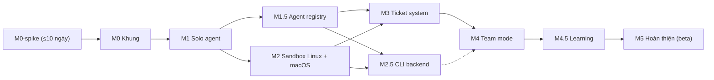

# IMPLEMENTATION-PLAN — Agenium v1.0 (FINAL, 2026-10-22)

> **[CẬP NHẬT 2026-10-23 — quyết định mới nhất, ưu tiên hơn nội dung gạch bỏ bên dưới]** SQLite là CSDL chính (rusqlite bundled + sqlite-vec + FTS5; ADR-49/50), SurrealDB chỉ là tính năng tùy chọn `--features surrealkv`. Bản phát hành đầu tiên chỉ **Linux + macOS** (ADR-39); **Windows hoãn** (xem `docs/WINDOWS-GUIDE.md`). Ngôn ngữ dưới Lead là **tiếng Anh**, kèm `user_language` (ADR-40). Chi tiết: `DECISIONS.md` ADR-39…50, `docs/STORE-SCALE.md`, `docs/STORE-PARITY.md`. Spike S0–S7 đã hoàn thành (xem `spike-reports/`).
> M0-spike đã xong; M0 (code) đã làm theo SQLite-first. SP-1…SP-3 và M2-2 dưới đây là lịch sử: Windows không còn trong phạm vi v1. CI: dùng `scripts/ci-local.sh` / `.ps1` (workflow GitHub chỉ chạy thủ công).

Nguồn: `Agenium-Kien-truc-v1.0.md` (Page), `DECISIONS.md`, `M0-SPIKE-CHECKLIST.md`, `REPO-LAYOUT.md`, `SCHEMAS/`.
Ước lượng là "thuận buồm" theo Page; khi lập lịch thật nên cộng vùng đệm tích hợp cuối mỗi mốc. Tên mốc giữ nguyên như Page.

## Thứ tự & phụ thuộc

Quy tắc chung cho mọi mốc (Definition of Done):
- ~~CI xanh trên Windows/macOS/Linux~~ **[CẬP NHẬT ADR-39]** kiểm tra xanh trên Linux/macOS, chạy cục bộ bằng `scripts/ci-local.sh`: `cargo fmt --check`, `clippy -D warnings`, unit + property test, e2e liên quan.
- Không mốc nào dùng tính năng của mốc sau; thứ gì cần sớm thì làm bản lõi (xem "Ghi chú triển khai lộ trình" trên Page).
- Mọi thay đổi trạng thái đi qua orchestrator: event ghi trước, idempotent theo `intent_id`.
- Schema JSON sinh từ Rust (`cargo xtask schemas`) khớp `SCHEMAS/` (diff được review).
- Golden task (từ M1) chạy lại khi đổi prompt/orchestrator/model; không tụt so với lần trước mà không có giải thích.
- Kết quả, quyết định mới → ADR trong `docs/adr/`.

---

## M0-spike — Kiểm chứng (≤ 10 ngày)
Chi tiết: `M0-SPIKE-CHECKLIST.md`. Repo riêng `agenium-spikes/`, code bỏ.

| # | Task | Acceptance |
|---|---|---|
| SP-0 | Chốt ngưỡng Pass/Kill mọi spike, ghi ngày | Biên bản có ngày chốt trước khi chạy |
| SP-1 | S0 build sạch 3 OS (Tauri 2 + surrealdb rocksdb/surrealkv + fastembed + keyring + git2/gix) | Số đo thời gian build, kích thước binary, danh sách yêu cầu phát sinh **[CẬP NHẬT ADR-39: Windows hoãn khỏi bản đầu (chỉ Linux + macOS); phần Windows/3 OS ở đây là thiết kế hoãn hoặc lịch sử]** |
| SP-2 | S1 SurrealDB (**[ADR-49] kết quả: chuyển sang SQLite chính**): fixture, đúng/sai vs SQLite, recall@10, p95, live query, 20 crash, JSONL round-trip, SurrealKV vs RocksDB | Bảng so sánh 2 engine + biên bản PASS/YELLOW/RED |
| SP-3 | S2 sandbox Windows: audit Codex (local users, admin setup, command runner), ma trận xâm nhập, việc hợp lệ, overhead | Bảng test + quyết định admin/local user |
| SP-4 | S3 macOS/Linux: ma trận rút gọn, kernel 5.13, fail-closed, bubblewrap | Biên bản + parity |
| SP-5 | S4 worktree/merge queue/8 điểm tiêm lỗi/file lớn/sửa ngoài/remote | 8/8 không mất việc |
| SP-6 | S5 keyring 5 loại secret 3 OS + vault tối thiểu | Quyết định keyring vs vault **[CẬP NHẬT ADR-39: Windows hoãn khỏi bản đầu (chỉ Linux + macOS); phần Windows/3 OS ở đây là thiết kế hoãn hoặc lịch sử]** |
| SP-7 | S6 embedding: cold start, throughput, 60 cặp Anh/Việt, model đa ngữ | Số đo cho quyết định 2b/2c |
| SP-8 | S7 realtime: Kanban 500 ticket, live query vs broadcast, burst, sleep | Chọn đường realtime chính |
| SP-9 | Cổng Go/No-Go, ADR, cập nhật Page/DECISIONS | Go hoặc No-Go có lý do; quyết định 1/2b/5/9/22/24 cập nhật |

**Exit:** điều kiện Go trong checklist mục 9.

## M0 — Khung (1–2 tuần)
Phụ thuộc: M0-spike Go. Crates: core, config, store, secrets, bus, vcs, app shell.

| # | Task | Acceptance |
|---|---|---|
| M0-1 | Workspace Cargo + CI 3 OS + cargo-deny + LICENSE/NOTICE | CI xanh trên repo rỗng **[CẬP NHẬT ADR-39: Windows hoãn khỏi bản đầu (chỉ Linux + macOS); phần Windows/3 OS ở đây là thiết kế hoãn hoặc lịch sử]** |
| M0-2 | `agenium-config`: `resolve_root` (`AGENIUM_HOME` > bootstrap > `~/.agenium`), layout root, `config.toml` (SCHEMAS/config.example.toml) | Test 3 nhánh ưu tiên; layout tạo đủ thư mục |
| M0-3 | Setup wizard (UI + backend), kiểm tra yêu cầu hệ thống (quyết định 24) | Lần chạy đầu tạo root; máy dưới tối thiểu được cảnh báo |
| M0-4 | `agenium-core`: ID, Ticket (gồm `approved`/`merged`), TicketStatus, AgentStatus, `check_transition`, `dep_satisfied` | Property test: không chuyển trái phép; Closed terminal; dep thỏa khi Closed hoặc Resolved+approved(+merged) |
| M0-5 | `agenium-store`: Repo traits + impl engine theo S1, schema SQLite `sql/001_core.sql` [ADR-49; `db-core.surql` = tham chiếu cho backend tùy chọn], migrate có `schema_version`, event log append-only + idempotency `intent_id` | Ghi 2 lần cùng intent = 1 event; migrate có backup + rollback |
| M0-6 | `agenium-secrets` theo S5 | Round-trip secret; không xuất hiện trong log (canary test) |
| M0-7 | `agenium-vcs`: git init/remote test (ls-remote, fetch, dry-run push), SSH ed25519, worktree + branch `agenium/<ticket-id>`, auto-commit + quét secret, merge queue tuần tự | Test tích hợp trên repo mẫu; secret canary bị chặn commit |
| M0-8 | Project: `agenium.toml`, mở/đóng, mặc định `<root>/projects` | Tạo/mở project từ UI |
| M0-9 | `agenium-bus` + đường realtime theo S7, UI resync từ event log | Restart giữa burst → UI đúng trạng thái DB |
| M0-10 | Reconcile DB ↔ git khi khởi động | 8 điểm tiêm lỗi của S4 chạy thành test hồi quy |
| M0-11 | Backup incremental/full zstd, retention 24/7/4 | Restore vào root mới khớp hash |

**Exit:** app mở được, tạo project, lưu dữ liệu, tạo ticket lõi bằng tay qua UI dev.

## M1 — Solo agent (2 tuần)
Phụ thuộc: M0. Crates: llm, backend (ApiBackend), tools, orchestrator (loop), eval.

| # | Task | Acceptance |
|---|---|---|
| M1-1 | `Provider` trait + Message chuẩn hóa; adapter Anthropic, Gemini, OpenAI-compatible (OpenAI, OpenRouter, Opencode, DeepSeek, Local) | Contract test record/replay cho mỗi adapter |
| M1-2 | Retry (1s ×2, trần 30s, jitter, 8 lần/5 phút → Offline + probe), QuotaExhausted (402/429 quota) | Test lỗi giả lập từng mã |
| M1-3 | Prompt caching theo thứ tự work order, effort mapping, model list + bảng giá | cache_read/write được ghi theo run |
| M1-4 | Tool set lõi (read/list/glob/grep/write/edit/multi_edit/apply_patch/shell/fetch/todo), read-before-edit, cắt output 30.000 ký tự/256 dòng | Test từng tool, lỗi có cấu trúc |
| M1-5 | Protocol tools Solo bản lõi (schemars, validate theo `SCHEMAS/tools/`): `submit_report`, `review_ticket`, `close_ticket`, `ask_question`, `post_progress`, `create_ticket` | Sai schema → lỗi về model; 3 lỗi liên tiếp dừng run; thiếu tool kết thúc → nudge |
| M1-6 | Agent loop, `max_steps` 200, phát hiện lặp (cùng tool + args 3 lần) | Test vòng lặp giả |
| M1-7 | Trước M2: YOLO tắt, mode `on-request` (người dùng duyệt shell/ghi ngoài worktree) | Không lệnh nào chạy không duyệt |
| M1-8 | Chat console + agent view live (stream, tool call, diff, terminal, replay) | Xem lại được run cũ |
| M1-9 | Hiển thị token + chi phí ước tính theo run/ticket (không chặn) | Số khớp usage provider ±5% |
| M1-10 | `agenium-eval`: 5 golden task coding + runner + báo cáo; trang chẩn đoán run log | Chạy `cargo run -p agenium-eval` ra bảng điểm |
| M1-11 | **Hook graph memory (ADR-51):** harness dựng khối memory của work order qua interface `MemoryRetriever` (retrieval fact hiện có); ghi `fact_usage` (ticket, run, rank, via) — chưa có bảng graph, không thêm tool giao thức mới | Mỗi fact được chèn vào work order đều có dòng `fact_usage` |

**Exit:** một Solo agent làm xong một ticket trong worktree, report → self-review → merge → close.

## M1.5 — Agent registry (2 tuần)
| # | Task | Acceptance |
|---|---|---|
| M15-1 | AgentProfile, DB `agent_<ulid>` (SQLite `sql/agent_001/002.sql` [ADR-49]; `db-agent.surql` = tham chiếu tùy chọn), đổi model không mất memory/MCP/skill | Test đổi vendor |
| M15-2 | Embedder fastembed (model theo S6), memory pipeline extract → ADD/UPDATE/DELETE, retrieval hybrid | Recall trên bộ 60 cặp ≥ ngưỡng S6 |
| M15-3 | McpHub stdio + Streamable HTTP, credential binding | Test connection trong Settings |
| M15-4 | SkillRegistry (SKILL.md, progressive disclosure, `load_skill`) | Skill index vào work order |
| M15-5 | Export/import JSONL agent, xóa agent (gõ tên, chặn khi còn ticket mở) | Round-trip khớp |
| M15-6 | Settings: form MCP, form Skill | Validate live |
| M15-7 | **Graph memory core (ADR-51):** migration `agent_003` (từ `schemas/sql/drafts/agent_003_graph_memory.sql`), trait `MemoryGraph` + impl SQLite (entity/alias/edge/fact_entity/fact_usage, tombstone merge, `valid_to`/`superseded_by`) | Test migration từ DB `agent_002` có dữ liệu (backup trước); backup/restore khớp; kill -9 ×20: không edge/`fact_entity` mồ côi |
| M15-8 | Pipeline trích xuất entity/relation (LLM, tiếng Anh, JSON schema, `untrusted`) + entity resolution (alias → FTS → embedding, ngưỡng tạm 0.90/0.80, quy tắc không gộp khác type/scope/version) | Bộ 2 000 cặp có nhãn: precision tự gộp ≥ 0.98 |
| M15-9 | Truy xuất lai: kênh graph (`WITH RECURSIVE` hai nhánh `INDEXED BY`, độ sâu ≤ 3, chống chu trình, trần hub, 25 ms) + RRF (k=60) + xếp lại scope/recency/confidence/usage; **scope hard-filter** | Test property (không vượt depth, không lặp node, không qua cạnh lệch scope); test kế hoạch `EXPLAIN QUERY PLAN` dùng `edge_out`/`edge_in` |
| M15-10 | Benchmark graph (`agenium-store-bench graph`): 100k/1M cạnh, hop 1–3, p50/p95/p99, hub, cold/warm, 1 reader vs 4 reader + 1 writer; golden set multi-hop QA ≥ 100 câu; (stretch) parity SurrealDB `->edge->` | 1M cạnh: p95 ≤ 25 ms (≤ 2 hop), ≤ 50 ms (3 hop); recall@8 +10 điểm trên lớp 2-hop; **scope-leak = 0**; ghi vào `docs/STORE-SCALE.md` §8 |
| M15-11 | Golden task GM-1…GM-5, GM-7 trong `agenium-eval` (tái sử dụng cùng agent, bẫy scope TP-Link/Netgear, multi-hop, sửa của Lead, reopen, prompt injection vào memory) | Ticket thứ hai ít bước hơn ≥ 20% (median), không bao giờ áp lesson sai scope |

## M2 — Sandbox Linux + macOS (3–4 tuần) **[CẬP NHẬT ADR-39: 3 OS → Linux + macOS]**
| # | Task | Acceptance |
|---|---|---|
| M2-1 | Fork/adapt sandbox Codex theo kết quả S2/S3 (hoặc phương án B) vào `agenium-sandbox` | Giữ LICENSE/NOTICE |
| M2-2 | ~~Windows theo kiến trúc mới~~ **[ADR-39] HOÃN** — Windows ngoài phạm vi v1; sandbox Windows fail-closed | Ma trận xâm nhập S2 chạy trong CI |
| M2-3 | macOS Seatbelt, Linux Landlock + seccomp, fail-closed | Ma trận S3 trong CI |
| M2-4 | Env sạch, kill cả cây tiến trình, fetch tool có allowlist | 20/20 kill sạch |
| M2-5 | Permission: Lead chỉ cấp theo run; "luôn cho phép" chỉ người dùng (`permission_grant.scope`) | Test: Lead tạo scope=project bị từ chối |
| M2-6 | Bật YOLO theo OS khi ma trận đạt | Cờ YOLO chỉ bật trên OS đạt |

## M2.5 — CLI backend
Phụ thuộc: M1.5 + M2. `CliBackend` cho `claude`, `codex`, `agy`, `opencode` (headless JSON-stream), MCP Agenium cho protocol tools, sandbox, giới hạn bước, bắt buộc report; phát hiện CLI trong PATH; contract test theo phiên bản tối thiểu; fallback API. **Acceptance:** golden task chạy được qua ít nhất một CLI.

## M3 — Ticket system (2 tuần)
| # | Task | Acceptance |
|---|---|---|
| M3-1 | Discovery + RequirementSpec (khóa v1) + Plan có version/duyệt, `revise_plan` (thay split_ticket) | Ticket không có plan item bị từ chối |
| M3-2 | Ma trận quyền đầy đủ state machine, user override | Bảng quyền trên Page = test table-driven |
| M3-3 | Mọi protocol tool + luật validate (`SCHEMAS/tools/`), form có cấu trúc, template theo loại ticket | Mọi ví dụ JSON trên Page pass schema |
| M3-4 | Scheduler mở khóa phụ thuộc bằng `deps_satisfied` (Closed hoặc Resolved+approved(+merged)) | Ticket phụ thuộc chạy trước khi ticket trước Closed |
| M3-5 | Kanban (dnd-kit), Ticket view, audit trail | 500 ticket mượt (ngưỡng S7) |

## M4 — Team mode (3 tuần)
Theo Page: 4 template built-in, `propose_role`, template wizard, Lead/Worker, scheduler (DAG, priority, aging, idle-pool), watchdog/stall-nudge, inbox Lead + SLA + interrupt, Handoff + TicketLink, merge thất bại → Reopened kèm log, khóa worktree với người dùng, thay Lead, dashboard + Needs you, 5 màn hình + thông báo chọn lọc. **Acceptance:** golden task team (≥ 2 worker, có depends_on) hoàn thành end-to-end; câu hỏi blocking được trả lời trong SLA khi Lead rảnh.

## M4.5 — Learning (2 tuần)
**Graph memory (ADR-51), thêm:** tín hiệu tái sử dụng (`fact_usage.outcome`: helped/hurt) → confidence; Reopened và sửa của Lead → giảm confidence/thu hẹp scope/supersede; consolidation + forgetting định kỳ; chia sẻ giữa agent: `knowledge_note` qua comment ticket (B) và gói tri thức project `.agenium/knowledge/*.jsonl` (C, opt-in, quét secret, **cần chủ sở hữu duyệt**); golden task GM-6; (stretch) parity SurrealDB; cache kề trong RAM chỉ nếu benchmark M15-10 vượt ngân sách. Benchmark M15-10 có thể chạy song song với M2 (không phụ thuộc sandbox).

Review sau ticket, lesson có scope + cue, áp theo mức khớp, decay, `propose_skill_update`, overlay copy-on-write + changelog + revert (quyết định 35). **Acceptance:** golden task lặp lại không tụt điểm; overlay xem/hồi được.

## M5 — Hoàn thiện (beta)
Export/import `.agenium`, Git LFS/content-hash, pre-merge check theo template, báo cáo Markdown + audit, nén run log 90 ngày, push branch khi Closed, egress proxy, đổi root, installer 3 OS, updater có chữ ký, gói hỗ trợ (log che secret + cấu hình + phiên bản). **Acceptance:** cài mới trên 3 OS sạch, golden task đạt, export → import khớp. **[CẬP NHẬT ADR-39: Windows hoãn khỏi bản đầu (chỉ Linux + macOS); phần Windows/3 OS ở đây là thiết kế hoãn hoặc lịch sử]**
